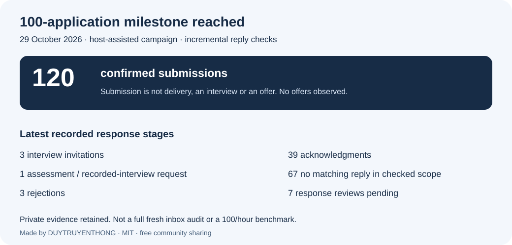
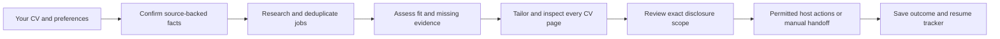

# Vietnam Career Agent Kit

**Made by [DUYTRUYENTHONG](https://github.com/DUYTRUYENTHONG). Open source and shared freely with the community.**

Created and maintained by DUYTRUYENTHONG, with community contributions welcome. The kit is free to use, modify and share under the [MIT License](LICENSE). Preserve its copyright and license notices when redistributing it. Optional external AI/browser services may charge their own fees. See [authorship and credits](AUTHORS.md).

Bring your own agent and CV. Research suitable jobs, prepare truthful documents,
review an exact application package, and track what actually happened.

## Start here

**Latest kit:** clone `main` and follow [CV-first setup](docs/COMMUNITY_START.md).
A [pinned preview source package](https://github.com/DUYTRUYENTHONG/vietnam-career-agent-kit/releases/tag/community-v0.2.0)
is also available. Attach your CV, answer only
missing material information, and use your own tool-enabled Codex, Claude Code
or compatible agent. The default goal is **100 new best-fit confirmed applications**;
it is not 100 offers, an hourly guarantee or blanket disclosure permission.

```sh
python scripts/kit.py --data-dir ../my-career-private start-campaign --cv /path/to/my-cv.pdf
```

Paste the [short start prompt](prompts/COMMUNITY_START.md) into your agent.
PDF/DOCX extraction requires a supported host tool; the starter records a path/hash.
Read [the 100-application milestone, 120 confirmed submissions and recruiter outcomes](docs/CAMPAIGN_RESULTS.md).



**New clone or fork?** Follow the [first-run walkthrough](docs/START_HERE.md).
It covers the latest `main`, a fictional demo, private workspace,
agent skills and optional email/browser setup.


[Five system models](docs/SYSTEM_MODELS.md) explain components, agent roles,
OAuth sending, concurrent browser lanes and recovery. They render directly on GitHub.

| Your next step | Open this |
|---|---|
| Turn missing JD evidence into learning tasks and future projects | [Career growth: RAG, reviewed plans and local LoRA export](docs/CAREER_GROWTH.md) |
| Measure recruiter outcomes by the exact submitted CV | [Private CV-version feedback and observation windows](docs/CV_OUTCOMES.md) |
| Tailor specific evidence-backed details to every job description | [Required JD-specific tailoring contract](docs/JD_SPECIFIC_TAILORING.md) |
| Experiment with local Qwen3 and reviewed CV-wording LoRA training | [Optional local fine-tuning](docs/LOCAL_FINETUNING.md) |
| Compare recorded base/adapter wording on held-out jobs | [Offline evaluation and review](docs/WORDING_EVALUATION.md) |
| Generate matched local base/LoRA records with measured tokens and timing | [Optional paired CPU runner](docs/LOCAL_PAIR_GENERATION.md) |
| Understand versioned training/generation inputs and legacy exports | [Explicit output contract](docs/LEARNING_PROMPTS.md) |
| Add concrete project details before sending a revised CV | [CV enrichment and candidate review](docs/CV_ENRICHMENT.md) |
| Automate cited CV/email drafts with your own AI host | [Local RAG and optional LangChain workflow](docs/LANGCHAIN_RAG.md) |
| Retrieve cited CV facts and export reviewed examples without another model API | [Career memory and local MCP](docs/CAREER_MEMORY.md) |
| Retrieve reviewed facts from an older workspace and diagnose excluded evidence without creating a second tracker | [Read-only source-memory bridge](docs/SOURCE_MEMORY.md) |
| Compare observed model-call and agent-turn time, tokens and acceptance separately | [Private performance tracker](docs/PERFORMANCE_TRACKER.md) |
| Keep skills small, current and efficient | [Canonical owners and progressive skill loading](docs/SKILL_MANAGEMENT.md) |
| Evaluate context-management techniques | [Pinned Context Engineering collection review](docs/CONTEXT_ENGINEERING_REVIEW.md) |
| Evaluate Awesome Copilot for browser work | [Pinned agents, skills, plugins and cookbook review](docs/AWESOME_COPILOT_REVIEW.md) |
| Set up Codex, Claude Code, or another tool-enabled agent | [Agent setup: skills, hooks, roles and browsers](docs/AGENT_SETUP.md) |
| Configure TinyFish without exposing your API key | [TinyFish setup and offline preview](docs/TINYFISH_SETUP.md) |
| Connect isolated TinyFish application sessions | [Experimental Browser runtime, scope and recovery](docs/TINYFISH_BROWSER.md) |
| Evaluate BrowserAct sessions and authorization | [BrowserAct review, setup and offline planner](docs/BROWSERACT.md) |
| Give your agent a setup task and your own campaign goal | [Copyable setup-and-goal prompt](prompts/SETUP_AND_GOAL.md) |
| Understand the workflow and its boundaries | [Visual guide: four workflow diagrams](docs/USER_GUIDE.md) |
| Run a real campaign with your own facts and limits | [Detailed copy-and-paste agent prompt](prompts/GUIDED_CAMPAIGN.md) |
| Try the tools without accounts or personal data | [Fictional quick start](#try-the-working-slice) |
| Configure documents or a supported execution bridge | [Document setup](docs/documents-and-approval.md) · [Execution](docs/execution.md) |
| Connect your own Gmail and isolated employer windows | [Local email/browser MCP plugins](docs/LOCAL_PLUGINS.md) |
| Understand ten-lane concurrency, TinyFish and cleanup without holding other lanes | [Parallel applications and measured limits](docs/PARALLEL_APPLICATIONS.md) |

### Set up in four steps

1. Follow the [community setup instructions](docs/COMMUNITY_START.md)
   to clone `main` and run the fictional demo. No feature-branch selection is needed.
2. Open the clone in your agent. Follow [agent setup](docs/AGENT_SETUP.md) to
   verify its shared skills and actual local/browser tools; hooks are optional.
3. Fill the [setup-and-goal prompt](prompts/SETUP_AND_GOAL.md) with your own CV,
   external private workspace, role filters, target and finite operating limits.
4. Add [TinyFish public Fetch](docs/TINYFISH_SETUP.md) if wanted. Prepare and
   review a batch; use concurrent applications only after the host bridge proves
   independent sessions. One shared login uses one action stream.

Codex and Claude Code have project skill entry points. Grokbot and Muse can use
the generic prompt/manual path; native adapters for those unidentified runtimes
are not supplied. A chat account alone does not provide local or browser tools.



**What runs today:** local preparation, document/approval checks and durable
request/receipt orchestration. Experimental public research includes Firecrawl,
bounded Greenhouse reads and TinyFish **Fetch** (up to ten public URLs per batch).
The application engine can coordinate up to ten isolated sessions. The optional
experimental TinyFish Browser driver supports reviewed single-page guest forms;
live provider/CDP compatibility is unverified. Agent-goal submissions remain
unsupported. A shared authenticated
session uses one action stream. [See the current capability table](docs/USER_GUIDE.md#what-is-implemented).

The prompt guides an agent through setup to receipts; it grants no new tool
permissions and does not override runtime confirmation. No live 100x speedup or
100-applications/hour result is established by the local tests.

Optional [local MCP plugins](docs/LOCAL_PLUGINS.md) now add Gmail OAuth/API sending
and isolated local Chromium form execution using the same canonical ledger.
Generate private install packages with `scripts/plugin_config.py`; connect your
own Google Desktop OAuth app. See [scoped QA](docs/LOCAL_PLUGINS_QA.md) and the
[copyable setup prompt](prompts/LOCAL_PLUGINS_SETUP.md). Live account/employer and
native host installation acceptance remain separate.

## Feature references

[CV and application-email writing](docs/LIVE_RESUME_REVIEW.md): the shared tailoring
skill now includes evidence-first drafting, concise language editing and bilingual
fact checks. [Copy the preparation prompt](prompts/TAILOR_AND_EMAIL.md).
The Live Resume reference is pinned and reviewed; no upstream plugin install is required.

[Source-bound CV wording v2](docs/CV_CONTENT_V2.md) adds structured sections,
reviewed paraphrasing and a shared Markdown/DOCX/PDF content model. Exact-quote
mode remains available. `import-wording --include-review-packet` combines two
local handoff calls without skipping checks. See the [slice plan](docs/QUALITY_FAST_PLAN.md)
and [quality rubric](docs/CV_QUALITY_RUBRIC.md); this is not unattended approval
or a measured live application-rate guarantee.

[Optional Fast Web Pipeline](docs/FAST_WEB.md): explicit Firecrawl v2 public
search, selected scrape/batch retrieval, durable task recovery and private
evidence import. Offline by default; no new Python dependency. [TinyFish Fetch and
parallel application lanes](docs/PARALLEL_APPLICATIONS.md) are experimental, opt-in additions.
[TinyFish Browser execution](docs/TINYFISH_BROWSER.md) requires separate cloud
scope, exact form mappings and an optional client; Agent-goal execution remains unsupported.

[Auto-decide campaign prompt](prompts/AUTO_DECIDE.md): let the agent rank jobs,
tailor supported evidence and reuse known answers without routine questions.
Blocked vacancies move aside while independent work continues. Instruction-only;
existing engine scope and host confirmations remain effective.

Bulk public Greenhouse discovery is available through `discover-greenhouse`.
See [the bounded reader, benchmark and performance limits](docs/BULK_DISCOVERY.md).

[Standing authorization](docs/STANDING_AUTHORIZATION.md) reuses one approved
recipient/answer/consent scope across later reviewed CVs and finite batches.
It shares one application cap, expiry and revocation; host-required confirmations
remain separate. Opt-in CLI support uses additive schema 4.

Bring your own AI agent and CV. Run an organized, evidence-based Vietnam job search with reusable tools and controlled application automation.

[Continue and close completed application tabs](prompts/AUTO_PROCEED.md) provides
a reusable campaign prompt: reuse confirmed answers and valid authority, save the
receipt, close the exact agent-created tab, verify absence and update the tracker.

[Tiếng Việt](README.vi.md) · [Product goal](GOAL.md) · [Architecture](docs/architecture.md) · [Compatibility](docs/compatibility.md) · [Roadmap](docs/roadmap.md)

**Working now:** a local preparation CLI: diagnose → private workspace → UTF-8 CV/profile import → exact profile confirmation → structured JD import → evidence matrix → tailored Markdown draft → tracker/report/manual handoff → resume. Ten shared skills and Claude wrappers support the workflow. Fictional examples cover two users, cities, roles and languages.

**Slice 2 adds:** optional source-bound DOCX → local LibreOffice PDF → page previews, explicit page review, and exact expiring approval manifests. [Rendering and approval setup](docs/documents-and-approval.md) explains dependencies, commands and limits. Plans without explicit execution scope remain preparation only.

**Execution engine:** an exact approved host-browser loop now supports sequential fill/upload/review/submit/verify, durable attempts, finite budgets and read-only recovery. See [execution setup and protocol](docs/execution.md). The agent supplies supported browser tools; the CLI does not acquire a browser.

For preliminary Apply screens, late consent, redacted field values and receipt
waits, follow the [host decision guide](docs/PRE_SUBMISSION_GATES.md). It documents
existing contracts; it does not add a browser driver or certify live throughput.

**Faster local pipeline:** selected-job validation avoids all-job scans;
`advance-execution` combines receipt and successor; `tracker` exports a fast
catch-up table. [Measurements and architecture](docs/PERFORMANCE.md) distinguish
local gains from unmeasured live-browser time.

**Model efficiency:** [deterministic routing](docs/MODEL_ROUTING.md) uses tools for
tests/status/metrics and an explicit model policy for agent work. `route-task`
checks host inventory without calling a model or silently changing models.

**Throughput KPI:** [rolling confirmation reporting](docs/THROUGHPUT.md) measures
an explicit target such as 100 qualifying confirmations in 60 minutes. It counts
confirmed fit-reviewed records, not prepared files or attempted clicks. No live
100/hour performance claim has been verified.

**Campaign continuity:** [goals and checkpoints](docs/campaign-continuity.md)
guide successive finite batches, resume from one private ledger, and count only
confirmed new submissions toward a user-selected target. Persistent goals require
a supported host; this guidance does not add a scheduler or browser worker.

**Remaining acceptance gates:** built-in PDF/DOCX CV extraction, production unattended operation and verified employer-specific submission mappings. Optional local browser execution is implemented for mapped same-origin forms; its live acceptance remains separate. Experimental public retrieval does not supply an authenticated application connector. [Slice gates](docs/roadmap.md) remain explicit.

## Try the working slice

Requires Git and a real Python 3.11+ interpreter. No pip install, API key, account login, browser driver or model call is needed for these commands.

```sh
git clone https://github.com/DUYTRUYENTHONG/vietnam-career-agent-kit.git
cd vietnam-career-agent-kit
python scripts/kit.py doctor --runtime generic
python scripts/demo_slice1.py --data-dir ../career-demo-private
python scripts/kit.py --data-dir ../career-demo-private resume
python scripts/kit.py --data-dir ../career-demo-private report --format md --output reports/checkpoint.md
```

Use a new empty demo directory. The demo imports fictional candidate A, records a clearly fictional profile confirmation, produces a source-bound Markdown CV and leaves a `review_required` tracker record. It never connects to `example.test` or submits an application. Use `--candidate b` with another empty directory for the Vietnamese operations example. Omit `--data-dir` for a disposable demonstration that cleans up its own temporary workspace.

On Windows, `py -3` or an absolute real interpreter path may be needed; the Store alias is not an interpreter. [Measured setup and recovery](docs/setup.md) includes the individual commands and outcomes.

## Use your own agent and CV

Open the clone in your chosen agent and paste:

> This is a job-seeker request. Read prompts/STARTUP.md and docs/job-seeker-policy.md. Diagnose my selected runtime, reuse or initialize one explicitly chosen external private workspace, and ask only for missing candidate facts/preferences. Start in PREPARE. Use only capabilities reported by the installed kit. Do not upload, enter personal data or submit without an exact permitted disclosure scope and my approval.

For explicit role filters, finite budgets, optional public providers, isolated
lanes and recovery instructions, use the [full campaign prompt](prompts/GUIDED_CAMPAIGN.md).
Replace its placeholders with your choices; no candidate biography or job target
is supplied by default.

The agent may draft versioned inputs using [schemas/contracts.schema.json](schemas/contracts.schema.json) and examples. Import your authorized text CV with `import-cv`, then a source-backed profile with `import-profile`. That returns `needs_input` until you review and explicitly confirm its fingerprint. Generated prose is not evidence. Pending/rejected facts cannot enter the CV; exact quotes preserve qualifiers. The kit validates linkage and structure, not the truth of a human's claim or every semantic requirement.

Keep CVs, evidence, salary, answers, trackers and screenshots in the selected directory **outside this clone**. One workspace selects one candidate. SQLite is authoritative; Markdown/reports are derived. Local-first means user-controlled storage; content supplied to a cloud agent may be processed remotely by that provider. Never put candidate information in public issues or fixtures.

## Local commands and external disclosure

| Operation | Current behavior |
|---|---|
| `doctor`, `source-registry` | Read-only capability/registry output; no account connection |
| `init`, `import-cv`, `import-profile`, `confirm-profile` | Private local evidence/profile state |
| `import-jd`, `assess`, `prepare` | Private local job/matrix/draft state; no website operation |
| `duplicate-candidates --job-id ID` | Read-only same-employer URL/title/city hints and prior recorded states; no auto-merge or clearance. [Limits](docs/DUPLICATE_CANDIDATES.md) |
| `render`, `review-documents`, `reject-documents` | Optional local DOCX/PDF/page generation and explicit review; no disclosure |
| `create-manifest`, `approve-manifest`, `check-manifest`, `revoke-manifest` | Exact finite authorization records and expiry/hash checks; execution requires an explicitly reviewed bridge/runtime scope |
| `create-authorization`, `approve-authorization`, `check-authorization`, `revoke-authorization`, `authorize-manifest` | Opt-in bounded standing delegation across reviewed batches; shared allocations and revocation, with host confirmations separate |
| `launch-execution` | Combine standing authorization, start and first request; reuse existing authority without another local prompt, never replay an existing run |
| `cleanup-execution`, `record-cleanup` | After saved confirmation, return exact tab cleanup instructions and record host-reported closure; preserve uncertain/user-owned tabs |
| `resume`, `status`, `report`, `handoff` | Local checkpoint or explicit manual handoff |
| `tracker` | Fast recorded-status table; does not validate artifacts, approvals or live vacancies |
| `route-task --packet task.json` | Read-only model/tool plan using explicit host capabilities; no workspace or model API required |
| `throughput --target 100 --window-minutes 60` | Rolling confirmation KPI; old records without frozen fit are separate, never inferred |
| Legacy `check-package`, `record-approval`, `check-approval`, `invalidate` | Content-bound local bookkeeping; no authenticated human identity, expiry-bound batch or browser grant |
| `start-execution`, `next-action`, `check-action`, `record-action`, `advance-execution` | Durable sequential engine; designated agent performs each request through supported browser tools |
| `execution-status`, `stop-execution`, `recover-execution` | Inspect/stop or reconcile an uncertain attempt read-only; no duplicate submit |

Structured operations return `schema_version`, `outcome`, `data`, `issues`, `message`. Outcomes: `ok`, `blocked`, `needs_input`, `manual_required`, `failed`, `submission_unknown`. Exit 0 means the local operation succeeded; exit 2 means inspect the outcome and next input. A manual handoff is not a submitted application. [Tool/data contract](docs/DATA_CONTRACT.md).

## Compatibility and sources

| Interface | Label | Actual scope |
|---|---|---|
| Generic local Python CLI | Verified on recorded test matrix | Deterministic commands/fictional tests; no native agent/browser certification |
| Codex desktop tool execution; CLI 0.137.0 inventory | Experimental | This development flow executes local tools; separate fictional browser fill/upload/submit smoke passed; engine bridge tested deterministically; native skill/hooks and real employer integration unverified |
| Claude Code 2.1.205 inventory | Instruction-only | Generated shared-skill wrappers; native agent execution/hooks not tested |
| Grok Bot / unidentified Grok runtime | Unsupported natively | Generic text/manual path only; no invented SDK, hooks or browser support |
| Muse / unidentified agent runtime | Unsupported natively | Generic instructions/manual path; identify actual tools before claiming execution |

[Compatibility evidence](docs/compatibility.md) lists versions, OS, documentation and limits. Coding CLIs and consumer chat websites differ. Ten wrappers do not create ten installed tools. `python scripts/generate_adapters.py --dry-run` previews repository-owned wrapper changes; `--check` detects drift. No global settings or active hooks are overwritten.

[connectors/registry.json](connectors/registry.json) declares discover/read/extract/fill/upload/submit/verify separately. Manual structured JD import works. Employer pages, feeds, universities and LinkedIn/Indeed/JobsGO/ITviec/TopCV/VietnamWorks/CareerViet are potential sources, not enabled connectors. Unknown permissions stay manual; snippets are leads, and only executed finite searches count as coverage.

[Faster discovery guidance](docs/DISCOVERY_ACCELERATION.md) covers public ATS
listings, coverage reuse and candidate-authorized adjacent role families. It is
instruction-only; implemented experimental readers and their limits are listed
in the [visual guide](docs/USER_GUIDE.md#what-is-implemented).

## Costs, hooks and development

Core dependencies are standard library only, recorded in [dependency-lock.json](dependency-lock.json). [Optional document dependencies](requirements-documents.lock) have a complete Python closure with exact versions/wheel hashes and are not auto-installed. LibreOffice and fonts are separately provisioned, measured external dependencies. Existing agent subscriptions, model usage, search APIs and future browser services may cost separately. There is no compulsory second model API, maintainer cloud service or default telemetry.

Optional [hook examples](docs/HOOKS.md) are inactive. Their conservative helper blocks recognized control names in preparation sessions and marks prior approvals stale after recognized edits; it cannot sandbox arbitrary shell/MCP/host actions. No auto-trust, permission bypass, CAPTCHA, cookie extraction or stealth. Employment, interview, ATS and universal-coverage guarantees are outside the product promise.

```sh
python -m unittest discover -s tests -v
python scripts/generate_adapters.py --check
python scripts/check_repository.py
python scripts/demo_slice1.py
```

Read [CONTRIBUTING.md](CONTRIBUTING.md), [SECURITY.md](SECURITY.md), [CHANGELOG.md](CHANGELOG.md) and maintainer AGENTS.md. CI uses fictional data, no paid model calls and no real employer applications. [MIT](LICENSE) covers original code; [third-party notices](THIRD_PARTY_NOTICES.md) and the [pinned reference review](docs/REFERENCE_REVIEW.md) distinguish ideas from copied code. No reference candidate examples, installers or orchestrators are bundled.

## Ten-job batch workflow

Maintainers: see [branch protection](docs/BRANCH_PROTECTION.md) for the policy
template and separate verification of actual GitHub enforcement. A checked-in
configuration does not itself enable server protection.

Opt-in schema6 application lanes and TinyFish public Fetch batches are documented in [the architecture and CLI guide](docs/PARALLEL_APPLICATIONS.md). Use the [detailed agent prompt](prompts/ten-job-batch.md). Requires an authorized host bridge with isolated concurrent sessions for actual simultaneous applications; no live browser driver is bundled.
