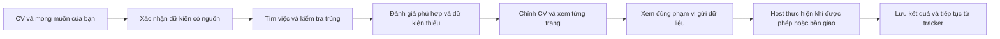

# Vietnam Career Agent Kit

**Được xây dựng bởi [DUYTRUYENTHONG](https://github.com/DUYTRUYENTHONG) — mã nguồn mở, chia sẻ miễn phí cùng cộng đồng.**

DUYTRUYENTHONG sáng lập và duy trì dự án, luôn chào đón đóng góp từ cộng đồng. Bạn được sử dụng, chỉnh sửa và chia sẻ bộ công cụ miễn phí theo [giấy phép MIT](LICENSE); khi phân phối lại, hãy giữ thông báo bản quyền và giấy phép. Các dịch vụ AI hoặc trình duyệt bên ngoài tùy chọn có thể tính phí riêng. Xem [tác giả và ghi nhận đóng góp](AUTHORS.md).

Mang theo agent và CV của bạn: tìm việc phù hợp, chuẩn bị tài liệu đúng sự thật,
xem trước chính xác hồ sơ sẽ gửi và theo dõi kết quả thực tế.

## Bắt đầu tại đây

| Bạn muốn làm gì? | Tài liệu |
|---|---|
| Thiết lập Codex, Claude Code hoặc agent có công cụ cục bộ | [Skills, hooks, vai trò agent và trình duyệt](docs/AGENT_SETUP.md) |
| Cấu hình TinyFish và kiểm tra trước khi gọi mạng | [Hướng dẫn TinyFish](docs/TINYFISH_SETUP.md) |
| Đánh giá BrowserAct, phiên trình duyệt và quyền thực thi | [Kiểm tra nguồn, thiết lập và lập kế hoạch ngoại tuyến](docs/BROWSERACT.md) |
| Giao việc thiết lập và đặt mục tiêu riêng | [Prompt thiết lập và mục tiêu](prompts/SETUP_AND_GOAL.md) |
| Hiểu quy trình và giới hạn | [Hướng dẫn trực quan với bốn sơ đồ](docs/USER_GUIDE.md) |
| Giao agent chạy chiến dịch theo dữ kiện và giới hạn của bạn | [Prompt chi tiết, có mẫu tiếng Việt](prompts/GUIDED_CAMPAIGN.md) |
| Thử công cụ không cần tài khoản hay CV thật | [Demo hư cấu bên dưới](#chạy-thử-bằng-dữ-liệu-hư-cấu) |
| Cấu hình tài liệu và kết nối host | [Dựng tài liệu](docs/documents-and-approval.md) · [Execution](docs/execution.md) |
| Hiểu mười luồng ứng tuyển và TinyFish | [Kiến trúc và số đo](docs/PARALLEL_APPLICATIONS.md) |

### Bốn bước thiết lập

1. Dùng [lệnh clone nhánh phát triển cụ thể](docs/AGENT_SETUP.md#1-clone-and-prove-the-local-tools-work)
   rồi chạy demo hư cấu. `main` có thể chưa chứa hướng dẫn/tính năng chưa được merge này.
2. Mở clone bằng agent của bạn; xác minh skills và công cụ thực tế theo
   [hướng dẫn thiết lập](docs/AGENT_SETUP.md). Hooks là tùy chọn.
3. Điền [prompt thiết lập và mục tiêu](prompts/SETUP_AND_GOAL.md) bằng CV, thư mục
   riêng ngoài repo, nhóm việc, mục tiêu và giới hạn của chính bạn.
4. Nếu cần, bật [TinyFish Fetch](docs/TINYFISH_SETUP.md) để đọc trang công khai.
   Chỉ ứng tuyển song song khi host có các phiên độc lập đã được kiểm chứng;
   một phiên đăng nhập dùng chung phải chạy tuần tự.

Grokbot/Muse chưa có adapter native được xác định và kiểm thử. Có thể dùng
prompt chung và bàn giao thủ công; tài khoản chat không tự tạo công cụ trình duyệt.



**Hiện có:** chuẩn bị cục bộ, kiểm tra tài liệu/phê duyệt và engine điều phối yêu
cầu/biên nhận. Nghiên cứu công khai thử nghiệm gồm Firecrawl, đọc Greenhouse có
giới hạn và TinyFish **Fetch** (tối đa mười URL công khai mỗi đợt). Engine có thể
điều phối tối đa mười phiên host độc lập, nhưng repo không kèm trình điều khiển
trình duyệt thật hoặc tự tạo các phiên đó. Chưa hỗ trợ TinyFish Agent/browser
nộp hồ sơ. Một phiên đăng nhập dùng chung phải thao tác tuần tự.

Prompt không cấp thêm quyền công cụ hoặc thay thế xác nhận bắt buộc của runtime.
Kiểm thử cục bộ chưa chứng minh tốc độ thực tế nhanh gấp 100 lần hay 100 đơn/giờ.

## Tài liệu tính năng

[Nội dung CV v2 có dẫn chứng](docs/CV_CONTENT_V2.md): chia mục CV, nhập cách diễn
đạt đã được kiểm tra độc lập và dùng chung nội dung cho Markdown/DOCX/PDF.
Chế độ chọn nguyên văn vẫn được giữ. `import-wording --include-review-packet`
gộp hai lần gọi CLI nhưng giữ nguyên kiểm tra. Xem [kế hoạch từng phần](docs/QUALITY_FAST_PLAN.md)
và [tiêu chí chất lượng](docs/CV_QUALITY_RUBRIC.md). Không tự phê duyệt hoặc cam
kết tốc độ nộp hồ sơ thực tế.

[Fast Web Pipeline tùy chọn](docs/FAST_WEB.md): tìm kiếm và đọc trang công khai
bằng Firecrawl v2, lưu tác vụ/bằng chứng riêng tư và nhập JD có dẫn chứng vào
SQLite hiện có. Mặc định không gọi mạng; không thêm thư viện Python. [TinyFish Fetch
và các luồng ứng tuyển song song](docs/PARALLEL_APPLICATIONS.md) là tính năng thử nghiệm,
chỉ bật khi được yêu cầu. Chưa hỗ trợ nộp hồ sơ trực tiếp qua TinyFish Agent/browser.

[Prompt tiếp tục chiến dịch và đóng tab đã hoàn tất](prompts/AUTO_PROCEED.md):
tái sử dụng câu trả lời đã xác nhận và phạm vi ủy quyền còn hiệu lực; lưu bằng
chứng nhận hồ sơ, đóng đúng tab do agent tạo, kiểm tra tab đã đóng và cập nhật bảng
theo dõi. Không tự trả lời “có” cho yêu cầu chưa có bằng chứng.

[Ủy quyền theo chiến dịch](docs/STANDING_AUTHORIZATION.md): phê duyệt một lần phạm
vi nhà tuyển dụng, nơi nhận, câu trả lời và lựa chọn đồng ý; agent tái sử dụng cho
CV đã kiểm tra và các đợt hữu hạn tiếp theo. Dùng chung hạn mức, thời hạn và quyền
thu hồi. Xác nhận bắt buộc của host vẫn áp dụng. CLI mới dùng schema 4, chỉ bật khi
người dùng chủ động ủy quyền phạm vi cụ thể.

`launch-execution` gộp việc áp dụng ủy quyền còn hiệu lực, bắt đầu và trả bước đầu
tiên trong một lệnh. Không hỏi lại phê duyệt nội bộ khi phạm vi khớp. Nếu lần chạy
đã tồn tại, lệnh trả trạng thái để đối chiếu; không lặp lại thao tác gửi.

Khi người dùng yêu cầu dọn tab, agent chỉ đóng tab ứng tuyển do mình tạo sau khi
đã lưu xác nhận và ảnh chứng minh. `cleanup-execution` trả đúng tab cần xử lý;
`record-cleanup` ghi kết quả do host quan sát. Giữ nguyên tab của người dùng và
các hồ sơ chưa rõ kết quả. CLI không tự điều khiển hoặc đóng toàn bộ trình duyệt.

[Hướng dẫn tìm việc nhanh hơn](docs/DISCOVERY_ACCELERATION.md) mô tả cách dùng
danh sách ATS công khai khi được phép, tránh tìm trùng và mở rộng nhóm vai trò
khi người dùng đồng ý. Đây là hướng dẫn; xem [bảng khả năng hiện có](docs/USER_GUIDE.md#what-is-implemented)
để phân biệt bộ đọc công khai thử nghiệm với connector ứng tuyển.

Tối ưu mới: kiểm tra CV theo từng việc, `advance-execution` ghi nhận kết quả và
trả bước tiếp theo trong một lệnh, `tracker` xuất bảng trạng thái nhanh. Bảng chỉ
phản ánh dữ liệu đã ghi, không kiểm tra lại tệp hay quyền gửi hồ sơ.
Xem [kiến trúc và số đo](docs/PERFORMANCE.md); chưa đo tốc độ ứng tuyển thực tế.

Trước khi chỉnh CV, chạy `duplicate-candidates --job-id ID` để xem việc cùng nhà
tuyển dụng có URL hoặc tên/địa điểm trùng và trạng thái nộp đã ghi. Lệnh chỉ đọc,
không tự gộp hay xác nhận chưa từng ứng tuyển. [Giới hạn](docs/DUPLICATE_CANDIDATES.md).

[Định tuyến mô hình](docs/MODEL_ROUTING.md): dùng công cụ trực tiếp cho kiểm thử,
trạng thái và số đo; `route-task --packet task.json` chọn theo độ khó/rủi ro và
danh sách mô hình, effort, skill thực tế của host. Lệnh không gọi AI, không tự
đổi mô hình và không âm thầm thay mô hình bị thiếu bằng lựa chọn đắt hơn.

[Đo KPI theo giờ](docs/THROUGHPUT.md): `throughput --target 100 --window-minutes 60`
chỉ tính bản ghi nộp đã xác nhận có mức phù hợp được lưu bất biến. Hồ sơ mới chuẩn
bị, lần thử và đơn đã nộp trước không được tính. Chưa xác minh tốc độ thực tế 100 đơn/giờ.

[Duy trì chiến dịch](docs/campaign-continuity.md): tiếp tục qua nhiều đợt hữu hạn,
khôi phục từ một tracker riêng và chỉ tính đơn mới đã xác nhận vào mục tiêu.
Mục tiêu bền vững cần host hỗ trợ; hướng dẫn này không tạo lịch chạy hay worker
trình duyệt độc lập. Kết thúc một đợt không có nghĩa là hoàn tất chiến dịch.

Dùng trợ lý AI và CV của riêng bạn để tìm việc tại Việt Nam theo một quy trình có bằng chứng, công cụ tái sử dụng và kiểm soát việc gửi hồ sơ.

[English](README.md) · [Mục tiêu](GOAL.md) · [Kiến trúc](docs/architecture.md) · [Tương thích](docs/compatibility.md) · [Lộ trình](docs/roadmap.md)

**Đã chạy được:** chẩn đoán → tạo không gian riêng → nhập CV dạng TXT/Markdown UTF-8 và hồ sơ có nguồn → xác nhận hồ sơ → nhập JD có cấu trúc → đối chiếu yêu cầu → tạo bản nháp CV Markdown → theo dõi, xuất báo cáo và tiếp tục phiên sau. Có mười skill dùng chung và ví dụ hư cấu cho hai người khác nhau.

**Slice 2 bổ sung:** tạo DOCX từ nội dung có nguồn, chuyển chính DOCX đó sang PDF bằng LibreOffice cục bộ, tạo ảnh từng trang, ghi nhận kiểm tra tài liệu và phê duyệt manifest hữu hạn có thời hạn. Xem [hướng dẫn dựng tài liệu và phê duyệt](docs/documents-and-approval.md). Manifest cũ không có phạm vi execution vẫn chỉ dùng để chuẩn bị.

**Engine mới:** điều phối tuần tự inspect/fill/upload/review/submit/verify qua công cụ trình duyệt được host hỗ trợ; ghi lần thử trước khi nộp, giới hạn hữu hạn và chỉ đọc để xác minh lần nộp chưa rõ kết quả. Xem [hướng dẫn execution](docs/execution.md). Agent cung cấp kết nối trình duyệt; CLI không tự đăng nhập hay tạo trình duyệt.

Xem [hướng dẫn xử lý các bước trước khi nộp](docs/PRE_SUBMISSION_GATES.md) khi có
thỏa thuận mới, giá trị trường bị che hoặc cần chờ biên nhận. Hướng dẫn mô tả
hợp đồng hiện có; không bổ sung trình điều khiển hay xác nhận tốc độ nộp thực tế.

**Chưa có:** bộ trích xuất CV PDF/DOCX tích hợp, worker trình duyệt chạy độc lập và adapter nộp hồ sơ theo nhà tuyển dụng đã được xác minh. Các bộ đọc công khai thử nghiệm không cung cấp kết nối ứng tuyển có đăng nhập. Skill/hook, tên nhà cung cấp AI hoặc một bản ghi phê duyệt không chứng minh các khả năng này đã hoạt động.

## Chạy thử bằng dữ liệu hư cấu

Cần Git và Python thật phiên bản 3.11 trở lên. Không cần pip install, API key hay gọi mô hình AI.

```sh
git clone https://github.com/DUYTRUYENTHONG/vietnam-career-agent-kit.git
cd vietnam-career-agent-kit
python scripts/kit.py doctor --runtime generic
python scripts/demo_slice1.py --candidate b --data-dir ../career-demo-vi-private
python scripts/kit.py --data-dir ../career-demo-vi-private resume
python scripts/kit.py --data-dir ../career-demo-vi-private report --format md --output reports/checkpoint.md
```

Dùng thư mục mới, rỗng và nằm ngoài repo. Ví dụ B là ứng viên hư cấu tại Đà Nẵng, dùng tiếng Việt; ví dụ A dùng `--candidate a`. Demo chỉ tạo xác nhận cho nhân vật hư cấu, không truy cập nhà tuyển dụng và không gửi hồ sơ. Bỏ `--data-dir` để dùng thư mục tạm được dọn sau khi chạy. Trên Windows có thể cần `py -3` hoặc đường dẫn Python thật; Store alias không đủ.

## Dùng CV của bạn

Dán vào trợ lý có quyền đọc/chạy công cụ cục bộ:

> Đây là yêu cầu tìm việc của người dùng, không phải tác vụ phát triển sản phẩm. Đọc prompts/STARTUP.md và docs/job-seeker-policy.md. Kiểm tra runtime, dùng một thư mục riêng ngoài repo và chỉ hỏi những thông tin còn thiếu. Bắt đầu ở PREPARE, chỉ dùng khả năng đã xác minh. Không nhập dữ liệu cá nhân, tải CV hay gửi đơn khi chưa có đúng phạm vi được phép và phê duyệt cụ thể của tôi.

Muốn cấu hình nhóm việc, ngân sách hữu hạn, nhà cung cấp công khai, luồng độc lập
và cách khôi phục, dùng [prompt chiến dịch đầy đủ](prompts/GUIDED_CAMPAIGN.md).
Thay các chỗ trống bằng lựa chọn của bạn; không sao chép dữ kiện ứng viên mẫu
thành hồ sơ thật.

Nhập CV được phép bằng `import-cv`, hồ sơ bằng `import-profile`; kết quả `needs_input` yêu cầu bạn xem và xác nhận đúng fingerprint. Dữ kiện cần trích dẫn nguồn, vị trí và trạng thái. Nội dung do AI viết và yêu cầu của JD không phải bằng chứng kinh nghiệm. Slice 1 chọn và sắp xếp trích dẫn đã xác nhận, giữ nguyên giới hạn bài tập/nguyên mẫu/đóng góp. Việc kiểm tra cấu trúc không chứng minh mọi phát biểu là đúng.

Mỗi thư mục chỉ chọn một ứng viên. CV, dữ kiện, mức lương, câu trả lời và SQLite phải ở ngoài Git công khai. Báo cáo/bản nháp là dữ liệu dẫn xuất; SQLite là nguồn trạng thái chính. Lưu cục bộ không có nghĩa là mô hình chạy cục bộ: nội dung bạn cung cấp cho trợ lý đám mây có thể được nhà cung cấp xử lý.

## Kết quả và giới hạn

Slice 2 cần cài riêng các thư viện Python đã khóa phiên bản/hash, LibreOffice Writer và font DejaVu Sans. Core không tự cài chúng. Trên Windows chưa có LibreOffice, lệnh render trả manual_required. Không gửi CV thật lên CI hoặc dịch vụ chuyển đổi bên ngoài.

```sh
python -m pip install --require-hashes --only-binary=:all: -r requirements-documents.lock
python scripts/demo_slice2.py --candidate b --data-dir ../career-doc-demo --soffice /absolute/path/to/soffice
```

Xem TẤT CẢ ảnh từng trang và nội dung có nguồn trước khi chạy review-documents. Sau đó dùng create-manifest để chọn đúng ứng viên, công ty/vị trí, đích HTTPS, hash CV/câu trả lời, lựa chọn đồng ý, thao tác, hạn UTC và giới hạn hữu hạn. Chỉ approve-manifest sau khi người dùng thực sự xem đúng fingerprint. check-manifest kiểm tra lại dữ liệu, thời hạn và việc thu hồi; execution_enabled chỉ là true khi kế hoạch có phạm vi execution rõ ràng gồm bridge_id và runtime_minutes, được xem và phê duyệt lại. Xem [cú pháp và các tệp đầu vào](docs/documents-and-approval.md).

- CLI đọc/ghi trạng thái cục bộ và phát yêu cầu cho agent; agent mới thực hiện thao tác qua công cụ trình duyệt được phép. `handoff` trả về bước bàn giao thủ công, không phải đơn đã gửi.
- Mỗi kết quả có `schema_version`, `outcome`, `data`, `issues`, `message`. Mã thoát 0 là tác vụ cục bộ thành công; mã 2 yêu cầu xem trạng thái và bổ sung/xử lý thông tin.
- Không tự điền ngày bắt đầu, quyền làm việc, nhu cầu bảo lãnh, đồng ý chuyển nơi ở hoặc mức lương. Giữ riêng VND/USD, tháng/năm, gross/net và thưởng.
- Trước khi nhập/upload cần đúng nhà tuyển dụng, vị trí, đích đến, hash tài liệu/câu trả lời, lựa chọn đồng ý, thời hạn và phạm vi. Phê duyệt của bạn không thay thế quy định nền tảng hay quyền công cụ.
- Bảng nguồn chỉ ghi khả năng từng thao tác; LinkedIn, Indeed, JobsGO, ITviec, TopCV, VietnamWorks và CareerViet chưa có connector hoạt động. Không tuyên bố tìm được mọi việc ở Việt Nam.

[Ma trận tương thích](docs/compatibility.md): CLI Python có kiểm thử; Codex là Experimental; Claude Code là Instruction-only; Grok chưa xác định runtime nên Unsupported ở mức tích hợp native. Có thể dùng hướng dẫn chung nếu trợ lý có khả năng phù hợp, nhưng website chat không tự có quyền chạy công cụ/trình duyệt.

Mã nguồn gốc theo MIT; [dependency-lock.json](dependency-lock.json) ghi core không có thư viện bên thứ ba. Thuê bao AI, API tìm kiếm hoặc hạ tầng tùy chọn có thể tính phí riêng. Không bắt mua thêm API mô hình, không có dịch vụ đám mây bắt buộc và không bật telemetry. Hook mẫu chưa kích hoạt, không tự được tin cậy và không bảo vệ mọi đường thao tác.

```sh
python -m unittest discover -s tests -v
python scripts/generate_adapters.py --check
python scripts/check_repository.py
```

[Thiết lập/nâng cấp/gỡ bỏ](docs/setup.md) · [Đóng góp](CONTRIBUTING.md) · [Bảo mật](SECURITY.md) · [Lộ trình](docs/roadmap.md) · [Nguồn tham khảo và giấy phép](THIRD_PARTY_NOTICES.md). Tác vụ phát triển chỉ dùng dữ liệu hư cấu, không gửi đơn thử đến doanh nghiệp thật. Sản phẩm không cam kết việc làm, phỏng vấn hay điểm ATS.

Khám phá hàng loạt bảng việc làm Greenhouse: `discover-greenhouse`, chỉ đọc công khai, không nộp hồ sơ. [Giới hạn và đo hiệu năng](docs/BULK_DISCOVERY.md).

[Bảo vệ nhánh](docs/BRANCH_PROTECTION.md) mô tả mẫu cấu hình và việc xác minh
riêng trên GitHub. Tệp cấu hình trong repo không tự chứng minh chính sách đã
được máy chủ áp dụng.
