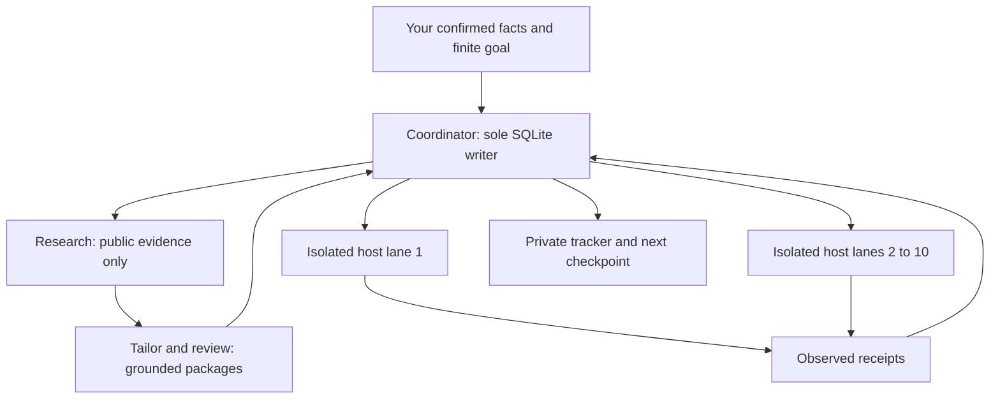

# Set up your agent, skills and browser lanes

Made by [DUYTRUYENTHONG](https://github.com/DUYTRUYENTHONG), freely shared under
[MIT](../LICENSE). Use your own AI account and facts. No extra model API is
required by the local core. Start here, then copy [SETUP_AND_GOAL](../prompts/SETUP_AND_GOAL.md).

For a guided first run and a fork checklist, see [Start here](START_HERE.md).
For the component and execution diagrams, see [System models](SYSTEM_MODELS.md).
For canonical skill ownership, selective loading and upstream updates, see
[Skill management](SKILL_MANAGEMENT.md). External collections remain references;
the [Awesome Copilot review](AWESOME_COPILOT_REVIEW.md) is not a plugin installer.

## 1. Clone and prove the local tools work

These instructions use the pinned `community-v0.2.0` preview tag. It includes the
CV-first starter, current skills and optional plugin code; it may be ahead of
`main`. For the shortest CV-plus-required-information path, use
[community setup](COMMUNITY_START.md). Native host/browser acceptance is separate.

```sh
git clone --branch community-v0.2.0 https://github.com/DUYTRUYENTHONG/vietnam-career-agent-kit.git
cd vietnam-career-agent-kit
python scripts/kit.py doctor --runtime generic
python scripts/demo_slice1.py
python scripts/generate_adapters.py --check
```

Use Python 3.11+ (`python3` or `py -3` if that is your actual interpreter).
The demo is disposable and fictional: no account, key, CV or external request.
Core commands need no pip install. [Optional document setup](documents-and-approval.md)
adds DOCX/PDF rendering tools; inspect every generated page before disclosure.

Open this clone as the working folder in your chosen agent. Keep the candidate
workspace outside it. For a new workspace, choose the path before running:

```sh
python scripts/kit.py --data-dir ../my-career-private init --language en
```

For an existing campaign, reuse its directory, back it up and review migration
notes before `init`. Current schema is 6; older clients reject it. Do not run the
fictional demo against a real workspace. [Individual intake commands](setup.md)
explain source import and actual profile confirmation.

## 2. Choose the actual AI runtime

| Your tool | Project entry point | What to verify |
|---|---|---|
| Codex in a local code workspace | `AGENTS.md`, `.agents/skills/` | Run `doctor --runtime codex`; check that `onboarding` is available, or ask it to read the exact shared SKILL.md |
| Claude Code in the clone | `CLAUDE.md`, generated `.claude/skills/` | Run `doctor --runtime claude`; check `/onboarding` and that its shared-file reference resolves |
| Grokbot / Grok runtime | [Generic instructions](../adapters/generic/README.md) | `doctor --runtime grok` reports native support as Unsupported; identify the actual product/version and available tools |
| Muse or another unidentified agent | Generic instructions and `doctor --runtime generic` | No native Muse adapter, model ID, hook schema or browser support is claimed |
| Chat without local tools | Paste the prompt and run commands yourself | Instruction-only; return CLI results to the agent and perform browser steps manually |

The kit's labels describe tested interfaces, not whether a vendor sells a tool.
Generic CLI verification does not certify the surrounding AI runtime. Local
project skills are documented by [OpenAI](https://learn.chatgpt.com/docs/build-skills)
and [Claude Code](https://code.claude.com/docs/en/skills); installed versions and
managed policies may differ. Inspect [recorded compatibility](compatibility.md).

## 3. Load the skill for the current stage

The ten canonical skills live in `.agents/skills/<name>/SKILL.md`. Claude wrappers
point to the same files. They are instructions, not ten workers or browser tools.

| Stage | Shared skill | Output |
|---|---|---|
| Setup/resume | `onboarding` | Capability report and selected workspace |
| Candidate facts | `candidate-evidence` | Confirmed evidence and unresolved conflicts |
| Public research | `vietnam-job-discovery` | Dated leads, source coverage and exclusions |
| Full JD | `job-normalization` | Versioned job with exact requirements |
| Eligibility | `fit-assessment` | Requirement-to-evidence matrix and gaps |
| CV wording | `application-tailoring` | Supported job-specific draft |
| Documents | `document-review` | Inspected final pages and hashes |
| Scope | `campaign-approval` | Exact finite manifest and actual authority |
| Host actions | `browser-application` | Issued requests and observed receipts |
| Continuity | `application-tracking` | Canonical tracker and resume checkpoint |

Load only the active skill and necessary evidence. Keep one owner per workstream;
use tools directly for hashing, tests, rendering and status. [Model routing](MODEL_ROUTING.md)
uses explicit available model/effort IDs; it never silently switches your agent.

## 4. Review optional hooks separately

You can complete setup with hooks disabled. The examples under `hooks/` are
inactive; cloning and wrapper generation do not install them. Follow
[HOOKS.md](HOOKS.md) to review exact paths, host event schemas and trust decisions.
Preserve existing settings and test in a disposable session before enabling any.

The sample PreToolUse guard is for **preparation-only** sessions and denies
recognizable browser tools. It is not the execution bridge and cannot authorize
submissions. Do not enable it expecting live applications to work automatically.
Stop hooks report progress; they do not restart agents or schedule campaigns.
Native callback enforcement remains unverified. No Grokbot/Muse hook schema is
provided. See [Claude's hook reference](https://code.claude.com/docs/en/hooks).

## 5. Divide work without sharing browser state

These are logical responsibilities, not auto-installed native subagent definitions.
One agent can perform them in sequence. Delegate only when the user and host
permit it; use the same owner when resuming a job.



| Responsibility | Receives | Returns; restrictions |
|---|---|---|
| Coordinator | User scope, ledger and compact evidence references | Assignments, exact requests, saved receipts; sole ledger writer |
| Research | Role filters and permitted public URLs | Sources and gaps; no CV, private contacts or account access |
| Tailor/reviewer | Selected candidate evidence, JD and draft | Supported wording and review findings; cannot approve itself |
| Browser lane | One issued request and its job/session binding | Observed protocol receipt; no ledger writes or mutation retries |

Start with one lane. Before using two or more, verify independent session
bindings, concurrent host calls, finite timeouts and matching receipts on
controlled fictional forms. Different tabs or browser brands are not proof of
isolation. Shared Gmail/login/profile state uses `workers=1`. Chrome, Edge or
another browser is usable only through an actually supported host bridge.

After exact package/host authority is established, follow the runnable protocol
in [PARALLEL_APPLICATIONS.md](PARALLEL_APPLICATIONS.md). It permits 1-10 workers;
a supplied host bridge is still required unless you explicitly configure the
experimental [TinyFish Browser adapter](TINYFISH_BROWSER.md) or the optional
[local Chromium plugin](LOCAL_PLUGINS.md). Without a supported
bridge, keep preparation automated and hand browser work off.
TinyFish Fetch is a separate [public research setup](TINYFISH_SETUP.md).
BrowserAct has an optional [review and offline session planner](BROWSERACT.md).
Its CLI is separate from the internal host browser; live form writes are not
implemented by that planner. Installation and native driver support are separate.

## 6. Set the goal and verify the first batch

Use [SETUP_AND_GOAL](../prompts/SETUP_AND_GOAL.md), then
[GUIDED_CAMPAIGN](../prompts/GUIDED_CAMPAIGN.md) and the
[ten-job runbook](../prompts/ten-job-batch.md). Specify your own target, fits,
locations, expiry, limits and requested mode. A host goal needs explicit user
request and host support; otherwise use a private continuity note.

The first batch is ready when facts are confirmed, full JDs/destinations checked,
duplicates excluded, documents inspected and exact execution scope established.
Save a matching receipt before counting a submission or closing its owned tab.
Keep uncertain attempts for read-only reconciliation. Export the private tracker
after every pass; see [goal continuity](campaign-continuity.md). A target does
not create a scheduler, promise employment or establish a live application rate.
