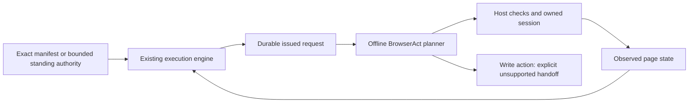

# BrowserAct review and optional session planning

BrowserAct is a useful candidate for compact page inspection and named browser
sessions. This kit adds an **offline session planner**, not a BrowserAct
submission driver. No BrowserAct software, account, browser profile or hooks are
installed. Live speed and employer compatibility have not been measured.

Reviewed on 26 October 2026: [skills source at the pinned revision](https://github.com/browser-act/skills/tree/11c057b03f92101642cadc9f840564574120d184),
entry skill 2.0.2, and [CLI 1.4.5 metadata](https://pypi.org/project/browser-act-cli/1.4.5/).
Exact source and wheel hashes, declared dependencies and acceptance limits are in
[the source record](../adapters/browser-act.source.json). The skills repository
is MIT; the CLI wheel metadata supplies no license expression. The compiled
wheel and its full dependency closure have not been audited or redistributed.

## What helps and what needs verification

| Capability | Decision for this kit |
|---|---|
| Compact indexed `state`, including changed elements | Adopt the workflow; refresh after actions, use screenshots when layout or proof matters |
| Explicit session names and session reuse | Plan a stable name per coordinator/run/job; verify actual ownership before use |
| Multiple sessions | Preserve the ten-lane coordinator; live host isolation/concurrency still needs testing |
| Same-browser sessions | They share cookies/login state; use one worker for a shared account, even with distinct session names |
| Human handoff | Keep the exact pending form/session, then read the result; never restart an uncertain submission |
| BrowserAct confirmation gates | Conversational skill guidance, not a CLI-enforced authorization boundary; retain the kit and host checks |
| Profile/cookie import, remote-assist links, proxies, CAPTCHA services, log uploads | Outside this adapter; each has separate access/disclosure implications |
| Claimed anti-detection, privacy and speed guarantees | Upstream claims, not verified properties of this kit |

The CLI is a separate browser-control program. It is not an extension for the
Codex internal browser. A host that permits only its supplied browser tools must
continue using those tools; this planner cannot attach BrowserAct to that host.
Hosts already offering indexed accessibility snapshots and change diffs may
gain little from another compact-state format. Session concurrency and end-to-end
latency need measurement in the actual permitted host.
For permitted public URL batches, use the existing TinyFish/Firecrawl research
path first. Reserve interactive browser sessions for pages that need them;
reuse an owned session during a form instead of repeatedly creating browsers.

## Three different kinds of authority

1. **Service authentication:** BrowserAct `auth login`/API keys unlock BrowserAct
   services. They do not authorize a job application or grant employer permission.
2. **Candidate authority:** the existing exact manifest or explicitly approved
   [bounded standing scope](STANDING_AUTHORIZATION.md) names the recipient,
   current documents/answers/consents, operations, bridge, limits and expiry.
3. **Host permission:** tool availability and host-required confirmations are
   checked separately immediately before the affected action. A local plan or
   approval record cannot override them.

Switching from another bridge requires a new reviewed execution scope with
`bridge_id: "browser-act"`. A pending issued action cannot be moved to another
driver just to bypass a blocker. New terms, required unknown answers or
challenges need the corresponding resolution. Matching standing authority can
remove repeated **local** approval bookkeeping; it is not an "always yes" rule.



## Opt-in setup

Keep the default core installation unchanged. If your chosen host permits this
driver, first review the binary/dependencies and vendor terms. The vendor's
installation mechanism is `uv tool install`; pin the reviewed CLI release in an
isolated tool environment rather than silently installing/upgrading it:

```sh
uv tool install browser-act-cli==1.4.5 --python 3.12
browser-act --version
browser-act get-skills core --skill-version 2.0.2
```

The reviewed CLI package requires **Python ==3.12.***, narrower than the upstream
skill's "3.12+" wording. The kit itself still supports Python 3.11/3.12. These
commands are setup guidance, not commands executed by this kit or a dependency
lock for BrowserAct. Runtime `get-skills` content may change; inspect it as
third-party material, not new authority. Do not automatically run its upgrade,
profile import, account creation or reporting suggestions.

Choose an already configured, appropriate browser through the host's supported
inventory. Start with fictional forms and one worker. Establish independent
bindings, finite command timeouts and matching receipts before increasing
concurrency. BrowserAct's same-browser multi-session feature does not establish
account-level isolation. Cloud/remote-assist access needs its own review; the
adapter provides no such command.

## Plan an already-issued request

Use the normal [execution protocol](execution.md) to create/review/approve the
finite manifest, start its run and obtain a request. No request is issued by the
planner itself. Use an external private workspace:

```sh
python scripts/kit.py --data-dir ../career-private browser-act-plan \
  --run-id RUN_ID --request-id REQUEST_ID --browser-id CONFIGURED_BROWSER_ID
```

The versioned output contains `commands` as argument arrays, a deterministic
`session`, expected `binding_id`, and a fresh-check `preflight`. It contains no
answer values or document paths. It does not call a subprocess, write the ledger,
claim a receipt, close a session, or install software.

| Issued action | Planner result |
|---|---|
| `inspect` | Plan `browser open` and `state` in one owned session |
| `review`, `verify` | Plan `state` on the existing binding; no reopen or new submit |
| `fill`, `upload`, `submit` | `manual_required`, empty command list; translation is unimplemented |

The planner reuses `check-action` or `check-parallel-action` and rejects a wrong
coordinator, bridge, binding, completed request, stale artifact, revoked approval
or expired disclosure scope. Read-only verification retains the engine's
recovery rules. **Planning is not a reusable execution permit:** the host must
recheck immediately before acting, verify the visible employer/requisition/URL,
and obey its own confirmation requirements. Never copy expected values into a
receipt without observing them. Do not treat `manual_required` as success.

Use argument arrays without shell concatenation in any future driver. Do not
cache element indexes across UI changes or run a sequence through an unexpected
dialog. The planned `--no-auto-dialog` leaves dialog decisions visible. After a
verified receipt, the existing cleanup protocol can request closing only the
owned completed application. Unknown outcomes preserve the session for recovery.

## Performance acceptance

Use [existing stage metrics](PERFORMANCE.md) and [confirmed throughput](THROUGHPUT.md)
to measure the complete path on controlled fictional portals first. Compare
sequential and isolated parallel runs with the same documents, confirmations
and portal behavior. Record wall time, host calls, actual token usage if exposed,
failures and uncertain outcomes. Do not infer a 100/hour or 100x gain from compact
output, ten planned sessions or a synthetic sleep benchmark.

Local regressions cover authorization freshness, pending-request ownership,
bridge/session mismatch, no process/ledger side effects, unsupported writes and
read-only recovery with one durable submit attempt. A production BrowserAct
bridge, live multi-browser test and employer speed measurement remain pending.
