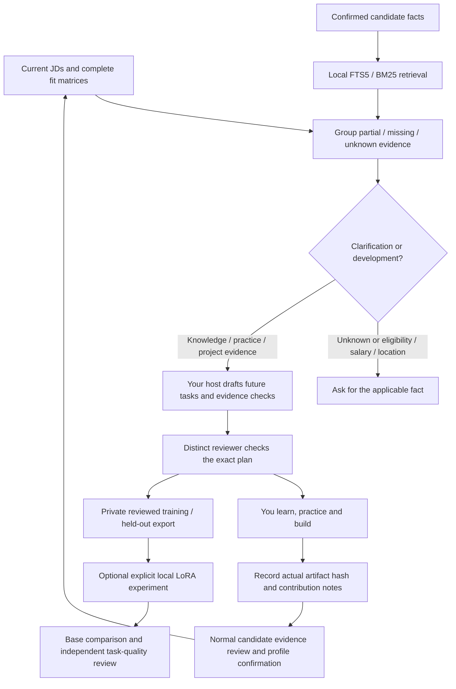

# Turn job requirements into an evidence-backed development plan

The kit can collect **evidence gaps** across assessed jobs, retrieve related
confirmed facts, and prepare a private learning/project plan with your own AI.
A missing source is not proof that you lack a skill. An unknown answer requires
clarification. A suggested project is future work, never an accomplishment.
See [measured QA and remaining limits](CAREER_GROWTH_QA.md).



## Collect current gaps

Use an initialized external workspace with confirmed sources, a structured JD
and a complete assessment. Reuse the existing candidate and ledger.
This interface accepts the portable workspace schema 1–6. It does not migrate
older source-packet/legacy campaign databases or initialize a second tracker to
unlock learning tools; use a reviewed manual gap report for unsupported legacy data.

```sh
python scripts/kit.py --data-dir ../my-career-private growth-context --job-id 1 --job-id 2
python scripts/kit.py --data-dir ../my-career-private growth-capture --job-id 1 --job-id 2
```

`growth-context` is read-only. `growth-capture` writes an immutable, idempotent
snapshot under `reports/growth/contexts/`. Each gap retains the exact requirement,
mandatory/hard status, current match, limitation, job and source-fact IDs.
Literal field/value matches are grouped; there is no fuzzy semantic equivalence
claim. Priority uses mandatory-job count, then distinct-job count, then stable ID.
Related retrieved facts are context, **not proof that a requirement is met**.

Unknowns and recognized condition fields route to clarification first. Field
classification is conservative and deterministic, not a complete semantic
classifier. A reviewer must catch unusual condition fields. Closed or submitted
jobs can inform learning if their structured source and assessment remain current;
this never reopens an application. Stale or missing assessments stop the request.

The optional post-assessment capture is explicit:

```sh
python scripts/kit.py --data-dir ../my-career-private assess --job-id 1 --matrix ../my-career-private/matrix.json --capture-growth
```

Assessment success and capture success are reported separately. An assessment
already saved is not rolled back if the optional capture fails.

## Draft and review a plan

Use [the coach prompt](../prompts/GROWTH_COACH.md) with your own host and the
current context. The [versioned contract](../schemas/career-growth.schema.json)
defines `plan`, `action`, `resource` and `review`. The host generates actions;
the core validates and stores them. No extra model API is called.

Each action has a current gap ID, kind (`clarify`, `learn`, `practice`, `build`),
objective, bounded steps, acceptance checks and optional HTTPS source references.
Resources are untrusted references, not automatically verified recommendations.
Use current official documentation and record what was checked. Do not invent a
course's availability, cost, certificate or value. Projects should specify inputs,
implementation, tests, evaluation and artifacts to collect, with unknowns explicit.

```sh
python scripts/kit.py --data-dir ../my-career-private growth-plan --file ../my-career-private/growth-plan.json
python scripts/kit.py --data-dir ../my-career-private growth-check --fingerprint PLAN_FINGERPRINT
python scripts/kit.py --data-dir ../my-career-private growth-review --fingerprint PLAN_FINGERPRINT --file ../my-career-private/growth-review.json
```

The plan is bound to profile, JD **and assessment-content** fingerprints. A new
assessment reason can invalidate it even when the profile and JD are unchanged.
Every action needs a distinct reviewer's explicit grounded/feasible/future-only/
no-CV-promotion findings. Reviewer identity and independence are caller-declared,
not authenticated. Review approves a plan, not expertise or application authority.
An edited/rejected plan requires a new reviewed artifact; existing bytes are not
overwritten. This slice has no review-revocation command. If approval changes,
remove the local review from the active reviews directory before future use;
missing or changed review bytes invalidate exports.

## Record work you actually performed

```sh
python scripts/kit.py --data-dir ../my-career-private growth-evidence --fingerprint PLAN_FINGERPRINT --action-id A1 --artifact projects/retrieval-demo.md --note "Implemented with AI assistance; tests and limitations documented."
```

This hashes an existing workspace file and records **submitted for candidate
review**, not completed, validated or CV-eligible. A hash proves file identity,
not authorship or technical skill. Use the normal `candidate-evidence` workflow
to review actual contribution, dates, tools, scale and results; confirm the exact
new profile and reassess before changing CVs. Plans, courses, generated examples,
test outputs and model weights never become candidate facts automatically.

## RAG and opt-in local fine-tuning

RAG uses the existing local lexical confirmed-fact retriever, one bounded query
per context. No embeddings, shared corpus, vector DB, cloud parser, external
inference or extra SDK is introduced. It is an experimental retrieval-augmented
planning brief, not a production hybrid RAG system.

```sh
python scripts/kit.py --data-dir ../my-career-private growth-export --fingerprint PLAN_ONE --fingerprint PLAN_TWO --output datasets/growth-v1
python scripts/kit.py --data-dir ../my-career-private growth-check-export --directory datasets/growth-v1
python -m adapters.local_finetuning --task career-growth --data-dir ../my-career-private --directory datasets/growth-v1 --model-directory /path/to/local-qwen --output training/growth-v1 --target-module q_proj --target-module v_proj --epochs 1 --device cpu
```

Growth datasets have task `career-growth`, schema `1.0`, prompt `growth-plan-1`,
an explicit output schema and exact current plan/review provenance. They remain
separate from reviewed **CV wording** datasets (`learning-export`). Wrong-task
training is rejected; CV remains the runner's backward-compatible default.
Related fact quotes can identify a person, so these exports remain private.
Any overlapping job/revision groups or exact-output duplicates stay on one side
of the split, transitively. With fewer than two independent groups, no training
or evaluation split is written. The exporter reconstructs current reviewed
examples and exact file bytes; rehashing altered outputs does not make them valid.

The existing explicit offline LoRA runner now selects the matching task validator
before loading train/evaluation rows and rechecks before/after training. It
compares held-out assistant-token loss with the base model. A loss improvement is
not evidence of better advice. This feature's tests validate dataset preparation,
not an actual growth-model training run or measured coaching quality. Paired
growth-generation/task-quality acceptance and native host integration remain
pending. Do not promote an adapter automatically or use suggestions as CV facts.

## Agents, hooks and limits

The existing fit-assessment owner collects gaps; a bounded logical gap/evidence
coach drafts the plan; a distinct reviewer checks it; the candidate performs the
work. One coordinator writes the ledger. Use explicit host-supported delegation,
actual model IDs and source references. Logical roles are not auto-installed
native subagents. The ten canonical skills are retained.

Optional `hooks/guard.py` SessionStart/Stop output reminds the host about growth
commands. It reads no transcript, calls no model, collects nothing by itself,
does not restart the goal and installs no host/global configuration. Actual
collection is the explicit command or `assess --capture-growth` integration.
Native callback discovery and enforcement remain unverified.

Bounds: 1–100 jobs, 100 distinct gaps, 5 MB returned context and 2 MB persisted
JSON artifact, 1–100 proposed actions,
1–20 steps/checks, 10 resource references per action and 20 MB evidence/export.
All files stay in the selected private workspace. No fact, CV, fit, consent,
submission or campaign target is changed by these commands.
