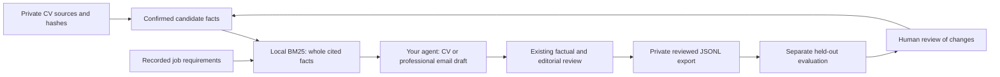
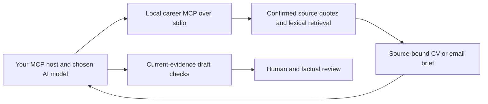

# Local career memory, evaluation and reviewed exports

Older campaign with `data/source-facts.json` but no portable `workflow.sqlite3`?
Use the explicit [read-only source-memory bridge](SOURCE_MEMORY.md); do not
initialize a competing tracker. It reads a hash-bound reviewed subset only and
does not replace normal profile/job-bound writing validation.

For fingerprinted CV/email briefs, current draft-citation checks and optional
LCEL orchestration using your own AI host, see [LangChain RAG](LANGCHAIN_RAG.md).

Use your existing agent to write. The optional career MCP server provides cited
context and measured feedback without adding a second model API. It runs locally
over stdio against one explicitly selected private workspace. Nothing here sends
an application, grants authority, uploads data or trains model weights.



Feedback never promotes a generated claim into a fact automatically. A positive
application response is not evidence for every claim in its CV. Keep all source,
context, gold-query and dataset files private; even contact-free facts can identify
a person. Share only deliberately anonymized aggregate results.

## CLI first

Initialize and confirm the selected profile using the normal [CV-first flow](COMMUNITY_START.md).
With an existing recorded job, these commands reuse that same database:

```sh
python scripts/kit.py --data-dir ../my-private career-context --query "SQL marketing automation" --limit 5 --max-chars 6000
python scripts/kit.py --data-dir ../my-private career-email-context --job-id 1 --language vi
python scripts/kit.py --data-dir ../my-private career-evaluate --file ../my-private/gold-queries.json
python scripts/kit.py --data-dir ../my-private learning-export --job-id 1 --job-id 2 --output datasets/review-001
python scripts/kit.py --data-dir ../my-private learning-check --directory datasets/review-001
```

`--file` is a path from the working directory; it must resolve inside the private
workspace. Export paths are workspace-relative. Export refuses existing directories;
if interrupted, inspect the incomplete directory and choose a fresh path. The
manifest is written last as the completion marker. No candidate/application schema
migration is needed. Existing email/browser configurations keep their defaults.

## Optional MCP setup

For a forkable career-only environment without email/browser packages, use the
[standalone MCP setup](MCP_SERVER.md). The full plugin route below remains valid.

Use the project's existing hash-locked optional environment; MCP is pinned to
**1.30.0**. Follow [local plugin setup](LOCAL_PLUGINS.md) for dependency installation.
Career-only use does not require downloading Chromium or authorizing Gmail.

```sh
python scripts/serve_plugin.py career --data-dir ../my-private
python scripts/plugin_config.py --data-dir ../my-private --python /absolute/path/to/plugin-python --include-career
```

### Opt in to the career MCP server only

Users who want retrieval and CV/email preparation without email/browser tool
registration can generate just the existing career stdio server:

```sh
python scripts/plugin_config.py --data-dir ../my-private --python /absolute/path/to/plugin-python --career-only
```

Use the locked optional plugin environment described in
[local plugin setup](LOCAL_PLUGINS.md). Review the resulting
`configured-plugins/mcp-servers.example.json` or `codex.example.toml` in that
private workspace, then add its single `career-career` server entry through your
MCP host's normal setup. No Docker or public HTTP endpoint is required. The host
starts `scripts/serve_plugin.py career --data-dir ...` over stdio. Initialize
your own private workspace and confirm your source-backed profile first; the
server refuses to create a campaign or import a CV at startup.

`--career-only` and `--include-career` are mutually exclusive. The default still
generates email/browser entries; `--include-career` still generates all three.
Changing modes replaces the generated example configurations and marketplace,
but leaves old package folders and host settings untouched. It does not revoke
or disable a server you previously installed in a host. Preview generation does
not install software, connect Gmail, open browsers or register tools globally.



The host owns drafting; this server does not silently select a model or load
Qwen weights. Optional [local fine-tuning](LOCAL_FINETUNING.md) stays a separate
reviewed experiment. Failed/unreviewed adapters are not defaults, and no training,
model promotion, account-connection or application-submission tool is exposed.
Real stdio protocol checks do not prove that every Codex/Claude/Muse/Grok host
has installed or can invoke the server; test the chosen host explicitly.

### Job requirements drive writing-context retrieval

Email context and CV/email writing briefs build their lexical query from the
recorded structured requirements: mandatory clauses first, hard clauses first
within each priority, followed by optional clauses and the role title. Input
order breaks ties. They select up to 20 distinct literal words in first-seen
order within a 1,000-character query bound, skipping words that cannot fit whole.
Repeated words do not consume additional slots. Company introductions in `raw_jd` no longer consume
that budget. Direct `retrieve` queries are unchanged.

This is bounded lexical selection, not complete requirement coverage, semantic
matching or qualification certification. Later clauses can still fall outside
the query budget; use the full JD/evidence map for final tailoring. All profile
and source checks remain fresh. The writing brief still binds the complete
current job fingerprint, including `raw_jd`: changing even the preamble makes an
old draft stale. Existing briefs may require regeneration after this change;
no stored evidence, approvals or historical application snapshots are rewritten.

Use the interpreter where the locked MCP dependency is installed. The first command
starts a protocol server; it is not a terminal chat. The second writes example
configurations under the private workspace's `configured-plugins/`; it does not
install plugins or edit host settings. Without `--include-career`, the original two
email/browser configurations remain unchanged. Generation replaces the private
example configurations, so preserve any local edits before regenerating. It never
overwrites host settings. Review the generated stdio entry in a host that
supports MCP. Codex/Claude installation and permission UIs require host testing;
Grokbot/Muse need an identified compatible tool runtime.

| Tool | Result / side effect |
|---|---|
| `career_context` | Read confirmed facts with source IDs, locators, hashes and profile fingerprint |
| `career_email_context` | Read cited job context and an English/Vietnamese professional writing brief |
| `career_writing_brief` | Read a fingerprinted CV/email brief and draft output contract |
| `career_check_draft` | Recheck evidence freshness and citations; semantic truth remains unverified |
| `career_evaluate` | Read labelled retrieval results, BM25 and simple token-overlap baseline metrics |
| `learning_export` | Create a new private dataset directory from current independently reviewed CV wording |
| `learning_check` | Recheck exported bytes, reviews, profile, job and deterministic split |
| `performance_record` | Append one source-bound caller-reported usage observation |
| `performance_report` | Read per-model timing/token coverage; missing is not zero |
| `campaign_tracker` | Read canonical recorded application status |

`career-kit://writing-policy` supplies the existing curated evidence-writing
reference. No upstream installer or arbitrary filesystem/SQL/network tool is
exposed. A host still owns factual review and drafting; the email tool returns a
brief, not a claim that an email has been generated, reviewed or sent.

## Retrieval contract and evaluation

The first backend is **Experimental lexical retrieval**, SQLite FTS5 BM25 with
Unicode tokenization and diacritic removal. It is not production hybrid/vector
RAG. It indexes only current confirmed quotes from the selected profile after
source revalidation. Pending/rejected facts are excluded; stale evidence and
unconfirmed profiles block. Quotes and job descriptions are untrusted data,
never instructions. Limits: 2,000 confirmed facts, one million quote characters,
1,000 query characters, first 20 unique query words, top-k 1–10, context 1–20,000
quote/locator characters. Whole facts are omitted rather than truncated. Other
JSON metadata adds overhead beyond that character budget. Missing FTS5 returns
`manual_required`; oversized corpora need a reviewed narrower scope.

Create private gold queries using [the v1 schema](../schemas/retrieval-evaluation.schema.json):

```json
{"schema_version":"1.0","limit":1,"cases":[
  {"id":"sql","query":"SQL","expected_fact_ids":["F1"]},
  {"id":"unknown","query":"unconfirmed skill","expected_fact_ids":[]}
]}
```

Use actual current confirmed IDs. Evaluation returns precision/recall@k and
reciprocal rank averaged over positive queries. Negative false positives are
reported separately. A literal token-overlap baseline uses the same quotes.
Gold-label/held-out provenance is caller-supplied, not authenticated. Add representative
roles, absent skills, Vietnamese/English and adversarial queries before drawing
conclusions. A later dense/hybrid adapter requires separate quality and latency
comparison; no embedding or generation quality is established by this slice.

Run the fictional local benchmark with no account/model/API:

```sh
python scripts/benchmark_memory.py --facts 1000 --samples 10
```

It measures full retrieval including source/profile validation and rebuilding an
in-memory index, and evaluates four authored queries. See [QA evidence](PERFORMANCE_MEMORY_QA.md).
This cannot establish a job-submission rate or quality on real CVs.

The JSON also reports `stage_samples` for profile/source validation, index
construction, lexical query and context assembly. Each named stage includes its
observed count, minimum, median, maximum and total milliseconds from the measured
retrieval calls. Setup and the four separate evaluation queries are excluded.
Stage times are rounded and do not account for all wall time. Use them to locate
local bottlenecks before caching or replacing retrieval; keep current source
checks intact. This does not measure browser waits, model inference or tokens.

## Reviewed dataset contract

Export accepts 1–100 distinct existing local job IDs. Each must have current
source-bound **independently reviewed CV wording** through the existing v2 factual
and editorial path. Unreviewed drafts and stale/revoked reviews cannot export.
Targets retain pending statement review status: models are not taught to approve
their own output. Identity/contact header fields are omitted, but selected facts,
source locators and provenance can still contain identifying information.

`examples.jsonl` holds messages plus hashes/provenance. With at least two
independent components, `train.jsonl` and `evaluation.jsonl` hold only messages;
the manifest maps example IDs and fingerprints. Same-job/revision and exact-output
duplicates, including transitive overlaps, stay together. About 20% of components
are held out deterministically. One group yields a collection only,
`ready_for_split: false`, with no train/evaluation files. This flag means split
availability, **not** sufficient diversity or model-training readiness.

The new directory is bounded to 20 MB of serialized JSONL. `learning-check`
revalidates its bytes, counts, splits and all current source/job/wording/review
fingerprints; editing/revoking those records makes an old export stale. Hashes
detect changes, not authentic human identity. Same-candidate facts and semantic
near-duplicates may still overlap: this is not cross-candidate generalization.
Email briefs are not reviewed email training examples in this version.

`learning-export` and `learning-check` also return a computed `split_overlap`
report. It counts unique input facts in each partition, facts shared by both,
source-content hashes shared by both, and evaluation facts not exactly present
in training. Exact fact identity combines the source-content hash, field, quote
and locator; local fact/source IDs alone do not determine identity. Counts cover
all facts supplied to the model, including facts not used in its target output.
No raw quotes, source hashes or IDs are added to this report.

This is an overlap audit, not a new split policy. A held-out job may reuse the
same candidate evidence; `ready_for_split` therefore does not mean unseen facts.
Different locators, changed source bytes and semantic paraphrases may conceal
related evidence. `semantic_independence_verified` stays false even when exact
overlap is zero. Source-hash overlap does not infer which facts are related.
With fewer than two groups, no partitions exist and the report counts are zero;
that does not mean the collection has been evaluated. Reports are recomputed
after existing export checks, without changing JSONL/manifest versions or old
export files. No training, model promotion or candidate fact changes occur.

New version 1.1 exports include a versioned explicit output schema and current
assessed requirement-to-fact links. Unchanged version 1.0 exports retain legacy
validation. See [generation input and compatibility](LEARNING_PROMPTS.md).

Actual fine-tuning uses the separate opt-in [local runner](LOCAL_FINETUNING.md).
This exporter performs **zero training/provider calls**; dataset collection does
not select, train or promote a model.

Primary implementation references: [SQLite FTS5](https://www.sqlite.org/fts5.html)
and the [official MCP Python SDK](https://github.com/modelcontextprotocol/python-sdk),
reused through the existing locked 1.30.0 profile. No upstream code was copied.
