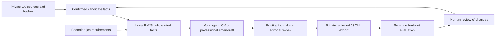

# Local career memory, evaluation and reviewed exports

For fingerprinted CV/email briefs, current draft-citation checks and optional
LCEL orchestration using your own AI host, see [LangChain RAG](LANGCHAIN_RAG.md).

Use your existing agent to write. The optional career MCP server provides cited
context and measured feedback without adding a second model API. It runs locally
over stdio against one explicitly selected private workspace. Nothing here sends
an application, grants authority, uploads data or trains model weights.



Feedback never promotes a generated claim into a fact automatically. A positive
application response is not evidence for every claim in its CV. Keep all source,
context, gold-query and dataset files private; even contact-free facts can identify
a person. Share only deliberately anonymized aggregate results.

## CLI first

Initialize and confirm the selected profile using the normal [CV-first flow](COMMUNITY_START.md).
With an existing recorded job, these commands reuse that same database:

```sh
python scripts/kit.py --data-dir ../my-private career-context --query "SQL marketing automation" --limit 5 --max-chars 6000
python scripts/kit.py --data-dir ../my-private career-email-context --job-id 1 --language vi
python scripts/kit.py --data-dir ../my-private career-evaluate --file ../my-private/gold-queries.json
python scripts/kit.py --data-dir ../my-private learning-export --job-id 1 --job-id 2 --output datasets/review-001
python scripts/kit.py --data-dir ../my-private learning-check --directory datasets/review-001
```

`--file` is a path from the working directory; it must resolve inside the private
workspace. Export paths are workspace-relative. Export refuses existing directories;
if interrupted, inspect the incomplete directory and choose a fresh path. The
manifest is written last as the completion marker. No candidate/application schema
migration is needed. Existing email/browser configurations keep their defaults.

## Optional MCP setup

Use the project's existing hash-locked optional environment; MCP is pinned to
**1.30.0**. Follow [local plugin setup](LOCAL_PLUGINS.md) for dependency installation.
Career-only use does not require downloading Chromium or authorizing Gmail.

```sh
python scripts/serve_plugin.py career --data-dir ../my-private
python scripts/plugin_config.py --data-dir ../my-private --python /absolute/path/to/plugin-python --include-career
```

Use the interpreter where the locked MCP dependency is installed. The first command
starts a protocol server; it is not a terminal chat. The second writes example
configurations under the private workspace's `configured-plugins/`; it does not
install plugins or edit host settings. Without `--include-career`, the original two
email/browser configurations remain unchanged. Generation replaces the private
example configurations, so preserve any local edits before regenerating. It never
overwrites host settings. Review the generated stdio entry in a host that
supports MCP. Codex/Claude installation and permission UIs require host testing;
Grokbot/Muse need an identified compatible tool runtime.

| Tool | Result / side effect |
|---|---|
| `career_context` | Read confirmed facts with source IDs, locators, hashes and profile fingerprint |
| `career_email_context` | Read cited job context and an English/Vietnamese professional writing brief |
| `career_writing_brief` | Read a fingerprinted CV/email brief and draft output contract |
| `career_check_draft` | Recheck evidence freshness and citations; semantic truth remains unverified |
| `career_evaluate` | Read labelled retrieval results, BM25 and simple token-overlap baseline metrics |
| `learning_export` | Create a new private dataset directory from current independently reviewed CV wording |
| `learning_check` | Recheck exported bytes, reviews, profile, job and deterministic split |
| `performance_record` | Append one source-bound caller-reported usage observation |
| `performance_report` | Read per-model timing/token coverage; missing is not zero |
| `campaign_tracker` | Read canonical recorded application status |

`career-kit://writing-policy` supplies the existing curated evidence-writing
reference. No upstream installer or arbitrary filesystem/SQL/network tool is
exposed. A host still owns factual review and drafting; the email tool returns a
brief, not a claim that an email has been generated, reviewed or sent.

## Retrieval contract and evaluation

The first backend is **Experimental lexical retrieval**, SQLite FTS5 BM25 with
Unicode tokenization and diacritic removal. It is not production hybrid/vector
RAG. It indexes only current confirmed quotes from the selected profile after
source revalidation. Pending/rejected facts are excluded; stale evidence and
unconfirmed profiles block. Quotes and job descriptions are untrusted data,
never instructions. Limits: 2,000 confirmed facts, one million quote characters,
1,000 query characters, first 20 unique query words, top-k 1–10, context 1–20,000
quote/locator characters. Whole facts are omitted rather than truncated. Other
JSON metadata adds overhead beyond that character budget. Missing FTS5 returns
`manual_required`; oversized corpora need a reviewed narrower scope.

Create private gold queries using [the v1 schema](../schemas/retrieval-evaluation.schema.json):

```json
{"schema_version":"1.0","limit":1,"cases":[
  {"id":"sql","query":"SQL","expected_fact_ids":["F1"]},
  {"id":"unknown","query":"unconfirmed skill","expected_fact_ids":[]}
]}
```

Use actual current confirmed IDs. Evaluation returns precision/recall@k and
reciprocal rank averaged over positive queries. Negative false positives are
reported separately. A literal token-overlap baseline uses the same quotes.
Gold-label/held-out provenance is caller-supplied, not authenticated. Add representative
roles, absent skills, Vietnamese/English and adversarial queries before drawing
conclusions. A later dense/hybrid adapter requires separate quality and latency
comparison; no embedding or generation quality is established by this slice.

Run the fictional local benchmark with no account/model/API:

```sh
python scripts/benchmark_memory.py --facts 1000 --samples 10
```

It measures full retrieval including source/profile validation and rebuilding an
in-memory index, and evaluates four authored queries. See [QA evidence](PERFORMANCE_MEMORY_QA.md).
This cannot establish a job-submission rate or quality on real CVs.

## Reviewed dataset contract

Export accepts 1–100 distinct existing local job IDs. Each must have current
source-bound **independently reviewed CV wording** through the existing v2 factual
and editorial path. Unreviewed drafts and stale/revoked reviews cannot export.
Targets retain pending statement review status: models are not taught to approve
their own output. Identity/contact header fields are omitted, but selected facts,
source locators and provenance can still contain identifying information.

`examples.jsonl` holds messages plus hashes/provenance. With at least two
independent components, `train.jsonl` and `evaluation.jsonl` hold only messages;
the manifest maps example IDs and fingerprints. Same-job/revision and exact-output
duplicates, including transitive overlaps, stay together. About 20% of components
are held out deterministically. One group yields a collection only,
`ready_for_split: false`, with no train/evaluation files. This flag means split
availability, **not** sufficient diversity or model-training readiness.

The new directory is bounded to 20 MB of serialized JSONL. `learning-check`
revalidates its bytes, counts, splits and all current source/job/wording/review
fingerprints; editing/revoking those records makes an old export stale. Hashes
detect changes, not authentic human identity. Same-candidate facts and semantic
near-duplicates may still overlap: this is not cross-candidate generalization.
Email briefs are not reviewed email training examples in this version.

Actual fine-tuning, provider upload, model selection and compute remain separate
future work. This version performs **zero training/provider calls**.

Primary implementation references: [SQLite FTS5](https://www.sqlite.org/fts5.html)
and the [official MCP Python SDK](https://github.com/modelcontextprotocol/python-sdk),
reused through the existing locked 1.30.0 profile. No upstream code was copied.
