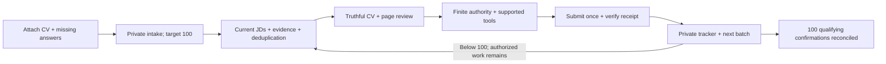

# Community quick start: your CV → your private campaign

Made by **[DUYTRUYENTHONG](https://github.com/DUYTRUYENTHONG)**. Free to use,
modify, fork and redistribute under [MIT](../LICENSE). Keep the notices.
Your AI subscription and optional browser/provider services may have their own costs.

## 1. Clone the latest main

For a fork-oriented walkthrough and choosing separate engineering, product or
delivery tracks, use the [forker playbook](FORKER_PLAYBOOK.md) and its
[role-aware prompt](../prompts/ROLE_FAMILY_CAMPAIGN.md).

The default `main` branch includes the merged community kit, so a normal clone
gets the latest CV-first starter, skills and optional transports. Clone and
verify the local tools:

```sh
git clone https://github.com/DUYTRUYENTHONG/vietnam-career-agent-kit.git
cd vietnam-career-agent-kit
python scripts/kit.py doctor --runtime generic
python scripts/demo_slice1.py
```

Requires Git and Python 3.11+. `python3` or `py -3` may be your Python command.
The core and fictional demo need no pip install, account, browser or model API.
Fork `main` for the latest source. To update an existing fork without losing
your changes, follow [the fork walkthrough](START_HERE.md). For a reproducible
snapshot, the [community-v0.2.0 release](https://github.com/DUYTRUYENTHONG/vietnam-career-agent-kit/releases/tag/community-v0.2.0)
remains available with its source ZIP and SHA256 manifest; it is not moved when
`main` changes. [Main integration QA](MAIN_RELEASE_QA.md) records the merge gate.

## 2. Attach a CV and seven small answers

Open the clone in your AI agent. Attach PDF, DOCX, TXT or Markdown. Paste
[this short start prompt](../prompts/COMMUNITY_START.md). You supply roles/level,
locations/remote eligibility, employment types, availability/work authorization,
salary basis or negotiable, current contacts/mailbox and prior applications.
The agent should reuse confirmed information and ask only for missing facts.
Unknown answers remain unknown; optional DOB/address/GPA are not intake requirements.

One local command prepares the private packet:

```sh
python scripts/kit.py --data-dir ../my-career-private start-campaign --cv /path/to/my-cv.pdf
```

On Windows, quote a CV path containing spaces. Choose a private directory outside
the checkout. Add `--target 25` to change 100; add `--language vi` for the workspace
language. Existing matching starter packets are reused without overwriting edits.
Changed CV/target/language requires an explicit reviewed update, not a reset.

The starter creates `workflow.sqlite3`, `starter/intake.json` and `starter/GOAL.md`.
It records a CV path/hash and **100** as the default finite goal. It does not
extract/import/confirm CV facts, create a running host goal, authorize uploads,
send applications or install hooks. Supported host extraction is needed for
PDF/DOCX; verify it and import checked UTF-8 evidence with `import-cv`.

## 3. Let your agent operate the workflow



**Best fit** means reviewed **Strong fit** or **Plausible fit** within your scope.
A target never establishes qualification, available vacancies or permission.
Stretch applications stay outside the default best-fit count. Interviews,
rejections and offers are later outcomes, separate from successful submission.
The [rolling throughput KPI](THROUGHPUT.md) is also separate from the total goal.

| Your agent | Entry point | What you must verify |
|---|---|---|
| Codex | `AGENTS.md`, `.agents/skills/`, start prompt | Actual local/file/browser tools and host permissions |
| Claude Code | `CLAUDE.md`, `.claude/skills/` wrappers | Project discovery and compatible local/MCP configuration |
| Another model in a tool-enabled host | Same prompt and Python CLI | Host can read files/run commands; optional MCP/browser support |
| Grokbot/Muse or text-only chat | Generic instructions/manual handoff | No native adapter or browser capability is presumed |

There is one owner per job and one canonical SQLite writer. Skills guide work;
hooks are inactive examples until separately installed and verified. Optional
[Gmail/local browser plugins](LOCAL_PLUGINS.md), [TinyFish](TINYFISH_SETUP.md) and
[Firecrawl](FAST_WEB.md) have separate setup and acceptance requirements.
Begin with one lane. Ten lanes need ten verified isolated sessions, not ten tabs
sharing the same account. No runtime-independent one-click application guarantee.

## 4. Read your result and resume

```sh
python scripts/kit.py --data-dir ../my-career-private tracker --format md --output reports/tracker.md
python scripts/kit.py --data-dir ../my-career-private resume
```

Keep CVs, contacts, raw messages, approvals, receipts and goals private. Reuse
the same workspace across batches. Failed/uncertain attempts are not submitted;
recover uncertain outcomes read-only. Do not widen fit to fill a quota.
When you ask the agent to check replies, match exact jobs and keep acknowledgments
separate from interview invitations. A sent email does not prove inbox delivery.

[Real anonymized campaign results](CAMPAIGN_RESULTS.md) show this distinction.
They are a host-assisted case study, not a benchmark of unattended kit execution.

## Share or maintain your fork

Share the [repository](https://github.com/DUYTRUYENTHONG/vietnam-career-agent-kit)
for the latest `main`, or the [pinned release link](https://github.com/DUYTRUYENTHONG/vietnam-career-agent-kit/releases/tag/community-v0.2.0)
or fork the source. Retain LICENSE/AUTHORS/THIRD_PARTY_NOTICES and use fictional
fixtures when contributing. A source ZIP has no Git history; clone/fork for Git work.
Maintainers can rebuild a checked archive from an exact committed tree:

```sh
python scripts/package_community.py --output ../career-kit-community.zip
```

This packages **HEAD**, not uncommitted edits. It scans archived UTF-8 files with
the bounded repository hygiene rules, refuses tracked private artifacts/symlinks,
and writes an external SHA256 manifest. It never packages an untracked `.venv`,
CV folder or `.git` directory. Inspect the manifest; this is not an exhaustive
secret scanner. Keep artifacts outside the checkout and never overwrite a release.
