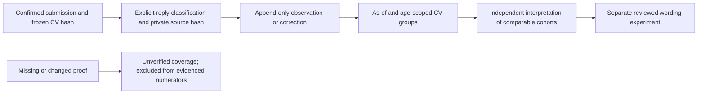

# Observe recruitment outcomes by the exact submitted CV

Status: **Experimental local observation/reporting**. Fictional QA and
compatibility evidence are recorded in [the scoped QA log](CV_OUTCOMES_QA.md).



The RAG/fine-tuning feedback loop needs actual recruitment observations, separate
from successful submission receipts and offline wording quality. This increment
imports explicitly classified, source-bound observations for already confirmed
portable-engine submissions. It never reads a mailbox or operates an employer site.

## Contract and boundaries

- Reuse the selected portable workspace, application schema 3–6 and immutable
  `execution_submissions`. No legacy campaign migration or second tracker.
- An observation names the submission ID, its frozen snapshot hash and exact CV
  hash. Verify the submission/attempt linkage and retain historical document
  identity even if the current CV file has changed. Do not re-tailor history.
- Types: `acknowledged`, `screening_passed`, `shortlisted`, `assessment_invited`,
  `interview_invited`, `rejected`, `offer_received`, `withdrawn` and `retract`.
  Each is explicit: an interview never invents a preceding screening result.
- Source: one existing bounded private file and its SHA256, classified as
  `employer_message`, `portal_observation` or `manual_record`. File identity and
  caller classification do not authenticate an employer or prove semantic truth.
- Received time must be explicit UTC, no earlier than the durable submit
  attempt and no later than observation time; observation time cannot be future.
  Confirmation-record time is not necessarily the exact original send time.
- Append-only observations are idempotent by event ID. A changed ID payload is
  rejected. `retract` references an earlier non-retraction event for the same
  submission; it corrects classification, not application or employer history.
- Reports group exact CV hashes, optionally restricted to explicit job IDs, and
  separate recent applications using a stated minimum age (default 14 days).
  Rates use only age-eligible confirmed submissions and count each application
  at most once per outcome kind. Outcome categories may overlap.
- Report as-of excludes observations not yet recorded at that time. Missing or
  changed source bytes are reported separately and excluded from evidenced
  outcome numerators; no response never becomes rejection. Report coverage is
  not evidence of a complete mailbox audit.
- No model ranking, causal uplift, ATS/admission guarantee, candidate-fact update,
  training export, consent, application action or automatic model promotion.

## CLI and local MCP

`outcome-record --file PRIVATE_JSON` and `outcome-report --min-age-days 14
--as-of TIMESTAMP --job-id N` share their functions with two local career MCP
tools. Report time defaults to now; `--as-of` is optional. Reports return JSON
through the normal outcome envelope; the host can save a private review artifact.
The report's `applications` entries expose the immutable submission ID, snapshot
and document hashes needed to prepare a subsequent observation; direct SQL is
not required. No contact headers or message body is returned by the report.

```sh
python scripts/kit.py --data-dir ../private outcome-report --min-age-days 0
python scripts/kit.py --data-dir ../private outcome-record --file ../private/reply.json
python scripts/kit.py --data-dir ../private outcome-report --min-age-days 14 --job-id 1
```

An event has schema version 1.0, bounded `event_id`, `job_id`, `submission_id`,
`submission_sha256`, `document_sha256`, `kind`, `received_utc`, `observed_utc`,
nullable `retracts_event_id`, and `source` with `kind`, `path`, `sha256`.
See [the JSON schema](../schemas/cv-outcome.schema.json). For example, after
replacing every ID/hash/time with the actual private values:

```json
{
  "schema_version": "1.0",
  "event_id": "reply-001",
  "job_id": 1,
  "submission_id": "COPY_FROM_APPLICATIONS",
  "submission_sha256": "COPY_EXACT_64_HEX_SNAPSHOT_HASH",
  "document_sha256": "COPY_EXACT_64_HEX_CV_HASH",
  "kind": "interview_invited",
  "received_utc": "2026-10-30T09:00:00Z",
  "observed_utc": "2026-10-30T10:00:00Z",
  "retracts_event_id": null,
  "source": {
    "kind": "employer_message",
    "path": "evidence/reply-001.txt",
    "sha256": "COPY_EXACT_64_HEX_SOURCE_HASH"
  }
}
```

Place only permitted evidence in the private workspace; do not download content
from a restricted source to unlock this command. A `retract` event supplies a
new ID/source and the original event's ID. It does not delete the original.
If a retraction's proof later disappears, the correction still conservatively
suppresses the original outcome and the unavailable proof is counted separately.
Missing/changed sources can lower evidenced counts on a later report; preserve
private proof files or retain an explicitly dated report with its limitations.

Reports bound metadata before loading payloads: at most 10,000 confirmations,
20,000 events, 1 MB per snapshot, 16 KiB per event and 20 MB per selected payload
set. Sources are at most 256 KiB each, with a 20 MB verification budget and one
check per distinct source path/hash per report. Narrow explicit job IDs when
limits are reached. This is a local read snapshot plus file checks, not an
atomic filesystem snapshot or continuous monitoring service.

## Interpreting results for CV tailoring

First use [held-out wording evaluation](WORDING_EVALUATION.md) to reject factual,
qualifier, specificity and output-contract regressions. Then inspect recruitment
outcomes over comparable role/seniority/location cohorts and observation windows.
An identical PDF reused across different employers is one CV-version group, not
a randomized experiment. Small samples, role mix, timing, employer processes and
candidate qualifications confound comparisons. Keep base-model fallback and
separate promotion decisions. This feature does not implement statistical causal
inference or establish that RAG/LoRA increases interview rates.

Platform data that prohibits model training/evaluation must stay out of those
datasets. An outcome record is for private campaign measurement, not permission
to train on a job board, recruiter message or other third-party content.
