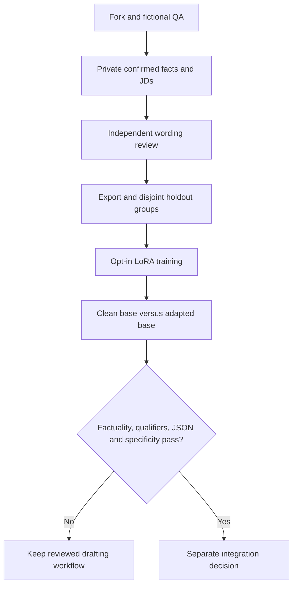

# Fork, train and evaluate your own CV-wording adapter

This optional research path uses your own local model and private workspace.
Docker, Gmail and a second model API are not required. Current experimental
adapters failed writing-quality acceptance: read the [model catalog](../models/README.md).
[Tiếng Việt](FINE_TUNING_START.vi.md).

The [private-data 8B pilot report](REAL_DATA_PILOT_QA.md) shows why a completed
training run and lower loss still require separate wording acceptance. Only
aggregate observations are published; its data and weights remain private.



## 1. Fork and verify

Use GitHub's **Fork**, then run from your clone (Python 3.11 or 3.12):

```sh
git clone https://github.com/YOUR_ACCOUNT/vietnam-career-agent-kit.git
cd vietnam-career-agent-kit
python scripts/check_repository.py
python -m unittest discover -s tests -v
python -m venv .venv-finetuning
```

Activate with `.venv-finetuning\Scripts\Activate.ps1` in PowerShell or
`source .venv-finetuning/bin/activate` on Linux/macOS. Models, private workspaces
and outputs belong outside the clone. For the measured CPU profile:

```sh
python -m pip install torch==2.10.0 --index-url https://download.pytorch.org/whl/cpu
python -m pip install -r requirements-finetuning.in
python -m pip check
python scripts/setup_qwen3.py --model-directory ../models/qwen3-06b --download
```

Review the upstream license before the explicit public download. Its helper
resolves a revision, hashes files and refuses an existing destination. The
dependency profile pins direct packages, not a complete platform lock. Training
loads local safetensors with remote code disabled; these library settings are
not an OS network sandbox. CUDA requires separate compatible provisioning.
The local trainer does not implement 4-bit QLoRA or guarantee 8B/T4 support.

## 2. Run a fictional smoke test

```sh
python scripts/demo_finetuning.py --data-dir ../fictional-lora-demo --model-directory ../models/qwen3-06b
```

Use a new empty workspace. This trains one epoch and records a short generation.
Its generated reviews are explicitly test inputs: never use this fixture helper
on real candidate data. Exit zero proves runtime completion, not an acceptable CV.

## 3. Prepare your own reviewed dataset

Follow [candidate intake](COMMUNITY_START.md) in your existing private workspace.
Confirm facts, import complete JDs, assess requirements and independently review
the exact wording under the [JD-specific contract](JD_SPECIFIC_TAILORING.md).
Then use your actual recorded job IDs:

```sh
python scripts/kit.py --data-dir ../my-private learning-export --job-id 1 --job-id 2 --output datasets/reviewed-v1
python scripts/kit.py --data-dir ../my-private learning-check --directory datasets/reviewed-v1
```

These commands require current reviews; they do not create them. Exports use
[cv-wording-json-2](LEARNING_PROMPTS.md): cited confirmed facts, assessed complete
requirements and an explicit output schema, with reviewed CV JSON as the target.
Plain bullet pairs are not a drop-in replacement. Email targets are not implemented.

At least two independent job/output groups enable a split, but do not establish
sufficient data. Review shared facts/projects and near-duplicate wording for
leakage; reserve further unseen JDs for acceptance. Conflicting CV versions,
reference candidates, identity photos and borrowed metrics are not training facts.
Submission receipts are provenance, not positive writing labels; no reply is not
rejection. Legacy campaigns use the [read-only bridge](SOURCE_MEMORY.md), not a
second tracker or invented portable reviews.

## 4. Train, compare and review

Choose new output names; existing or interrupted runs cannot be overwritten:

```sh
python -m adapters.local_finetuning --data-dir ../my-private --directory datasets/reviewed-v1 --model-directory ../models/qwen3-06b --output training/qwen3-trial-001 --target-module q_proj --target-module v_proj --epochs 2 --max-length 2048 --device cpu
python -m adapters.local_pair_generation --data-dir ../my-private --dataset datasets/reviewed-v1 --model-directory ../models/qwen3-06b --training-directory training/qwen3-trial-001 --output evaluations/qwen3-pair-001 --max-examples 10 --max-new-tokens 512
```

Inspect training `result.json` for versions, source/model hashes, sequence lengths,
time and held-out loss. In the evaluation directory, inspect `runs.json`,
`comparison.json` and `completed.json`. Partial/failure records are not completion.
Two separate model loads handle the held-out set; observed generation tokens/time
are separate from loading and total wall time. Missing host tokens/cost stay unknown.

Follow [independent output review](WORDING_EVALUATION.md): strict JSON, claim
entailment, assistance/timeframe qualifiers, employment/project context and useful
JD detail. Lower loss cannot substitute for these checks. Training does not
change candidate facts, promote the model, send email or apply for a job.

When new facts, requirements or corrections arrive, follow the
[versioned real-data refresh workflow](TRAINING_DATA_REFRESH.md) and its
[agent prompt](../prompts/REFRESH_TRAINING_DATA.md). Keep changing facts in source
retrieval; preserve old datasets and reserve untouched acceptance examples.

## 5. Share your experiment

Commit reusable source/docs and fictional fixtures through a QA-checked PR.
Publish reviewed adapter weights as explicit GitHub release assets, with a model
card, upstream license/attribution, base ID/revision, data provenance, settings,
observed environment, file checksums, evaluations and known failures. Download
base weights separately under their own license. Keep real CVs, tracker exports,
source packets, screenshots, credentials and personal-model weights private by
default. Bigger models and more epochs do not prove better admission rates.

See [local training](LOCAL_FINETUNING.md) for limits, [paired generation](LOCAL_PAIR_GENERATION.md)
for measurement scopes, and the [catalog](../models/README.md) for actual available
artifacts versus report-only experiments.

For inspection of a verified, extracted research adapter, use only fictional
input and its exact provisioned base revision. Run from the repository root:

```python
from pathlib import Path
from adapters.local_qwen import generate

record = generate(Path('../models/qwen3-06b').resolve(), [
    {'role': 'system', 'content': 'Rewrite only the supplied fact. Add no claims.'},
    {'role': 'user', 'content': 'Fictional fact: Used SQL to query a classroom dataset.'},
], adapter_directory=Path('../downloaded-research-adapter').resolve(), max_new_tokens=64)
print(record)
```

This records raw output/timing with review required; it does not import wording
into a CV. Metadata preflight verifies the selected base identity before SDK
loading. The historical release dataset alone cannot satisfy a new workspace's
`learning-check` or matched-training bindings.
