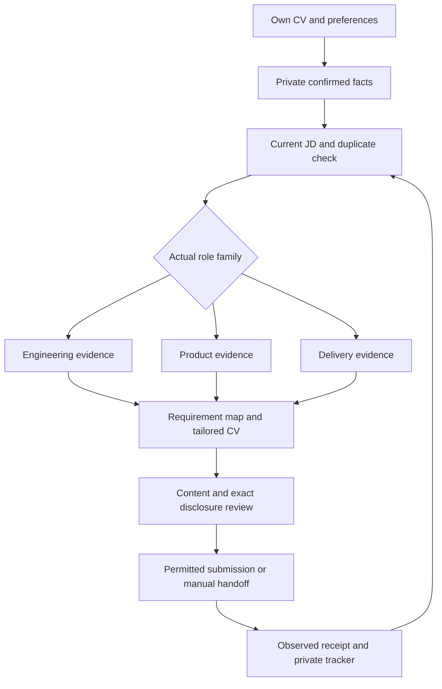

# Fork the kit and run your own job search

Made by **DUYTRUYENTHONG**, free community sharing under [MIT](../LICENSE).
Keep LICENSE, AUTHORS and third-party notices when redistributing your fork.
Your AI subscription and optional providers can have separate costs.

## First working run

1. Fork the repository, clone **your fork** and open it in your tool-enabled
   agent. Follow [CV-first setup](COMMUNITY_START.md).
2. Run `python scripts/kit.py doctor --runtime generic` and
   `python scripts/demo_slice1.py`. These do not connect accounts or apply.
   Use your installed Python 3.11+ command (`python3` or `py -3` if appropriate).
3. Attach your own CV and choose a private folder outside the clone:

   ```sh
   python scripts/kit.py --data-dir ../my-career-private start-campaign --cv "/path/to/my-cv.pdf"
   ```

4. Paste [the role-aware prompt](../prompts/ROLE_FAMILY_CAMPAIGN.md). Supply target
   roles/level, locations, employment types, current contacts, start date/notice,
   work eligibility, salary basis and previous applications. Unknown facts may
   remain unknown. Do not provide passwords or API keys in chat.
5. Verify extracted facts, assess a small real-job batch, inspect every final CV
   page and review the exact application scope before live execution. The starter
   records a path/hash; it does not itself extract facts or start submissions.
6. Reuse the same workspace and tracker. The default goal is **100 new best-fit
   confirmed applications**, not offers or an hourly promise. Explicitly changing
   your target must preserve existing history.



## Choose families, then assess each actual JD

A research report helps choose search terms. It does not establish a live
vacancy, your experience or qualification for its seniority. Keep official
employment titles and dates. A headline change alone is not tailoring.

| Target family | Prioritize supported evidence | Do not infer |
|---|---|---|
| Applied AI / LLM Application Engineer | Real API/code paths, retrieval, data contracts, validation, error handling, deployment scope and own contribution | Production RAG, model training, ownership or years from a tool list |
| AI Product Owner / Associate Product | Actual user requirements, prioritization, acceptance criteria, prototypes, feedback and adoption | Formal PO employment, budget authority, Scrum certification or business impact |
| AI Project Manager / Coordinator | Actual scope, dependencies, coordination, risks, status, testing and handover | PM title, team size, delivery budgets, PMP or sole release authority |

Engineering specialties may include marketing data, automation/agents, creative
tools, measurement/ML, lifecycle, search/content, conversational AI and platform
work. Select specialties individually; do not turn them into one mandatory stack
or describe all as existing experience. Junior/coordinator and senior ownership
require different assessments even within the same family.

## Make each CV specific

Map every requirement to direct, partial, missing or unknown evidence and source
IDs. Select the strongest relevant examples first. Where supported, explain the
problem, system/data, personal action, validation and observed result. Describe
concrete responsibilities when results were not measured; do not invent numbers.
Separate paid work, projects, prototypes and deployed features. Preserve material
AI-assistance and team-contribution scope.

Use [JD-specific tailoring](JD_SPECIFIC_TAILORING.md),
[CV enrichment](CV_ENRICHMENT.md) and the existing application-tailoring skill.
Professional reframing improves clarity; it cannot supply missing experience.
Keep gaps in a private report and propose future work via
[career growth](CAREER_GROWTH.md).

[RAG/LangChain](LANGCHAIN_RAG.md) retrieves source-bound context. Optional
[local fine-tuning](LOCAL_FINETUNING.md) uses reviewed exports and held-out
evaluation; neither creates facts, guarantees admission nor automatically
promotes CV wording. Do not label a host-written draft fine-tuned.

## Skills, browsers and faster batches

Load only the skill needed for the current step. Codex uses `AGENTS.md` and
`.agents/skills`; Claude Code has project wrappers. Other tool-enabled hosts use
the generic prompt/CLI after capability checks; native support is not presumed.
See [agent setup](AGENT_SETUP.md) and [skill management](SKILL_MANAGEMENT.md).

Read public jobs before opening application forms. Explicit employer-linked
boards can use [Greenhouse discovery](BULK_DISCOVERY.md) or experimental
[Ashby discovery](ASHBY_DISCOVERY.md). Optional [TinyFish](TINYFISH_SETUP.md)
has separate setup. Start with one verified application lane; increase only with
independent tested sessions. Ten tabs sharing one login are not ten safe writers.
One coordinator owns the tracker; reconcile uncertain outcomes before retries.
See [parallel applications](PARALLEL_APPLICATIONS.md).

Live tools retain platform rules, disclosure scope and required host
confirmations. A goal, prompt, hook or standing scope cannot override them.
Unsupported actions remain prepared packages or manual handoffs.

## Read results, update and share

```sh
python scripts/kit.py --data-dir ../my-career-private tracker --format md --output reports/tracker.md
python scripts/kit.py --data-dir ../my-career-private resume
```

Count unique observed confirmations; keep uncertain attempts, recruiter replies,
interviews and CV updates separate. A sent message is not inbox-delivery proof.
Public [campaign results](CAMPAIGN_RESULTS.md) are an anonymized case study,
not a new user's tracker or a guaranteed hiring result.

Keep CVs, messages, receipts, sessions, keys, goals and model weights outside Git.
Share source and fictional examples. Run checks in `AGENTS.md`, inspect staged
files and use a protected PR before publishing fork changes. Follow the
[change workflow](change-workflow.md). Updates preserve your external private
workspace and its history.
