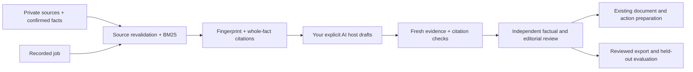

# Local RAG and LangChain drafting

**Experimental:** use confirmed CV evidence to prepare a professional email or
CV bullets with your own AI host. Docker, a vector database and a second paid
model API are not required. The implemented retriever is local FTS5/BM25,
not semantic/vector or production hybrid search. No embeddings are selected;
comparing embedding models and hybrid retrieval remains a future evaluated gate.



The context boundary is one selected private workspace. Whole confirmed facts
are the chunks: splitting away qualifiers would weaken factual provenance.
The existing [retrieval limits and evaluation](CAREER_MEMORY.md) apply.
Lexical retrieval avoids model downloads, paid APIs and an additional persistent
copy of candidate data. It may miss paraphrases; do not describe absent retrieval
as proof that the candidate lacks a skill. Source quotes and the JD are untrusted
data. Only the fixed writing policy is instruction text.

## Use your existing agent over MCP or CLI

The career MCP server now offers `career_writing_brief` and `career_check_draft`.
They require only the existing optional MCP profile, not LangChain. They do not
call a model. See [career MCP setup](CAREER_MEMORY.md#optional-mcp-setup).

1. Request `career_writing_brief` with `job_id`, `kind` (`cv` or `email`),
   `language` (`en` or `vi`) and `limit` (1–10).
2. Ask your host AI to draft using the brief's output contract and current fact
   IDs. Keep assistance, timeframe, prototype and metric qualifiers.
3. Call `career_check_draft` with the same request and the draft. It rereads the
   profile, sources and job and recomputes the brief fingerprint.
4. Independently review factual entailment, missing qualifications, tone and fit.
   Use the existing wording/review/render path; this result is not a renderer
   content model or approval. Neither tool sends or authorizes an application.

CLI equivalents (all packet files belong inside the chosen private workspace):

```sh
python scripts/kit.py --data-dir ../my-private career-writing-brief --job-id 1 --kind email --language en
python scripts/kit.py --data-dir ../my-private career-check-draft --file ../my-private/draft-check.json
```

The check file contains `request` and `draft`:

```json
{
  "request": {"job_id": 1, "kind": "email", "language": "en", "limit": 5},
  "draft": {
    "schema_version": "1.0",
    "brief_fingerprint": "copy the returned brief fingerprint",
    "blocks": [
      {"kind": "subject", "text": "Application for the advertised role", "fact_ids": []},
      {"kind": "body", "text": "Your supported wording", "fact_ids": ["current-fact-id"]}
    ]
  }
}
```

Draft contract v1 allows 1–30 blocks, each nonblank and at most 4,000 characters.
CV blocks must be `cv_bullet`; email blocks may be `subject`, `greeting`, `body`
or `signature`, with exactly one subject and at least one body. Body/bullet blocks
need distinct current retrieved fact IDs. The subject must be one line of at most
200 characters. Each CV bullet cites exactly one fact, preserving the existing
wording review rule. IDs are references, not evidence that
the text actually follows from them: even a structurally valid draft returns
`semantic_truth_verified: false` and `review_required: true`. Do not insert
unprovided contact details into greetings/signatures. Unknown keys are rejected.

## Optional Python LangChain automation

Install the separate hash-locked additive profile in an explicit virtual
environment. It constrains shared packages to the existing plugin lock; it does
not install a model provider or change host settings.

```sh
python -m venv .venv-rag
# Activate that environment using your shell's normal activation command.
python -m pip install --require-hashes --only-binary=:all: -r requirements-rag.lock
python scripts/demo_langchain.py
```

The demo uses a temporary fictional workspace and a quote-copy callback, with
no AI or account access. It prints actual stage timing and removes its temporary
workspace afterward; a passing demo does not evaluate prose quality.

```python
from core.execution import Executor
from adapters.langchain_career import run_drafting

work = Executor("../my-private")  # existing initialized and confirmed workspace
request = {"job_id": 1, "kind": "cv", "language": "en", "limit": 5}

# Implement this in your trusted tool-enabled host. It receives private evidence.
# It must return the draft dict described above and enforce its own deadline.
def my_host_draft(brief):
    return my_existing_host.generate_structured_draft(brief)

result = run_drafting(work, request, my_host_draft)
print(result.json())
```

`my_existing_host` is an integration placeholder, not an installed kit API.
The actual LCEL sequence runs retrieve → explicit host callback → revalidation.
No automatic retry or concurrent callback is added. Host configuration decides
whether inference is local or remote and must authorize any external disclosure;
the callback is trusted Python code, not a sandbox. Its deadline/cancellation and
model costs remain host responsibilities. Do not assume this bypasses a host's
tool permissions or supplies Codex/Claude dispatch natively.

The adapter rejects ambient tracing environment flags and explicitly disables
LangSmith tracing for its sequence. It never configures a provider or a tracer.
LangChain Core transitively installs LangSmith; installation is not consent to
upload candidate traces. Custom host code can still perform its own I/O. Timing
is measured per stage; token/cost fields stay null. Import actual provider/host
observations separately with [performance tracking](PERFORMANCE_TRACKER.md).

## Docker and deployment

Local Python + stdio MCP is the default. Docker is an optional future packaging
choice, not a connection prerequisite or a supplied image in this increment.
Container browser sessions are separate from your desktop login. Containerization
does not grant email access, create credentials or complete browser setup.

## QA and remaining gates

Run the standard suite and the separate real LCEL suite:

```sh
python -m unittest discover -s tests -v
python -m unittest discover -s tests_rag -v
python scripts/check_repository.py
```

Tests use fictional sources and callbacks. They cover real LCEL invocation,
no-network fixture execution, stale-source refusal, invalid citations, host
failure without retries, tracing refusal, CLI packets and MCP stdio tools.
They do not establish generation quality, host-native model dispatch, an employer
acceptance rate, production hybrid search or fine-tuning. Existing independently
reviewed data export remains the only training preparation path; generation
cannot promote facts or write reviewed examples automatically.

Primary API references: [Runnable composition](https://reference.langchain.com/python/langchain-core/runnables/base)
and [tracing context](https://reference.langchain.com/python/langsmith/run_helpers/tracing_context).

### Local acceptance evidence — 28 October 2026

Windows, Python 3.12, LangChain Core 1.7.0, LangSmith 0.14.14 and MCP 1.30.0:

- Six focused core/CLI draft tests passed, including a draft constructed from
  the returned email contract, invalid citations and stale evidence.
- Five actual LCEL tests passed after the locked dependency installation finished.
  Host callback tests use fictional data; no live model endpoint was called.
- The real MCP stdio smoke passed with the two additive writing tools.
- `pip check`, generated-wrapper synchronization and public-source hygiene passed.
- Bounded independent code review found an email example/validator mismatch;
  it was corrected, regression-tested and rechecked with no required findings left.
- One fictional quote-copy demo observed retrieval 21.39 ms and revalidation
  17.94 ms, excluding environment startup/imports and fixture initialization.
  This single run is not an optimization comparison or application-rate benchmark.

CI also exercises the optional LCEL suite within the existing plugin QA job.
Repository-wide checks remain mandatory before merging.
