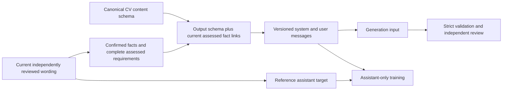

# Explicit generation inputs for reviewed CV wording

Status: **Experimental export contract**, not an accepted default model.
The local paired Qwen3 test returned fenced, incompatible JSON from both base
and one-step LoRA models. A vague request for "language/sections" did not tell
the generator the complete nested output shape. This change supplies that shape
and the current assessed evidence; improved model output remains unproven.

## Version and compatibility

| Export manifest | Generation prompt | Validation |
|---|---|---|
| 1.0, no wording_prompt_version | Original cv-wording-json-1 instructions and input | Rebuild exact legacy examples from current reviews; never rewrite export bytes |
| 1.1, wording_prompt_version=cv-wording-json-2 | Explicit output schema and assessed fact links | Rebuild current versioned inputs/targets and recheck exact bytes, provenance and splits |
| Any other combination | Unsupported | Stop before training/evaluation |

`learning-export` creates only new 1.1 directories. Its CLI/MCP arguments and
output envelope remain unchanged. The statement content schema is still **2.0**;
that is separate from the dataset manifest and prompt versions. Existing model
weights/adapters are not rewritten, converted or promoted. An adapter trained
under a legacy prompt is not evidence of quality under a new prompt.

If sources, reviews or a supported output contract change, recheck the export.
Prepare a new independently reviewed export when stale; never edit the old JSONL
or recompute hashes to bless changed training data. Legacy validation keeps the
original system/user format and all existing source/review checks.

## What the generator receives

The new system prompt requires one JSON object, no Markdown fences/commentary,
one source fact per statement, exact source locators, matching history scopes,
pending review status, preserved qualifiers and only assessed direct/partial
requirement links. Text in facts/JDs remains untrusted evidence data.

The user JSON includes the existing language, role, complete requirements and
selected confirmed facts, plus:

- `output_schema`: the language/sections projection of the canonical
  `schemas/cv-content-v2.schema.json`, with section/group/statement/string
  definitions and additional-properties restrictions. It contains no target CV.
- `assessed_evidence`: current requirement_id, match and fact_ids entries. A
  missing match never becomes a candidate qualification.

The reference assistant target stays the exact independently reviewed wording.
For held-out generation pass **only system/user messages**. Do not show the
reference target to the model. Use identical prompt/decoding settings for paired
base/adapter comparisons and record actual model/adapter identities.

## Acceptance and limits

New inputs use more tokens. Measure prompt/target lengths on the chosen tokenizer;
increase the explicitly bounded local max length only when hardware permits.
No automatic truncation, extra model API or schema-repair pass is added.
The prompt is not a constrained decoder and does not guarantee valid JSON,
semantic truth, useful specificity, independence of review or better CVs.
Existing deterministic wording checks and independent factual/editorial review
remain necessary; use the [paired evaluation report](WORDING_EVALUATION.md).

The initial CPU observation used Qwen3-0.6B revision
`c1899de289a04d12100db370d81485cdf75e47ca`, four OMP/MKL threads and a single
fictional held-out example. Legacy-prompt base generation used 418 input / 380
output tokens and 72,573.824 ms; LoRA used 418 / 306 and 88,419.643 ms, excluding
loading. Both were invalid. These are observed failed-fixture results, not a
candidate-specific quality estimate, statistically independent benchmark or
proof that prompt specificity was the sole cause. The fixture reviews were
synthetic test data, not independent candidate review. No model was promoted.

A follow-up **version 2 base-model diagnostic** on that fictional held-out job
used 1,133 input tokens and reached the 768-output-token cap. It still returned
fenced, incomplete, incompatible JSON. Observed generation time was 365,604.735 ms,
excluding loading, with four CPU threads while repository tests also ran. This
is not a comparable speed benchmark. Supplying a schema did not make this small
model usable; no automatic continuation, JSON repair or candidate use followed.

## Maintainer QA — 31 October 2026

The Windows/Python 3.12.14 standard-library suite passed **329 tests** in
737.844 seconds while the optional CPU diagnostic also ran. Four new regressions
cover schema/evidence inputs, unchanged legacy exports, unsupported versions and
rehashed schema tampering. Repository hygiene (300 UTF-8 sources), ten shared
skills/adapters, generated-wrapper synchronization and the disposable fictional
CLI preparation demo passed. These checks verify the export contract and existing
behavior, not better generated CVs or live application performance. The six
protected-main CI checks remain the merge gate.
