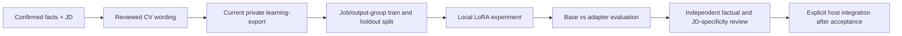

# Local CV-wording LoRA experiments

The default task remains `cv-wording`. Optional `--task career-growth` consumes
the separate [reviewed development-plan export](CAREER_GROWTH.md); its validator
reconstructs current plan/review/assessment bindings. The tasks cannot be silently
interchanged. Growth tests cover preparation boundaries, not a trained coaching
model's quality or automatic promotion.

Experimental, opt-in `adapters/local_finetuning.py` trains an adapter over the
existing independently reviewed `learning-export` dataset. It does not modify
the standard-library core, confirmation rules, candidate facts or application
ledger. A trained model proposes wording; it is never an authority on experience.

[Actual CPU smoke evidence](LOCAL_FINETUNING_QA.md): training/inference ran, but
the generated fictional bullet added an unsupported claim and failed strict JSON.
The local model is **not accepted as a default tailoring model**.

New exports use the [explicit versioned generation contract](LEARNING_PROMPTS.md).
The additional schema and assessed links increase prompt tokens. Recheck actual
sequence lengths; the runner rejects rather than truncates oversized examples.
An unchanged legacy export remains valid under its original prompt.



## Model choice

Start with **Qwen3-0.6B** to test CPU setup and the training pipeline; do not assume
it has adequate CV-writing quality. **Qwen3-4B-Instruct-2507** is a candidate for
larger English/Vietnamese instruction-following experiments, not a benchmarked
winner. Actual memory depends on precision, sequence length and optimizer state.
This initial runner supports CPU and CUDA explicitly, not Intel XPU or QLoRA.
Use locally reviewed safetensors and tokenizer files. No model is bundled,
downloaded by training, or selected automatically. Respect the model's license.

## Setup and run

Use an isolated Python environment. Optional dependencies are PyTorch, Transformers
and PEFT, with their transitive dependencies. Installation and a separate explicit
public-model download require network access; the training entry point uses
`local_files_only=True`, disables Hub telemetry and remote custom code, requires
safetensors, and never calls a model API or Hub upload. These library settings
are not an OS-level network sandbox. Private datasets/adapters can contain personal
information; keep them in the external private workspace and outside public Git.

`requirements-finetuning.in` pins the three direct experimental dependencies; it
is not a complete hashed lock. Resolve and inspect the platform-specific closure
before distributing a production environment. No dependencies are auto-installed
by a skill or by the trainer. For CPU-only setup:

```sh
python -m venv .venv-finetuning
# Activate that environment using your shell's normal command, then:
python -m pip install torch==2.10.0 --index-url https://download.pytorch.org/whl/cpu
python -m pip install -r requirements-finetuning.in
python scripts/setup_qwen3.py --model-directory ../models/qwen3-06b --download
```

The explicit setup command downloads only public Qwen model/tokenizer/document
files, pins the resolved Hub revision and hashes downloaded files. It refuses
existing destinations and anything inside the source checkout. Failed downloads
leave incomplete folders, not a usable completion manifest. Download does not
train or read any candidate workspace. Without `--download`, setup prints a plan.

From the repository root, after exporting **at least two independent reviewed
job/output groups** and provisioning the optional environment/model:

```sh
python scripts/kit.py --data-dir ../my-private learning-check --directory datasets/reviewed-v1
python -m adapters.local_finetuning --data-dir ../my-private \
  --directory datasets/reviewed-v1 --model-directory ../models/qwen3-local \
  --output training/qwen3-trial-001 --target-module q_proj --target-module v_proj \
  --epochs 2 --max-length 2048 --device cpu
```

The two-group minimum only enables a disjoint split: it is **not evidence of
sufficient training data**. Do not generate unreviewed filler to meet a quota.
Export only reviewed examples with complete JD mapping and source-backed details.
Contact headers are omitted by the exporter, but facts can still identify people.
The split groups job revisions/exact output duplicates; semantic leakage is still
possible and needs dataset review. Email training examples are not implemented.

Check that the complete raw JD and its structured requirements describe the same
job before dataset review. Structural/source-hash checks cannot prove semantic
agreement. The fictional wording seed previously retained a SQL/documentation JD
while replacing its structured requirements with role-specific skills and a
certification preference. New seeds now align both representations for all three
demo roles; a regression exercises them without loading a model. Keep historical
exports and failed runs unchanged. A corrected fixture needs a new reviewed export
and separately recorded run; it does not retroactively improve old results or
establish candidate-model quality.

The runner revalidates current source/review fingerprints, rejects stale exports,
refuses existing run directories and reports token-length distributions. Prompt
tokens are masked; assistant tokens supply the loss. Overlength examples or
non-prefix-compatible chat templates fail rather than silently losing source/JD
details. Defaults: rank8, alpha16, dropout0.05, AdamW weight decay0.01, batch1,
learning rate0.0002, 10% warmup/linear decay, seed42, two epochs. These are pilot
settings requiring tuning, not an optimal recipe or large-model memory guarantee.

## Results and acceptance

After offline quality acceptance, [source-bound CV outcome feedback](CV_OUTCOMES.md)
can describe actual recruitment observations by the frozen submitted PDF hash.
It is a separate measurement stream, not training data, a model leaderboard or
evidence of causal improvement. Preserve observation windows and comparable job
cohorts; never optimize on acknowledgments as if they were positive screening.

Use the [offline held-out wording comparison](WORDING_EVALUATION.md) to compare
recorded base/adapter generations with strict output checks and hash-bound
independent reviews. This supplements loss metrics; it does not promote a model.
The optional [paired CPU runner](LOCAL_PAIR_GENERATION.md) generates both variants
on every held-out system/user prompt from the matching export, with observed
tokens, generation-only time and separate load-inclusive wall time.

Reusable agent prompt:

> Use the application-tailoring skill and JD-specific detail contract. Inspect my
> explicitly selected private workspace and local Qwen directory. Validate an
> existing independently reviewed CV-wording export; do not manufacture reviews
> or examples. Run a bounded local LoRA experiment in a new private training
> directory. Compare the unchanged base model against the adapter on held-out
> groups. Report only observed versions, model identity, token lengths, loss and
> timing; distinguish runtime success from writing quality. Independently review
> unseen-JD drafts for factuality, preserved qualifiers, complete requirement
> mapping and specific supported actions/tools/results. Keep gaps explicit and
> reject regressions. Do not promote the model, change facts or submit applications
> as a consequence of training. If compute/data is insufficient, report the exact
> missing prerequisite and preserve the working base-model workflow.

Only `training/<run>/result.json` marks completion. It records dataset fingerprint,
model config hash, dependency versions, settings, observed training/evaluation time,
base and per-epoch held-out assistant-token NLL/perplexity. `adapter/` contains
LoRA weights and tokenizer files. Interrupted/non-finite/stale-evidence failures
leave an incomplete directory; inspect it and choose a new run name, never resume
automatically. No auto-retry, checkpoint merge, model serving or promotion exists.

Teacher-forced evaluation time is **not generation latency**. NLL/perplexity is
not factual correctness, JD coverage, writing quality or hiring success. Before
integrating a trained adapter, compare base/adapter generated drafts on unseen
JDs with the existing CV-quality rubric: supported claims, qualifier preservation,
requirement coverage, concrete relevant detail, natural language, and render quality.
Measure actual generation latency separately. Reject regressions, preserve the
base-model fallback and reuse current evidence validation plus independent review.
Training never establishes a new candidate skill or sends a CV.

`adapters.local_qwen.generate` supplies a separate explicit CPU inference function
for a provisioned base model and optional local adapter. It returns raw text plus
observed input/output tokens and generation time (excluding model loading).
It does not translate/import the response into a reviewed CV or call the host
automatically. Pass only a source-grounded prompt; validate the output with the
existing wording contract, then perform independent review. No automatic retry
or repair of rejected/invalid JSON is performed.

For a real-library smoke test with **fictional** independently reviewed fixtures:

```sh
python scripts/demo_finetuning.py --data-dir ../fictional-lora-qa \
  --model-directory ../models/qwen3-06b
```

This performs one epoch, records held-out loss and generates a short fictional
bullet with the resulting adapter. The synthetic review helper is only a test
fixture; never run it on a real candidate's CV or count its output as quality proof.

## QA scope and references

Standard-library tests cover prompt masking, overlength rejection, nonfinite losses,
path isolation, stale reviews and changed-export rejection without downloading or
training a model. They do not certify Hugging Face compatibility, model quality,
GPU performance or a successful real training run. Optional runtime evidence must
state the exact versions/model revision, hardware, dataset and actual outcome.

Official references reviewed 30 October 2026:
[PEFT LoRA quicktour](https://huggingface.co/docs/peft/quicktour),
[Transformers chat templates](https://huggingface.co/docs/transformers/v5.10.1/chat_templating),
[Qwen3 model family](https://github.com/QwenLM/Qwen3),
[Qwen3-0.6B model card](https://huggingface.co/Qwen/Qwen3-0.6B).
Original implementation; no upstream skill/example copied or installer executed.
