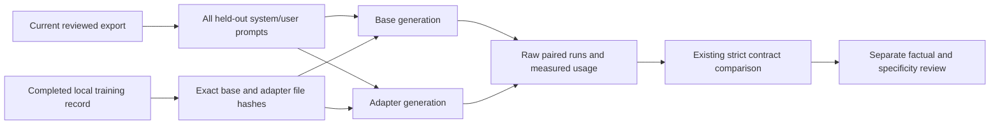

# Generate matched local base/LoRA evaluation records

**Experimental, opt-in CPU runner.** Generate recorded outputs for the existing
[held-out wording comparison](WORDING_EVALUATION.md) without hand-assembling
prompts or passing reference answers to the model. It reuses the existing local
inference function and evaluation validator. It never trains, downloads, repairs
JSON, creates positive reviews, imports wording or promotes a model.

[Observed runtime and QA](LOCAL_PAIR_QA.md): the fictional legacy-prompt CPU
comparison completed, but both model outputs failed strict JSON validation.



## Run with an already provisioned environment

Use the optional environment/model from [local fine-tuning](LOCAL_FINETUNING.md).
Choose an existing completed `training/` run and its **same current reviewed CV
export**. This is a matched in-export holdout experiment, not a generic external
OOD benchmark. Unchanged legacy training records without a task label retain
the original CV-wording meaning; explicit career-growth runs are rejected.

```sh
python -m adapters.local_pair_generation \
  --data-dir ../my-private --dataset datasets/reviewed-v1 \
  --model-directory ../models/qwen3-local \
  --training-directory training/qwen3-trial-001 \
  --output evaluations/qwen3-pair-001 --max-examples 10 --max-new-tokens 512
```

The runner checks the training record's export fingerprint and exact local base
file hashes, then fingerprints the selected adapter. Every held-out example runs
once with each variant, using byte-equivalent system/user messages and the same
greedy, thinking-disabled decoding settings. The assistant reference is omitted.
The whole held-out set must fit the explicit example cap: no silent subset.

Limits: 1–50 maximum examples, 1–2,048 generated tokens per call, and existing
inference's 30,000-character prompt / 8,192 prompt-plus-output token bounds.
Defaults are 10 examples / 512 generated tokens. Overlength input fails without
truncation. Token limits bound generation length, not elapsed time; local model
loading/CPU execution may still be slow. No background service or native agent
switching is installed. CPU only; this wrapper does not add CUDA or quantization.

## Private artifacts and measurements

Use a **new** `evaluations/<name>/` inside the selected workspace:

- `provenance.json`: source export identity, prompt hashes, base/adapter file
  hashes, training-result hash, exact bounds and decoding configuration.
- `partial.json`: last completed generation evidence. A failure may leave only
  partial results; this file is not accepted as a completed paired report.
- `runs.json`: exactly the existing `base` / `adapter` recorded-output contract,
  including raw unmodified text and observed input/output tokens and generation
  milliseconds. The existing inference timer excludes model loading.
- `comparison.json`: existing strict JSON/source-link checks and exact-reference
  matching. Semantic scores remain null until all outputs have explicit reviews.
- `completed.json`: final runtime marker and artifact hashes, per-call wall time
  including model load/imports and total runner wall time including validation
  and hashing. Runtime completion can coexist with **zero valid model outputs**.
- `failure.json`: error and completed-call timing if the reserved run fails. A
  process interruption can leave an incomplete folder without this error file.

Each call loads the model independently. Generation-only time, per-call wall time
and total runner time have different scopes; do not add them together or label
them equivalent. No model/API cost or Codex subscription savings are inferred.
There are no provider calls. Review identities and positive factuality labels are
never generated by this runner.

## Review and failure handling

Inspect raw drafts against the complete current JD and source packet, preferably
blind before variant identities. Add exact-output-bound review records to a
**separate copy** of `runs.json`, then use `scripts/evaluate_wording.py` to create
a new report. Preserve the original runs and completion hashes. Existing review
rules require factuality, assistance/timeframe qualifiers, useful specificity and
an explanation; exact-reference matching is not a writing-quality score.

Current source/review/export bindings are rechecked before each call and after
generation. Base files, adapter files and training record are rehashed before
completion. Stale evidence, changed identities, missing files, inference failures
or invalid measurements leave no completion marker. Existing or incomplete run
directories cannot be overwritten/resumed; inspect them and select a new name.
No automatic retry is performed.

Hashes bind observed bytes, not the authenticity of a training record, semantic
truth or review independence. Filesystem checks are not an atomic snapshot or
an OS network sandbox. Optional libraries retain their existing offline/local
file settings; no credentials, account access or disclosure authority is added.
This runner does not establish generalization, a better CV admission rate, native
host integration or an accepted default Qwen model. Keep private records outside
Git and preserve the current base/host workflow until separate acceptance.

Original orchestration; no third-party source copied or dependency added.
Primary API references checked 31 October 2026:
[Transformers chat templates](https://huggingface.co/docs/transformers/v4.57.1/chat_templating)
and [PEFT model loading](https://huggingface.co/docs/peft/v0.18.0/en/package_reference/peft_model).
Existing `local_qwen.generate` continues to own those library calls.

## QA scope

Run `python -m unittest discover -s tests -p test_local_pair_generation.py -v`
for fictional orchestration checks, then the full suite required by `AGENTS.md`.
The focused tests patch model inference: matched held-out prompts, raw JSON
failures, caps without silent sampling, current training/base identity, review
revocation, private paths, incomplete-run retention and refusal to overwrite.
These tests do not establish real inference speed, model quality, independent
semantic review or a higher interview rate. A separate actual local-model run
must report its model/environment, raw outputs and measured timing scopes.
