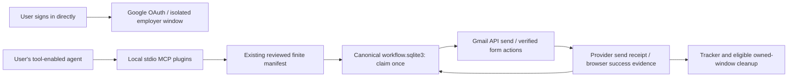

# Local email and application browser plugins

New user? [Clone/fork walkthrough](START_HERE.md) · [System models and diagrams](SYSTEM_MODELS.md).

Made by **DUYTRUYENTHONG**, MIT licensed, free community sharing.
These are optional desktop MCP servers, not hosted services or public-directory
listings. Each user runs them on their own computer and private workspace.
No second model API, subscription to this kit, or candidate cloud database is added.
Google/browser providers and the user's agent have their own access requirements.

The opt-in third [career server](CAREER_MEMORY.md) adds local confirmed-fact
retrieval, professional email briefs, reviewed dataset exports and observed
model-usage reporting. Add `--include-career` to configuration generation; the
default two-server setup stays compatible. Career-only use needs no browser or
Gmail authorization. It offers no submission, training or approval tool.



## Install in a separate environment

Requires Python 3.11+ and an existing kit workspace outside the clone. The initial
locked dependency profile is Windows/Python 3.12; do not treat it as a verified
Linux/macOS dependency closure. The standard-library core is unchanged.

```powershell
python -m venv .venv-plugins
.venv-plugins/Scripts/python -m pip install --require-hashes --only-binary=:all: -r requirements-plugins.lock
.venv-plugins/Scripts/python -m playwright install chromium
.venv-plugins/Scripts/python scripts/plugin_config.py --data-dir ../my-private-workspace --python .venv-plugins/Scripts/python.exe
```

Initialize a new workspace separately with `scripts/kit.py init`; never point the
plugin at another person's workspace or the public clone. Generation writes only
`configured-plugins/` inside the selected private workspace. It does not install,
enable plugins, trust hooks, modify global settings, grant access or approve jobs.
Keep the clone and selected interpreter at their configured paths.

Use the generated `mcp-servers.example.json` with a host supporting local stdio MCP
(Claude Code or another identified compatible agent). For Codex, review/copy the
generated `codex.example.toml` server entries into your chosen host configuration,
or add the generated `configured-plugins` directory as a local marketplace using
`codex plugin marketplace add <directory>`. Install its two plugins from that
marketplace in a supported desktop client, then start a new chat. Native marketplace
discovery and host-specific approval UI require testing in that installed host;
they are not established by an MCP protocol test. Grokbot/Muse require an actual
local MCP/tool runtime; the kit does not invent native integrations for them.

The server commands can also be run directly (stdio is a protocol, not a chat UI):

```sh
python scripts/serve_plugin.py email --data-dir ../my-private-workspace
python scripts/serve_plugin.py browser --data-dir ../my-private-workspace
```

## Connect a Gmail account

1. In your Google Cloud project, enable Gmail API and configure the OAuth consent
   screen for your own users. Create a **Desktop app** OAuth client. Add test users
   if your consent screen is in testing. Public distribution of a shared OAuth
   application may require Google's verification; a GitHub push does not provide it.
2. Save its downloaded client JSON as
   `credentials/google-desktop-client.json` in your private workspace. Never add it
   to the repository or give it to the model as prompt text.
3. Ask your agent to call `email_connect`. Google opens the normal browser flow.
   Select the account you intend to send from and complete sign-in yourself.
4. Call `email_account` to verify the selected identity. The account can differ
   from your agent-login account. Separate named connections can be launched using
   `serve_plugin.py ... --connection <label>`; a manifest must match that mailbox.

The requested scopes are OpenID/email identity and **gmail.send**. Inbox reading,
deletion and alias impersonation are not implemented. OAuth refresh tokens stay
in a supported OS credential vault; no plaintext fallback. `email_disconnect`
removes that local credential; revoke the grant separately in Google account
settings if desired. Windows Credential Manager is the intended first platform;
other supported vault backends must be verified on the actual OS.

## Tailor, review and send a finite batch

Prepare evidence, fit assessment, rendered PDF and page review with the existing
kit. In a normal version-1 campaign plan set:

```json
{
  "bridge_id": "gmail-api-local",
  "runtime_minutes": 30
}
```

That object is the plan's `execution` field. Each entry retains its employer
recruitment-source `destination` and permission evidence. Its `answers` must
contain **exactly** `sender`, `to`, `subject`, `body`, using the existing answer
provenance contract. Put the verified published employer mailbox in `to`; the
exact address, message and reviewed PDF are part of the existing manifest review.
The PDF must be at most 20 MiB. CC/BCC, extra files and consent acceptance through
this email adapter are unsupported. Do not mark generated text candidate-confirmed
without the candidate's review. This mechanism preserves the existing factual checks.

Approve the exact finite manifest using the existing review/standing-scope flow.
The plugin intentionally has **no approval-creation tool**. Then call:

1. `email_start(manifest_fingerprint)` — checks scope and connected mailbox.
2. `email_send_next(run_id)` — sends one entry and saves an immutable Gmail API
   acknowledgement in the existing execution tables. Repeat for remaining entries
   within the same cap/deadline. No duplicate question for unchanged valid scope.
3. `campaign_tracker()` — shows actual canonical outcomes.

An acknowledgement establishes **sending**, not employer delivery or absence of
later bounces. No inbox scope is requested to make stronger claims. A timeout,
lost response or process crash leaves a durable uncertain attempt; no automatic
resend is offered. The same job cannot subsequently receive a browser attempt.
Reconnect/switching accounts does not renew authority or clear attempts.

## Local employer application windows

Use `execution.bridge_id: "local-playwright"` and a private form-plan JSON with
one mapping per manifest job. The format is the existing
[single-page form plan](TINYFISH_BROWSER.md). Employer/requisition text, destination,
fields, consent text, PDF bytes and final confirmation are verified. Only permitted
HTTPS employer origins are supported; manual-only platform restrictions remain.

1. `browser_start(fingerprint, forms_path, workers=3)` validates exact mappings
   and starts the canonical parallel run, up to ten lanes.
2. `browser_open_login(run_id, job_id)` opens one isolated visible Chromium
   window for that job. Open every lane before executing. If needed, log in
   directly yourself, staying within that employer origin. No password/OTP tool,
   personal Chrome profile, cookie export/import or stored login-state file exists.
3. `browser_execute(run_id)` runs the existing bounded scheduler. Windows remain
   independent; the coordinator alone commits receipts. Confirmed owned windows
   are eligible for the existing cleanup protocol after receipt recording.
4. `browser_status` and `campaign_tracker` show pending/uncertain/manual outcomes.

Single-page same-origin forms only: cross-origin SSO, embedded frames, redirecting
flows, new controls/terms and CAPTCHA require handoff. Login alone does not approve
disclosure or terms. The plugin stops rather than solving CAPTCHA or accepting new
agreements. Lost sessions are not recreated automatically. Uncertain/manual windows
remain open while the process is alive; user closes them after reconciliation.
Restarting the MCP process loses those in-memory logins and requires manual recovery.

## Verification and release boundaries

Run core tests plus `tests_plugins` with the optional environment. Tests use only
fictional candidates, fake provider responses, MCP stdio and local/mocked pages.
No real email or employer application is sent during maintainer QA. See
[plugin QA evidence](LOCAL_PLUGINS_QA.md). Live Google consent/vault/provider sending
and real employer compatibility still require user-specific acceptance testing.

Deploying this kit means publishing the source and installable local configuration
generator. It does not start a public service, install into a user's account or
publish to the universal plugin directory. The core tracker and fit requirements
remain authoritative; no live 100/hour performance result is claimed.

## Primary references

- [Google Desktop OAuth, PKCE and loopback sign-in](https://developers.google.com/identity/protocols/oauth2/native-app)
- [Gmail messages.send](https://developers.google.com/workspace/gmail/api/reference/rest/v1/users.messages/send)
- [MCP Python SDK maintenance line](https://github.com/modelcontextprotocol/python-sdk/tree/v1.30.0)
- [Playwright authentication isolation and state sensitivity](https://playwright.dev/python/docs/auth)
- [OpenAI plugin packaging and local marketplaces](https://developers.openai.com/plugins/build/plugins)

These sources guide original implementation; no upstream sample code is copied.
