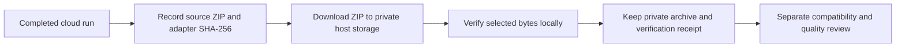

# Preserve a downloaded training checkpoint

Colab session storage is temporary. A saved notebook can retain successful logs
while its adapter files have already disappeared. Treat a run as locally
recoverable only after the downloaded bytes have been verified on the host.



## Verify an explicit local ZIP

Record the ZIP hash, exact adapter member path and tensor hash from the completed
run before ending its runtime. Obtain these expected values separately from the
host archive being checked. Hashing an unknown ZIP twice does not establish its
provenance. The trusted source receipt should also identify the model revision,
dataset hashes, training settings and actual completion status.

From the checkout, substitute those recorded values:

```sh
python scripts/verify_training_archive.py --archive ../private/run.zip --sha256 EXPECTED_ZIP_SHA256 --adapter-entry fictional-run/adapter/adapter_model.safetensors --adapter-sha256 EXPECTED_TENSOR_SHA256 --output ../private/checkpoint-receipt.json
```

The output must be a new `.json` file outside the checkout. Both flat and nested
adapter layouts are supported; use the exact member path. The command reads the
ZIP without extraction or model SDK imports. It checks the full archive hash,
the selected tensor hash and adjacent causal LoRA metadata, then rechecks the
archive bytes and file identity before writing its receipt. It rejects malformed
or oversized inputs, unsafe member paths, case collisions, symlinks, encryption,
duplicate metadata keys and nonfinite metadata. Limits: 1 GiB archive, 1 GiB total
declared uncompressed size, 200 members, a 1 MiB central directory and 1 MiB
metadata. The directory is checked before the ZIP library allocates members.
Only classic single-disk ZIP directories with stored/DEFLATE entries are
supported; ZIP64 directory lookup, signed directories and split archives fail
closed. Layout references: [PKWARE APPNOTE 6.3.10](https://pkware.cachefly.net/webdocs/casestudies/APPNOTE.TXT),
sections 4.3.12 and 4.3.16. No third-party implementation is copied.

Keep the source receipt, private ZIP and [versioned verification receipt](../schemas/model-archive.schema.json)
together. Reverify before loading after moving or modifying files. Only then
consider discarding temporary cloud outputs; this command never deletes them.

## What this proves

Success means the host ZIP and selected adapter bytes match the expected hashes
at verification time. It does not authenticate the publisher, validate tensor
shapes, check every other member's CRC, prove training completion, accept CV
wording or promote a model. The receipt explicitly leaves training and quality
`not_assessed`. Continue with [local adapter identity checks](LOCAL_FINETUNING.md#check-an-adapter-before-loading-weights)
and independent factual/JD-specific evaluation before any live use.

This is an Experimental offline utility tested with fictional bytes. It does not
implement Colab upload/download, cloud recovery, Drive access, training or an
application bridge. A missing checkpoint needs a separately scoped recovery;
notebook output alone cannot restore weights. Private datasets and adapters stay
outside public Git and community releases. Failures exit with code 2 and do not
write a success receipt or change the campaign ledger.
