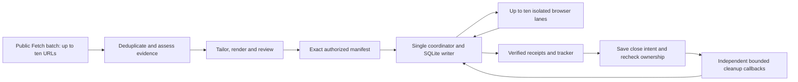

# Ten-lane applications and public research

`run_parallel_with_bridge(..., action_timeout_seconds=120)` now enforces finite
per-action deadlines, bounded by run expiry for writes. Stalled lanes remain
canonical pending requests and retain capacity; other lanes can finish. The runner
returns `needs_input` with quarantined request IDs and ignores late results.
Restart requires reconciliation: daemon workers are not cancellation. Read-only
verification remains possible after expiry.

Confirmed-session cleanup runs in a separate bounded callback pool. A slow tab
close does not hold the coordinator or unrelated application lanes. Each close
has at most `min(action_timeout_seconds, 30)` seconds, with at most `workers`
cleanup callbacks in flight; these do not allocate additional browser sessions.
The Python runner defaults to `cleanup_workers=1`, preserving serialized close
callbacks for existing bridges while keeping the coordinator unblocked. Set it
explicitly to 2–10 only for a bridge verified to support concurrent closes of
independent confirmed bindings; it cannot exceed application `workers`.
All eligibility checks and receipt writes remain on the coordinator thread.

Before dispatch, the coordinator creates an exclusive private intent under
`execution/cleanup-intents/RUN/`. Cleanup never starts without a saved confirmation
and current evidence/binding checks. Late or mismatched replies never acknowledge
a close. Timeouts retain cleanup capacity and appear in
`cleanup_quarantined_requests`, with `remote_termination_confirmed: false`.
This is an unknown tab-close outcome, not an unknown application submission.

An unresolved intent prevents automatic close replay, including after restart.
Inspect the actual owned binding and reconcile a real `closed`/`already_absent`
receipt through `record-parallel-cleanup` (or the host's corresponding method).
Do not manufacture a receipt, delete intents to unlock retries or resubmit the
application. A confirmed cleanup receipt makes its old intent inert; an unclosed
or inaccessible binding remains a manual cleanup task. Callback errors or changed
evidence keep the application confirmed and cleanup separately unresolved.

The [TinyFish Browser runtime](TINYFISH_BROWSER.md) is a separate experimental
bridge; native/provider live compatibility is unverified.

## Scope and performance

Ten browser sessions may progress independently; each session still performs inspect, fill, upload, review, submit and verify in order. A single coordinator writes SQLite. TinyFish Fetch supplies public research in batches of up to ten URLs. It never receives candidate documents or submits an application.

This is a concurrency feature, not a promise of 100x throughput. With ten equal I/O-bound jobs, the ideal concurrency gain is at most tenfold before overhead. Employer latency, challenges, fit, document review and available host sessions limit actual throughput. Count only verified submissions; uncertain outcomes never count and are never automatically retried.

## Architecture



Research and tailoring can overlap across jobs. A browser lane retains its own inspect-to-verify sequence; dependencies within a job never run out of order.

- One coordinator owns the candidate workspace and all ledger writes.
- Research workers use public URLs only. Page content is untrusted evidence.
- Tailoring workers return candidate-grounded drafts; they cannot add facts or approve themselves.
- Browser workers receive one request and one isolated binding. They never write SQLite or automatically retry a mutation.
- The coordinator validates each receipt against its request, job, destination and binding, then issues that lane's next step. One blocked lane does not block unrelated lanes.
- Shared submission caps, immutable attempts, manifest expiry/revocation and duplicate checks still apply. Unknown submit results enter verification-only recovery.

## Commands and integration

Run `python scripts/kit.py --data-dir PRIVATE_WORKSPACE init` to explicitly migrate to schema 6. Back up a real workspace first. Older clients reject schema 6; do not run old binaries against it.

After an exact batch manifest is reviewed and authorized:

```sh
python scripts/kit.py --data-dir PRIVATE_WORKSPACE start-parallel-execution --fingerprint FINGERPRINT --bridge-id HOST_BRIDGE --runtime-minutes 30 --workers 10
python scripts/kit.py --data-dir PRIVATE_WORKSPACE parallel-status --run-id RUN
python scripts/kit.py --data-dir PRIVATE_WORKSPACE next-parallel-action --run-id RUN --job-id JOB
python scripts/kit.py --data-dir PRIVATE_WORKSPACE check-parallel-action --run-id RUN --request-id REQUEST
python scripts/kit.py --data-dir PRIVATE_WORKSPACE record-parallel-action --run-id RUN --receipt RECEIPT_JSON
python scripts/kit.py --data-dir PRIVATE_WORKSPACE tracker --format md --output reports/tracker.md
```

For an installed, authorized host bridge supporting isolated concurrent sessions, call `core.parallel_execution.run_parallel_with_bridge(work, run_id, bridge)`, where work is ParallelExecutor and bridge implements `perform(request)`. The bridge must return observed protocol receipts, enforce its own tool/platform requirements and have bounded action timeouts. This kit does not bundle a live browser driver or grant a host ten concurrent sessions. Sequential hosts should use workers=1. Do not run ten agents against one shared tab.

Use recover-parallel-execution only for read-only reconciliation after an uncertain attempt. Preserve completed receipts and close only completed agent-owned tabs through parallel-cleanup and record-parallel-cleanup. The Python runner uses an optional close_application_tab bridge method after confirmation; if absent, it leaves cleanup requests for the host.

## TinyFish Fetch

First-time setup: [private key, offline preview and plan walkthrough](TINYFISH_SETUP.md).
For agent roles and session-isolation checks, read [agent setup](AGENT_SETUP.md).

```sh
python scripts/kit.py provider-doctor
python scripts/kit.py tinyfish-fetch --plan PUBLIC_PLAN_JSON
python scripts/kit.py --data-dir PRIVATE_WORKSPACE tinyfish-fetch --plan PUBLIC_PLAN_JSON --live --approve-plan REVIEWED_FINGERPRINT
```

Set TINYFISH_API_KEY privately in the environment. Reuse the versioned ResearchPlan contract, with 1-10 distinct public URLs. Preview performs no provider call. Live mode persists intent before one batch POST; an uncertain batch must be reconciled, never replayed. Provider-controlled server concurrency is not a local ten-thread guarantee. Live service behavior and account limits require separate verification. No Agent goals, stealth, account sessions or CAPTCHA bypass are integrated.

## Reusable agent prompt

Use [the batch execution prompt](../prompts/ten-job-batch.md). Route deterministic checks, rendering, hashing and tracker updates directly to tools; use the least costly available model appropriate to the actual reasoning task. Do not invent model IDs or measured cost savings.

See [cleanup regression QA](PARALLEL_CLEANUP_QA.md) for the event-based before/after
failure, concurrency boundaries and restart recovery coverage.

## Local benchmark evidence

On the development Windows host, `python scripts/benchmark_parallel.py --jobs 10 --latency-ms 250` on the final implementation produced:

| Workers | Seconds | Peak simultaneous browser calls | Attempts | Confirmations |
|---|---:|---:|---:|---:|
| 1 | 42.690 | 1 | 10 | 10 |
| 10 | 26.812 | 4 | 10 | 10 |

Observed fixture ratio: **1.592x**. Both runs performed 60 simulated browser actions. Preparation, live employer latency, model usage and provider calls were excluded. This is one local sample, not a confidence interval or production guarantee. A separate barrier test proves ten simultaneous inspect and submit calls; short action latency plus serialized validation means the timing fixture did not saturate all ten workers. The remaining serial validation/ledger work bounds speedup; further optimization must profile it without skipping fresh checks. An earlier run under concurrent test load measured 1.445x and is not the final timing sample.

## Recovery QA follow-up

Restarting a completed parallel run also services eligible saved-confirmation cleanup requests when the bridge supplies close_application_tab. Recorded successful closes are not repeated, and application actions are never replayed for cleanup.

The shared research-report, research-status and cancel-research commands can inspect TinyFish records. TinyFish Fetch has no cancellation API in this adapter: cancel-research only reports its persisted state and never polls or cancels it through Firecrawl. Observed TinyFish billing remains unknown. Uncertain requests require reconciliation rather than another POST.
