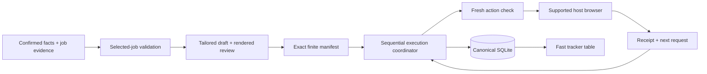

# Faster preparation and execution

## Combined launch measurement, 22 October 2026

`python scripts/benchmark_launch.py --samples 7` compares the existing
authorize-manifest/start-execution/next-action CLI sequence with launch-execution.
Each sample uses a fresh equivalent single-job fictional workspace, approved
standing scope and mock renderer; setup is outside timing. Order alternates.
The full unit suite finished before this benchmark. Windows, Python 3.12.14;
elapsed milliseconds include subprocess startup and the same authorization,
start and initial-inspection checks, with no model/network/browser measurement.

| Path | CLI calls | Median ms | Range ms |
|---|---|---|---|
| Separate commands | 3 | 1017.035 | 850.130–1835.182 |
| Combined launch | 1 | 537.829 | 514.023–657.884 |

The measured median fell 47.1%, with nonoverlapping sample ranges. Keep the
composition: it removes transport overhead while preserving durable allocation,
run creation, fresh checks and interruption reconciliation. Machine load varies;
this is local launch latency, not application completion speed. The benchmark
asserts first-action inspection and zero submission attempts. Five behavioral
launch tests additionally cover partial failures, nonreplay and host blockers.
This establishes no token/cost saving or 100/hour employer throughput result.

For discovery bottlenecks, see [the primary-source workflow review](DISCOVERY_ACCELERATION.md).
Public bulk-list guidance remains instruction-only and has no measured speedup
or implemented network connector. Post-confirmation cleanup reduces open tabs,
but its browser latency has not been benchmarked.

## Earlier preparation measurements

Measured 21 October 2026 on Windows, Python 3.12.14. Standard-library core only;
no models, browser, employer service or real converter was timed.

## Measurements

`python scripts/benchmark_pipeline.py --jobs 100 --samples 7` creates and removes
an external fictional workspace. Each sample revalidates bytes; there is no warm
validation cache. Setup/import/assessment/draft creation is outside the timed
region. Baseline revision: d580ce5. Times are milliseconds.
The timing workspace has 100 prepared drafts and no renders or execution actions;
execution call counts use a separate single-job fake-converter CLI regression.

| Operation | Before median (range) | After median (range) | Deterministic work |
|---|---|---|---|
| One selected CV content model, 100 prepared jobs | 1044.398 (800.248–1636.510) | 48.209 (37.829–57.552) | JD reads: 101 → 2 |
| Full resume, unchanged semantics | 873.854 (788.913–1815.094) | 1113.636 (1059.642–1381.373) | 100 JD reads; no speed claim |
| Ledger-only tracker, new operation | — | 4.843 (3.981–6.030) | 0 JD/file reads; one database snapshot |
| Six-phase CLI execution, excluding setup/start | 19 calls | 13 calls | Initial next + six checks + six acknowledgements; acknowledgement now returns successor |

The selected-CV median improved approximately 21.7× in this run; ranges do not
overlap. Machine load affects timings. The tracker deliberately does less than
resume: it does **not** certify files, current approvals or live vacancy status.
The CLI call reduction is tested, not an end-to-end employer latency measurement.
Real conversion time, agent reasoning, browsing, challenges and employer responses
remain outside these numbers. No token, money, hiring or universal coverage claim.

## Architecture decision

Keep the local modular core and one canonical SQLite writer. A 100-job campaign
does not justify another service, queue broker, model API or browser fleet.



1. **Validate the selected job on selected-job paths.** `job_checkpoint` and full
   resume share `draft_status`, preserving source/profile/JD/file checks. Rendering
   no longer scans all other drafts for each content check. A full manifest still
   validates all its entries; no permission or hash cache crosses action boundaries.
2. **Separate observation from authorization.** `tracker` uses a single SQLite
   read transaction and bounded table scans, without artifact I/O. It is safe for
   frequent catch-up output. Resume, content checks and check-action still gate
   actual work. Tracker output never grants permission to act.
3. **Combine transport calls, preserve durable steps.** `advance-execution`
   records a receipt, commits it, then requests one successor in a second
   transaction. Returning a submit request still reserves the unique attempt
   first. If the second step blocks, `receipt_recorded=true` preserves that fact.
   A lost response requires execution-status reconciliation, never replay.

Preparation can be reasoned about independently per job, while canonical writes
and browser submissions keep one coordinator. This change does not implement
parallel browser submissions or background workers. Research permission checks,
fresh UI inspection and candidate-only challenges stay at their existing boundary.

## Experiment ledger and regression guard

| Idea | Verdict | Evidence / trade-off |
|---|---|---|
| Replace all-job draft scan with selected-job validation | Kept | 101 → 2 JD reads; approximately 21.7× measured median improvement |
| Separate frequent status output from full resume | Kept as distinct read model | About 5 ms; explicitly does not validate artifacts |
| Combine receipt acknowledgement and successor issuance | Kept | 19 → 13 CLI calls in the real subprocess regression |
| Cache approval/file validation between browser actions | Rejected before implementation | Expiry, revocation and changed bytes must remain observable |
| Parallel browser writers / new distributed services | Deferred | No measured need; would complicate duplicate and interruption recovery |

Tests enforce selected-job-only reads, stale affected drafts, the 13-call loop,
immutable attempts, read-only tracker semantics and a lost combined response
before submit. CI uses deterministic work budgets rather than flaky wall-clock
thresholds. Re-run the benchmark when these paths change; a runtime-specific
browser benchmark is still required before claiming a faster live campaign.

Local verification: all 83 standard-library tests passed, including the real
subprocess loop and existing stale-source/approval/duplicate/recovery cases.
Repository hygiene and generated-wrapper synchronization passed. Optional real
conversion remains a separate Linux CI gate; no local LibreOffice run is claimed.

## Execution validation experiment, 21 October 2026

Reproducible command:

```sh
python scripts/benchmark_execution.py --jobs 100 --samples 7
python scripts/benchmark_execution.py --jobs 10 --samples 7
```

Python 3.12.14 on Windows; fictional jobs and a **mock renderer**. Setup,
rendering, review and approval are outside the timed region. No model, network,
browser, live application or real document converter is timed. Each timed sample
still runs full manifest validation. Timings are milliseconds.

| Workload | Baseline median (range) | Experiment median (range) | Decision |
|---|---|---|---|
| 100-entry check-manifest | 4474.023 (2442.255–6701.950) | 4477.160 (2980.021–5081.499) | Revert profile sharing: no timing gain |
| 100-entry check-action | 2107.154 (1622.352–4267.408) | 3517.190 (2633.276–6022.372) | Revert: slower median, broad overlapping variance |

The experiment shared one validated profile within a pass and reduced profile
validations from 201 to 2 while retaining 200 JD reads. That work-count reduction
did **not** establish a reliable latency improvement. Its production changes were
removed. Reference baseline was main at `73a77b7`, run in a detached disposable
worktree with the same benchmark script; the experiment followed sequentially.
An earlier run overlapped the test suite and is excluded from the comparison.
No speedup or token/cost saving is claimed from this rejected experiment.

The final implementation retains per-entry validation and adds a final
source/expiry/runtime recheck for long passes. Its separate **10-entry** operating
point measured:

| Operation | Median (range), ms | Profile validations | JD reads |
|---|---|---|---|
| check-manifest | 239.146 (236.155–255.462) | 22 | 20 |
| check-action | 155.628 (147.441–158.724) | 22 | 20 |

This is a different batch size, not a before/after speedup on identical work.
Use small finite batches as described in [THROUGHPUT.md](THROUGHPUT.md), measure
the actual host/employer steps, and preserve the same checks per manifest entry.
The [deterministic routing planner](MODEL_ROUTING.md) adds no model calls for
classification, tests or metrics. Its native host dispatch and token savings are
unmeasured. A 100/hour live KPI remains unverified; `throughput` reports actual
rolling qualifying confirmations rather than treating local benchmark capacity
as applications.

## Bulk discovery scheduling, 22 October 2026

See [the architecture review and benchmark](BULK_DISCOVERY.md). Seven alternating fictional 12-board runs with 50 ms simulated read latency reduced median serial 631.272 ms to 215.581 ms with three workers. This measures scheduling only, not live Internet or application throughput. No freshness checks were removed.

## Optional Firecrawl research slice, 22 October 2026

Current-run evidence: [raw fictional measurements](benchmarks/fast-web-20261022.json).
Python 3.12.14 on Windows, code `06b778b`. No provider key was configured.
Both required commands were run after the 184-test release suite completed:

```sh
python scripts/benchmark_pipeline.py --jobs 100 --samples 7
python scripts/benchmark_web.py --samples 7
```

The original pipeline benchmark remains separate: current medians are content
model 50.576 ms, full resume 1147.595 ms and tracker 4.756 ms. Corresponding JD
reads remain 2/100/0. These are current operating points, not a claimed core
speedup. The initial pre-change run also passed 153 tests in 273.131 seconds;
its benchmark overlapped tests and is excluded from timing comparisons.

The web experiment alternates individual/batch ordering across seven samples,
12 identical EN/VI fixture pages, two duplicate inputs, three closed and three
unverified records. Both paths capture exact content digests and import identical
source-referenced normalized JDs. Six records are active by fixture truth.
Transport overhead is a fixed simulated 30 ms per call plus identical 1 ms/page
work. Local SQLite/evidence/import work is real. No HTTP server, browser, AI
parser, converter, human waiting or live cloud queue is measured.

| Metric | Individual median (range), ms | Batch median (range), ms |
|---|---|---|
| Capture all evidence | 2425.539 (1565.090–3340.350) | 1500.475 (1319.079–1714.335) |
| First imported JD | 2501.118 (1619.882–3419.979) | 1603.217 (1387.707–1809.828) |
| Complete capture + normalization/import | 4099.489 (2482.804–4577.566) | 2777.068 (2179.023–3646.992) |
| Warm evidence lookup, separate scope | 264.480 (111.849–513.810) | 229.643 (202.855–312.578) |

Every sample has 12 unique captures and normalized records, no duplicate fetch,
12 cache hits on the warm pass, zero warm provider calls and zero browser starts.
Cold individual calls: 12; batch: 3 (start, status, errors). Fixtures retain all
content and supplied normalization exactly; this is not an autonomous semantic
extraction accuracy result. The warm pass checks/reuses evidence, rather than
repeating cold normalization/import, so it is not an equivalent full-run speedup.

The measured median full fixture run is lower with batches, with overlapping
ranges and seven samples. No p95, fixed live speedup, token saving, billing saving
or 100-applications/hour inference is made. Provider internal queueing, actual
cost/credits/tokens, live host comparison and new/established browser sessions
remain unknown. TinyFish interactive/hybrid paths are unsupported and the small
interactive fixture explicitly records that status. Deterministic CI asserts
equal outputs and 12/3/0 request budgets; it has no wall-clock performance gate.

Local release checks: all 184 standard tests passed in 260.837 seconds, including
31 new provider/research regressions and existing execution/document/approval
invariants. Public hygiene, generated wrappers, CLI dry-run, provider diagnosis
and whitespace checks passed. Optional real conversion is a separate CI job;
no local LibreOffice or live provider test is claimed. See FAST_WEB_REVIEW.md
for the bounded self-review and remaining limits.

After the measured code revision, transport hardening conservatively retains paid
intent on unexpected HTTP redirects, timeouts and conflicts. All six focused
provider boundary tests passed after that change; the 184-test full run above
precedes it. CI runs the complete current 185-test suite separately. No timing
change is inferred from this failure-classification fix.
