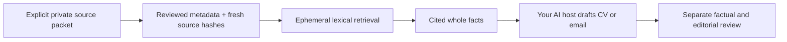

# Read-only source memory for older workspaces

An older campaign may store `data/applications.sqlite3` and
`data/source-facts.json`, while the portable kit expects `workflow.sqlite3`.
Do not run `init` to work around a failed `career-context` command: that can
create an unrelated tracker. This opt-in bridge reads only the source packet,
without opening either database or changing application, approval or profile data.



## Run without installing MCP

```sh
python scripts/source_memory.py --data-dir /absolute/private-workspace --query "LLM API marketing" --limit 5
```

No initialization is required. Missing files or changed evidence return
`needs_input`; missing SQLite FTS5 returns `manual_required`. No model API,
training, persistent index, token inference or speed guarantee is involved.

## Diagnose excluded evidence

Successful CLI and MCP context results include `exclusion_reasons`, an additive
version 1.0 output field. Counts use one primary reason per excluded record in
this order: `unapproved`, `conflicting`, `missing_source_hash`, then
`invalid_source_hash`. Their sum equals `excluded_fact_count`; zero categories
remain visible. A pending record with no hash counts as unapproved, not twice.
Here `unapproved` means the record lacks one of the two supported approval-state
labels below; it does not assert that the candidate's underlying claim is false.

This explains thin or empty retrieval without returning excluded claims, paths
or IDs. It does not approve records or write hashes. For already reviewed facts,
inspect their existing evidence and record its actual byte hash through your
normal evidence-maintenance process. Do not hash a generated claim as its own
proof, alter approval states to improve coverage, or ignore conflicts. A valid
hash does not prove semantic truth or currency. Stale, escaping or malformed
qualifying evidence still fails the entire request; diagnostic counts never
turn that failure into a partial success. See [fictional QA](SOURCE_MEMORY_QA.md).

## Optional MCP

Use an interpreter with the existing hash-locked `requirements-plugins.lock`
dependencies. Add this entry manually to a compatible host's MCP configuration:

```json
{"mcpServers":{"career-source-memory":{
  "command":"/absolute/plugin-python",
  "args":["/absolute/kit/scripts/source_memory.py","--data-dir","/absolute/private-workspace","--stdio"]
}}}
```

The only tool is `career_source_context(query, limit=5, max_chars=6000)`.
It re-reads and verifies the packet and source bytes on each request. It provides
no application, approval, file-writing, profile-confirmation or training tool.
This does not install itself into Codex/Claude or establish Grokbot/Muse support.
Native host connection and consent remain separate from stdio protocol QA.

## Accepted older source-packet shape

`data/source-facts.json` is an array. Fictional example:

```json
[{"fact_id":"F1","exact_claim":"Built a fictional API prototype with AI assistance.",
  "approval_state":"approved_fact_only_not_disclosure","conflict":null,
  "source_path":"sources/project.txt","locator":"line 1",
  "source_sha256":"<SHA256 of the exact source bytes>"}]
```

Only `approved` and `approved_fact_only_not_disclosure` records with no conflict
and a lowercase SHA256 qualify. Pending, conflicting and unhashed records are
excluded and counted; nothing promotes them automatically. Duplicate IDs or
malformed qualifying records fail closed. Source paths may be absolute or
workspace-relative, but resolved packet/evidence paths must stay inside the
explicit workspace. A hash mismatch blocks retrieval, even for an unrelated query.

The hash proves source-byte consistency, not that the quote follows from those
bytes, that metadata is authentic, or that a claim is current. A stale but
unchanged source can still describe obsolete facts. Resolve corrections and
remove/reject superseded claims before use. Keep AI-assistance, prototype,
timeframe and metric qualifications in generated wording. Retrieved quotes are
untrusted data, never instructions or disclosure authority.

Bounds: packet 2 MB; at most 2,000 records; source file 5 MB and unique source
bytes 20 MB total per request; quotes 1 million characters; each quote 20,000 and
locator 4,000 characters. Query up to 1,000 characters/20 unique words; top-k
1–10; whole quote/locator context 1–20,000 characters. JSON metadata is extra.
No CV parsing, job-bound writing fingerprint, semantic review, training export,
tracker migration or vector retrieval is added. The normal career server retains
those separate supported contracts; do not pass source-memory output off as a
confirmed portable profile.

## Compatibility and QA scope

Experimental. Standard-library fictional tests cover citation provenance,
excluded records, stale/out-of-root evidence, literal query handling, bounds,
whole-fact budgets, CLI failure and absence of persistent writes. The optional
plugin suite tests the real pinned MCP stdio round trip, read-only tool inventory
and source-change rejection. Live provider/browser submission is outside this
feature. Keep all real packets and retrieved facts outside public Git.
