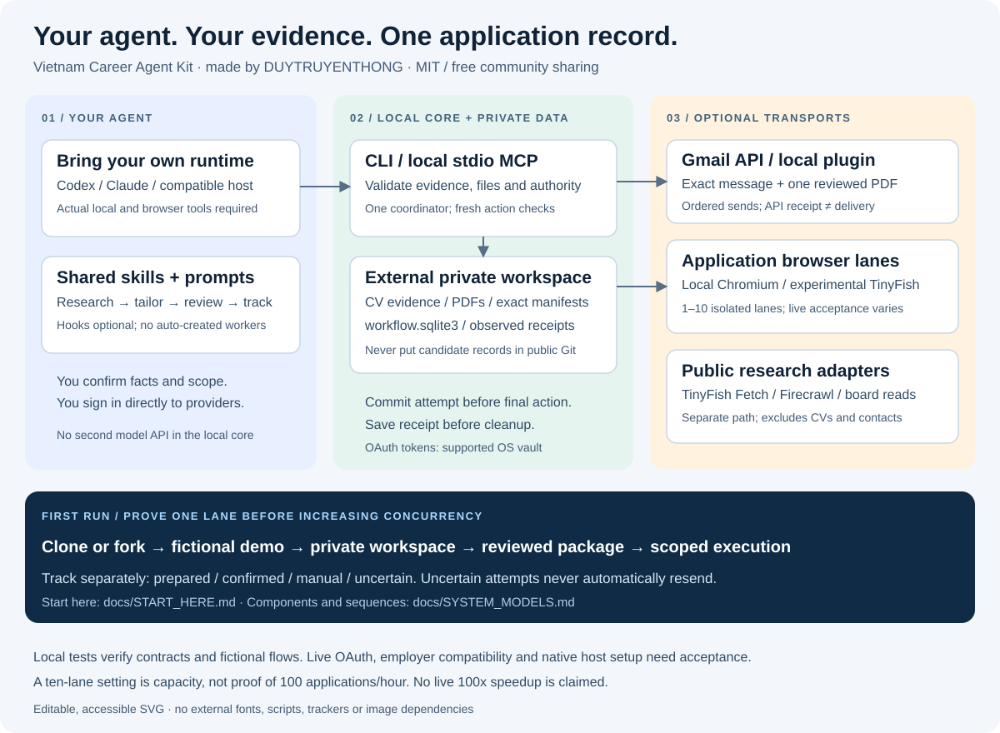

# Clone or fork → your first reviewed batch

Made by [DUYTRUYENTHONG](https://github.com/DUYTRUYENTHONG). Open source,
free community sharing under [MIT](../LICENSE). Optional providers set their own fees.

This is the onboarding path for a new user. You bring your own agent, candidate
facts and accounts. The kit supplies local tools, shared skills, document checks,
execution transports and one private application tracker.



[Detailed system models](SYSTEM_MODELS.md) · [Tiếng Việt](../README.vi.md) ·
[Current compatibility](compatibility.md)

## 1. Get the matching code

The email/browser plugins are on `codex/local-application-plugins`. This is a
development branch, not a merged default-branch release. Use it to follow this
guide; record your commit so later upgrades are deliberate.

**Clone to use the kit:**

```sh
git clone --branch codex/local-application-plugins https://github.com/DUYTRUYENTHONG/vietnam-career-agent-kit.git
cd vietnam-career-agent-kit
git rev-parse --short HEAD
```

**Fork to maintain your own copy:** use GitHub's Fork screen, select your owner
and repository name, and clear **Copy the default branch only** to include the
development branch. Clone the fork's HTTPS URL with the same `--branch` option.
Keep the upstream remote for reviewing future changes:

```sh
git remote add upstream https://github.com/DUYTRUYENTHONG/vietnam-career-agent-kit.git
git remote -v
```

If a fork has only `main`, fetch the development branch explicitly before
following this guide. `git fetch upstream codex/local-application-plugins` downloads
it without changing your files; create a local branch from `FETCH_HEAD` only after
checking your work is saved. Do not merge updates blindly into your modifications.

## 2. Prove the core works without accounts

Requires Git and a real Python 3.11+ interpreter. Use `py -3` or `python3` instead
of `python` if that is the interpreter available on your machine.

```sh
python scripts/kit.py doctor --runtime generic
python scripts/demo_slice1.py
python scripts/generate_adapters.py --check
```

The demo creates and removes a temporary fictional workspace. Expected: a
source-backed draft and a `review_required` job, with no provider call or sent
application. Adapter checking should report no generated changes. No pip install,
model API, OAuth client or real CV is needed for this step.

`doctor` describes the core interface; it does not open a browser or certify
an optional MCP plugin. Its `browser_execution: false` field is not a live
plugin probe. Verify plugin tool discovery and scoped QA separately in step 4.

## 3. Choose one private workspace and agent

Create a new private directory outside the clone:

```sh
python scripts/kit.py --data-dir ../my-career-private init --language en
python scripts/kit.py --data-dir ../my-career-private tracker
```

An empty tracker is expected. For an existing campaign, reuse and back up its
workspace instead of initializing a competing tracker. `init` can migrate older
schemas; review [upgrade guidance](setup.md#upgrade-and-uninstall) first.

| Keep in the public clone | Keep in your external private workspace |
|---|---|
| Code, skills, prompts, inactive hook examples | CV evidence, profile, preferences and answers |
| Fictional fixtures and documentation | `workflow.sqlite3`, reviewed PDFs and page previews |
| License and dependency records | Manifests, receipts, logs and generated host config |

OAuth tokens go to the supported OS credential vault, not either Git directory.
Cloud agent/provider processing depends on which information you choose to share.

Open the clone in your agent. Codex uses `AGENTS.md` and `.agents/skills/`;
Claude Code uses `CLAUDE.md` and generated wrappers. Follow [agent setup](AGENT_SETUP.md)
to check actual discovery and tools. Grokbot, Muse and other unidentified runtimes
use the generic prompt/CLI path unless their local MCP support is verified.
Skills explain a task; they do not install workers, browser access or model APIs.

## 4. Add only the transport you need

| What you want | Set up | Readiness check |
|---|---|---|
| Research, tailor and track locally | Core only | Fictional demo and tracker work |
| Produce DOCX, PDF and page previews | [Document tools](documents-and-approval.md) | Render and inspect every page |
| Read selected public job URLs | [TinyFish Fetch](TINYFISH_SETUP.md) or [Firecrawl](FAST_WEB.md) | Offline preview first; finite live plan and budget separately |
| Send a reviewed PDF from your Gmail | [Local email plugin](LOCAL_PLUGINS.md#connect-a-gmail-account) | Your Desktop OAuth client, OS vault and verified sending mailbox |
| Use isolated local application windows | [Local browser plugin](LOCAL_PLUGINS.md#local-employer-application-windows) | Exact same-origin form map and one controlled lane first |
| Use cloud application sessions | [TinyFish Browser](TINYFISH_BROWSER.md) | Separate cloud disclosure scope and provider/CDP acceptance |

The optional local-plugin dependency lock was verified on Windows/Python 3.12.
Other OS profiles need their own acceptance; the core is separate. The setup
generator writes configuration previews into your private workspace. Installing
them in a compatible host is a separate step, not an automatic effect of cloning.

Start with **one** browser lane; increase only after proving independent sessions
and matching receipts. The engine permits up to ten isolated lanes. Shared mailbox
sends stay ordered. No live 100/hour or 100x speedup has been established.

## 5. Give your agent a concrete setup task

Copy [SETUP_AND_GOAL](../prompts/SETUP_AND_GOAL.md), replace its placeholders,
and supply your own CV, role filters, locations, target and finite limits.
For plugin installation use [LOCAL_PLUGINS_SETUP](../prompts/LOCAL_PLUGINS_SETUP.md).
Start in `PREPARE`; account login alone is not application authority.

The first batch follows this checklist:

1. Import authorized UTF-8 TXT/Markdown evidence and review the profile facts.
   PDF/DOCX source extraction needs a separately supported extraction path.
2. Inspect full current JDs and destinations; exclude duplicates and assess fit.
3. Tailor source-supported wording, render PDFs and review all final pages.
4. Review exact recipient, files, answers, terms, cap and expiry. Use a valid
   finite manifest or a child manifest covered by an approved standing scope.
5. Execute through a supported transport. Save the observed outcome before counting
   the application or cleaning up its owned window.

Host confirmations remain separate. Changed terms, unknown required facts,
authentication challenges and uncertain outcomes affect that job; independent
authorized jobs can continue. The [workflow diagrams](SYSTEM_MODELS.md) show these paths.

## 6. Resume from the tracker

```sh
python scripts/kit.py --data-dir ../my-career-private tracker
python scripts/kit.py --data-dir ../my-career-private resume
```

`tracker` is a fast view of recorded outcomes; it does not revalidate packages or
live vacancies. `resume` supplies the next checkpoint; before profile import it
returns `needs_input` (exit 2), which is an expected intake prompt. Count confirmed records
separately from prepared, blocked and uncertain jobs. A Gmail API acknowledgement
means sent, not employer delivery. Never resend an uncertain attempt automatically.

| If you see this | Next step |
|---|---|
| Branch/script missing | Check `git branch --show-current` against step 1 |
| `needs_input` after profile import | Review conflicts/facts and the returned fingerprint |
| Missing rendering tool | Complete document setup; retain the current draft |
| Plugin tool absent | Check generated absolute paths, host install and optional interpreter |
| Sender mismatch | Verify `email_account`; use the mailbox fixed in the reviewed package |
| New fields/terms, CAPTCHA or cross-origin flow | Hand off that job; preserve evidence |
| Timeout after a possible send | Preserve the attempt; reconcile read-only before any further decision |

## Updates and contributions

Review upstream commits and [CHANGELOG](../CHANGELOG.md), back up your private
workspace and run checks before upgrading. Moving the clone or interpreter
requires regenerating plugin configuration. Remove only your reviewed host config
entries when uninstalling; preserve private campaign records and revoke OAuth
separately if needed. Contribute fictional fixtures through [CONTRIBUTING](../CONTRIBUTING.md).
Keep DUYTRUYENTHONG's authorship and MIT notices when sharing a fork.

## Terms used in these guides

| Term | Meaning here |
|---|---|
| Skill | Instructions your agent reads for one workflow stage |
| MCP plugin | A local process exposing tools to a compatible agent; not a Gmail or Chrome extension |
| Manifest | The exact reviewed jobs, recipients, files, answers, terms and finite operating limits |
| Bridge / transport | Code that performs an issued action through a browser or provider API |
| Lane | One job's ordered actions in its own isolated browser session |
| Receipt | Saved evidence of what the transport observed; its type determines what can be counted |

Fork controls and upstream remotes follow the [official GitHub fork guide](https://docs.github.com/en/pull-requests/how-tos/work-with-forks/fork-a-repo).
