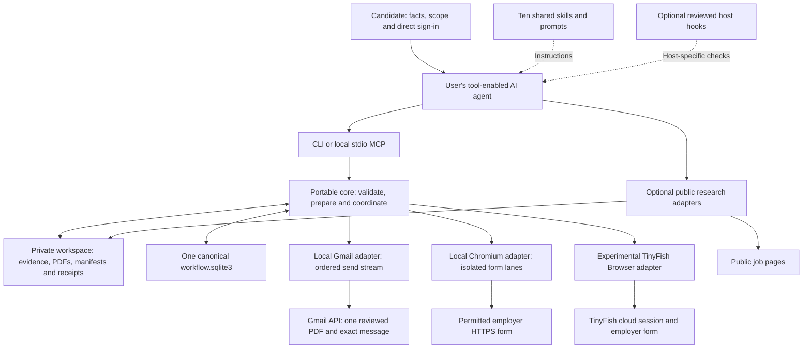
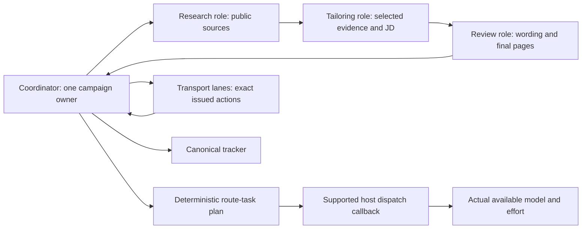
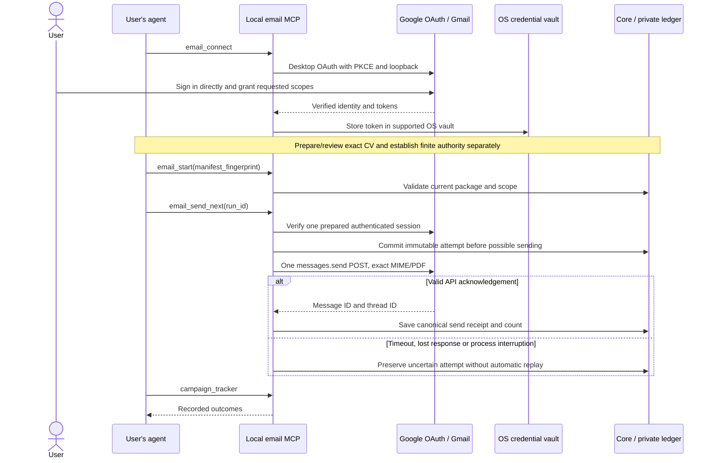
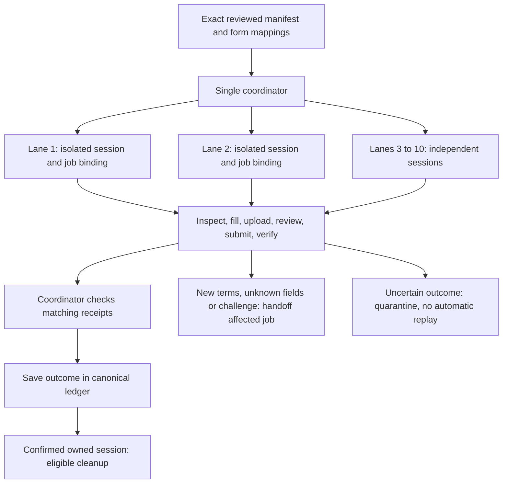
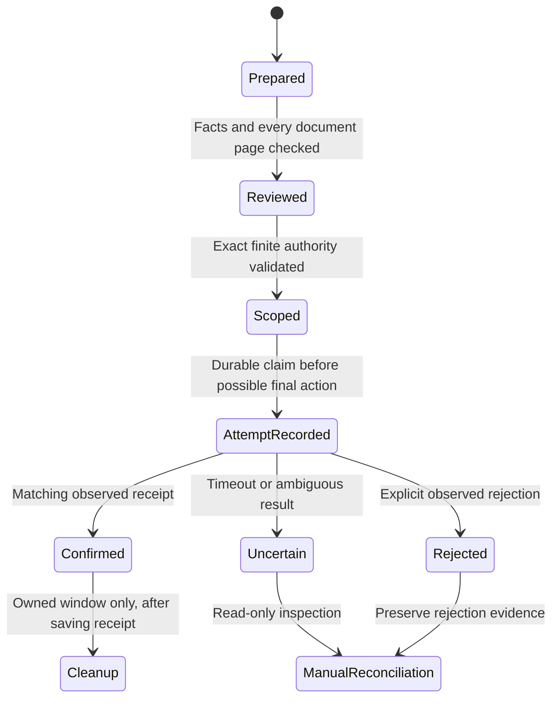

# System models: who does what, where data goes

Use [Start here](START_HERE.md) for runnable onboarding. These diagrams describe
the current implementation and its boundaries. GitHub renders Mermaid; the
[standalone SVG overview](diagrams/system-overview.svg) also works without Mermaid.

## 1. Components and data ownership

The clone contains reusable code and fictional examples. Candidate records stay
outside it. The public-research path excludes CVs, contacts and account cookies.
Email sends the reviewed package to Google/the destination; cloud browser use
has a separate provider disclosure boundary. Local browser execution does not
make the employer's form local. See [architecture](architecture.md).

## 2. Agent roles and model routing

These are responsibilities, not automatically spawned agents. One agent can do
them in sequence. The routing policy returns a plan; supported host dispatch
must apply and verify a real available model override. Tests, hashes, rendering
and tracker calculations use tools directly. Parallel research can return compact
source references; it never independently approves a package or writes the ledger.
See [skills and role table](AGENT_SETUP.md#3-load-the-skill-for-the-current-stage)
and [model routing](MODEL_ROUTING.md).

## 3. Login and one Gmail application

Signing in proves account access. It does not approve employers, messages, terms
or CV bytes. OAuth tokens are not returned to the model. Gmail's acknowledgement
establishes sending, not delivery or absence of a later bounce. The adapter has
no inbox-reading scope. [Email setup and exact inputs](LOCAL_PLUGINS.md).

## 4. Concurrent browsing, ordered actions per job

The action order applies independently inside every lane; a job never skips
review to race another job. Default local browser concurrency is three, with a
maximum of ten. Prove one lane before increasing it. Different tabs alone do not
establish isolation. Gmail remains an ordered mutation stream.

Local Chromium supports mapped single-page, same-origin HTTPS forms. TinyFish
Browser is an experimental REST/CDP transport with separate cloud scope; live
provider compatibility remains unverified. TinyFish Fetch is public research,
not an application lane. BrowserAct currently supplies an offline planner, not
form execution. See [parallel execution](PARALLEL_APPLICATIONS.md).

## 5. Outcome and recovery model

These are explanatory labels, not literal database enums. There is deliberately
no automatic path from uncertain back to send. Recorded attempts survive process
restart; in-memory browser logins do not. Cleanup failure does not erase a saved
confirmation. Use [execution recovery](execution.md), [plugin QA](LOCAL_PLUGINS_QA.md)
and [throughput semantics](THROUGHPUT.md) for exact interfaces and evidence limits.

## Reading order

| Need | Guide |
|---|---|
| Clone/fork and first use | [Start here](START_HERE.md) |
| Skills, hooks and runtime support | [Agent setup](AGENT_SETUP.md) |
| OAuth and local browser plugins | [Local plugins](LOCAL_PLUGINS.md) |
| Source/privacy and core contracts | [Architecture](architecture.md) |
| Current verified versus experimental scope | [Compatibility](compatibility.md) |

Made by **DUYTRUYENTHONG**, MIT licensed, shared freely with the community.

Diagrams use [Mermaid's documented Markdown-based syntax](https://mermaid.js.org/config/usage.html).
The SVG is an original editable source asset with embedded accessibility text.
