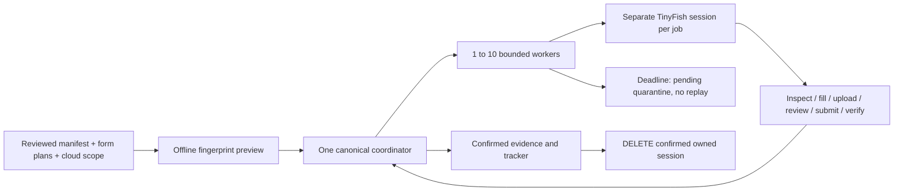

# TinyFish Browser runtime (experimental)

`python scripts/kit.py doctor --runtime codex` distinguishes public Fetch from
the optional guest-form adapter in `optional_browser_runtime`. This is a
description of implemented scope, not a live readiness probe: browser/network
execution remain false, dependencies and credentials are not inspected, and no
session is acquired. Use the explicit setup and preview below before any run.

The new adapter connects isolated cloud sessions to the existing six-stage
application protocol. TinyFish Fetch remains public research only. This original
implementation follows the [official REST API](https://docs.tinyfish.ai/browser-api/reference)
and [Playwright CDP interface](https://playwright.dev/python/docs/api/class-browsertype#browser-type-connect-over-cdp).
No cookbook installer, executable or natural-language Agent goal runs.



## Setup

Use Python 3.11/3.12 and an external schema-6 workspace. Explicitly provision the
optional client in your own environment:

```sh
python -m pip install --require-hashes --only-binary=:all: -r requirements-browser.lock
```

This installs Playwright 1.58.0 and pinned Python dependencies. Remote CDP needs
no local browser download; do not run `playwright install` for this adapter.
The lock was generated from exact PyPI wheel metadata; native CDP compatibility
is unverified. Standard tests do not install/import the optional client.

Configure `TINYFISH_API_KEY` through [hidden-input setup](TINYFISH_SETUP.md).
A key does not establish Browser API entitlement, budget, platform permission or
candidate authority. TinyFish processes page content, candidate fields and files
separately from the employer. Review this provider disclosure and its terms
before approving cloud scope. Existing Codex/Chrome sessions are never exported.

## Version 1.0 inputs

Create and approve a manifest with `execution.bridge_id: "tinyfish-browser"`.
Start a [parallel run](PARALLEL_APPLICATIONS.md) using that bridge, initially with
one worker. Place both following files inside the selected private workspace.

`cloud-scope.json` accepts exactly:

```json
{
  "schema_version": "1.0",
  "provider": "tinyfish-browser",
  "manifest_fingerprint": "REPLACE_WITH_EXACT_MANIFEST_FINGERPRINT",
  "expires_utc": "REPLACE_WITH_FUTURE_UTC_ISO_TIMESTAMP",
  "max_sessions": 1
}
```

`max_sessions` is an integer 1–10 covering both worker count and job count.
`forms.json` maps each manifest job ID string to this exact shape:

```json
{
  "1": {
    "schema_version": "1.0",
    "destination": "https://apply.example.test/form/FICT-1",
    "identity": {
      "employer": {"selector": "#employer", "text": "Fictional Example"},
      "requisition": {"selector": "#requisition", "text": "FICT-1"}
    },
    "fields": {"salary": {"selector": "#salary", "kind": "text"}},
    "consents": [{"id": "privacy-v1", "selector": "#privacy",
      "text_selector": "#privacy-label", "text": "Fictional retention policy", "required": true}],
    "upload_selector": "#cv",
    "submit_selector": "#submit",
    "confirmation_selector": "#confirmation",
    "confirmation_text": "Fictional application submitted",
    "blocker_selectors": ["#new-terms"]
  }
}
```

These placeholders are not a real employer template. Inspect and review the exact
identity, selectors, consent text, accepted `.pdf` extension and success text.
`kind` supports `text` or `select` (option values). Every consent must match the
manifest. Employer/requisition must remain visible at confirmation. Only PDF
uploads are supported. Runtime validators are `validate_form` and `preview` in
`adapters/tinyfish_forms.py` / `adapters/tinyfish_browser.py`; unknown keys fail.
Existing execution protocol and DB schema are unchanged.

## Preview, then execute

Replace `PRIVATE`, `RUN` and fingerprints with actual values; use absolute paths.

```sh
python scripts/kit.py --data-dir PRIVATE tinyfish-browser --run-id RUN --forms PRIVATE/forms.json --cloud-scope PRIVATE/cloud-scope.json
```

Preview makes zero network calls. After exact provider/form-bundle approval:

```sh
python scripts/kit.py --data-dir PRIVATE tinyfish-browser --run-id RUN --forms PRIVATE/forms.json --cloud-scope PRIVATE/cloud-scope.json --approve-cloud-scope BUNDLE_FINGERPRINT --live --action-timeout-seconds 120
python scripts/kit.py --data-dir PRIVATE tracker --format md --output reports/tracker.md
```

The bridge records an intent before POST, saves session IDs for reconciliation,
keeps CDP access URLs only in memory, and never automatically retries creation or
submit. Each action checks current canonical authority. Fresh form observations
are compared before writes. Visible values, choices and uploaded bytes are
checked again before submit. Only observed success plus a private screenshot
increments counts. Only confirmed, cleanup-requested owned sessions close.

Each job retains one CDP connection across actions, avoiding repeated connection
setup and keeping request/response guards active between steps. Authority reads
run off the shared async browser loop so one lane's guard does not block the
other lanes' browser I/O. Provider DELETE precedes local client disconnection.

## Boundary and recovery

Supported: explicit single-page HTTPS guest forms with visible identity,
text/select/checkbox/file controls and exact confirmation. Unsupported: email,
signed-in accounts, multi-page forms, frames, hidden upload controls, MIME-only
accepts, service-worker-backed forms, manual-only sites, visible login/challenges,
new required fields/consents, redirects and changed destinations. Stop and hand off; do not
use another tool to bypass a denial. Context-wide request interception blocks
foreign origins and popup requests while connected. CDP response-stage guards
reject redirects before Chromium forwards a POST (including 307/308). Ordinary service-worker registration is disabled
before initial navigation and page network requests bypass workers. This is not
a security sandbox for hostile employer scripts. Same-origin code still runs.

REST uses a fixed endpoint, 60-second timeout, no proxy and 120-second remote
*inactivity* timeout. Inactivity is not a hard runtime cap. Local action deadlines
default to 120 seconds, bounded by run expiry for writes. Already-issued read-only
verification remains possible after application/run expiry in the existing
session while the separate cloud scope is valid. Cloud-scope expiry stops even
verification and requires an explicit renewed access/manual reconciliation path;
this release does not automate renewal. Recovery never creates a replacement
session or authorizes further disclosure.

On deadline, `quarantined_requests` remains canonical pending work. The runner
returns `needs_input`; stalled lanes retain capacity and late results are ignored.
Running callbacks can survive a Python timeout. The bridge checks its own local
deadline before subsequent writes, but neither timeout nor process exit proves
remote termination. Confirm termination and reconcile before restart/recovery.

Existing `execution/tinyfish/RUN/*.intent.json` prevents automatic replacement
after restart, even when creation timed out without returning an ID. Inspect
provider sessions and retain the intent. There is no automatic cross-process
reconnection/cancellation. For a known ID, the official DELETE endpoint terminates
the session; only HTTP 204 proves termination here. Failed/uncertain sessions
need operator reconciliation and can incur cost. Failed closes remain deferred.

## Acceptance

Fictional transport/page tests cover the full protocol, isolated sessions,
cleanup, changed forms/files, replay, expiry and stalled workers. They do not
establish live API, native CDP or employer compatibility. Increase 1 → 2 → 5 → 10
only after controlled live verification with a stated budget. Ten lanes are a
ceiling; 100 applications/hour and 100x speedup remain unverified targets.
