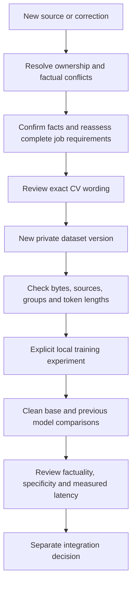

# Keep personal training data current

Use this workflow when your confirmed experience, captured job requirements or
reviewed wording changes. It reuses existing intake, review, retrieval, export
and evaluation commands. It does not install a watcher, schedule training or
start a cloud upload. [Copyable agent prompt](../prompts/REFRESH_TRAINING_DATA.md).



## 1. Reconcile changes before adding examples

Keep one existing private workspace and canonical ledger. Do not initialize a
second tracker to make an older campaign fit the portable export contract.
The [legacy source bridge](SOURCE_MEMORY.md) is retrieval only, not migration.

Record the original file, hash and source location for a new fact or correction.
A new CV version is a claim source, not independent verification. Resolve
contradictory dates, totals and responsibilities through normal candidate-evidence
confirmation. Keep reference resumes and role templates separate from experience.
Exclude identity images, private contacts and unrelated sensitive fields from
the learning payload. Exported professional facts may still identify a person.

Read each complete captured JD and assess its actual clauses. A research summary
or a model-generated role template is not a verbatim employer requirement.
When assessing a single bullet, credit only evidence supplied by that bullet;
true facts elsewhere in the CV cannot silently fill its gaps. A partial match is
not whole-job eligibility. Preserve qualifications such as AI assistance,
prototype scope, project-based tenure and total-versus-daily data volume.

## 2. Preserve old datasets and prepare a new version

First inspect the prior export:

```sh
python scripts/kit.py --data-dir ../my-private learning-check --directory datasets/reviewed-v1
```

Changed evidence or review can make this check fail. That is a stale export,
not permission to edit its JSONL or recompute hashes to bless changed data.
Keep its files, prior model runs and failed outputs unchanged. Update the facts,
assessment, draft and independent wording review through the normal workflow.

After those reviews exist, select the actual local job IDs and a new directory:

```sh
python scripts/kit.py --data-dir ../my-private learning-export --job-id 1 --job-id 2 --output datasets/reviewed-v2
python scripts/kit.py --data-dir ../my-private learning-check --directory datasets/reviewed-v2
```

These commands export current reviewed full-CV JSON under
[cv-wording-json-2](LEARNING_PROMPTS.md). They do not accept arbitrary bullet-pair
JSONL or create the independent review. Email training targets are not supplied.
If nothing changed, keep the valid export; another checkpoint alone is not progress.

The exporter co-groups job revisions and exact output duplicates. It does not
guarantee that related facts, projects or paraphrases stay in one split. Review
those overlaps separately and reserve an untouched acceptance cohort. If an old
holdout joins training, name a new experiment and holdout; do not continue calling
the old cohort unseen. More rows from the same facts are not more independent
experience. Keep held-out assistant targets out of generation prompts.

## 3. Compare before replacing a model

Follow the [training walkthrough](FINE_TUNING_START.md), using new run and
evaluation directories. Preserve the exact base revision, adapter identity,
dataset hashes, settings and dependency versions. Recheck sequence lengths with
the selected tokenizer; do not truncate away source facts or requirements.

Compare the clean base, previous candidate model and new model on the same
untouched prompts and decoding settings. The existing paired runner compares one
clean base with one matching training run; it does not automatically produce a
three-model leaderboard. Preserve separate comparison records and independently
review content before drawing a cross-run conclusion.

Record observed input/output tokens, generation latency, load time and training
time separately. Treat absent costs or host usage as unknown. Check JSON/source
links independently from factual entailment and useful JD-specific detail. A
lower reference loss or a completed process does not establish better tailoring.
Poll a known active run after an observation timeout; do not restart it solely
because the observer lost connection.

Changing facts should reach [current source retrieval](LANGCHAIN_RAG.md) first.
Fine-tuning learns editing behavior; model memory is not authoritative employment
history. Model acceptance and host integration remain separate from training.

## 4. Keep outcome feedback and sharing separate

[CV outcome observations](CV_OUTCOMES.md) bind actual submitted CV versions to
private evidence and observation windows. A send receipt is not a positive
screening label; no response is not automatic rejection. A recruiter reply does
not prove which bullet caused it. Do not manufacture training labels from these
events or claim improved interview rates without a suitable comparison.

Keep personal datasets, source packets, screenshots and personal-model weights
outside public Git. Share reusable code, instructions and clearly fictional
fixtures. Cloud runs require the applicable data/destination and compute scope;
refreshing a local export does not create that authority. This guide grants no
application, account or model-publication permission.
