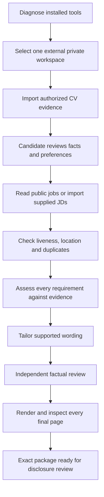
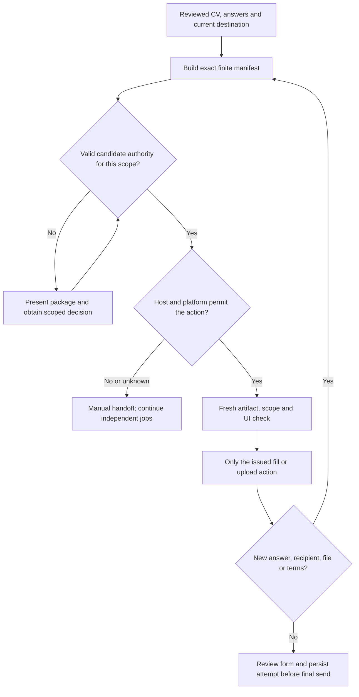
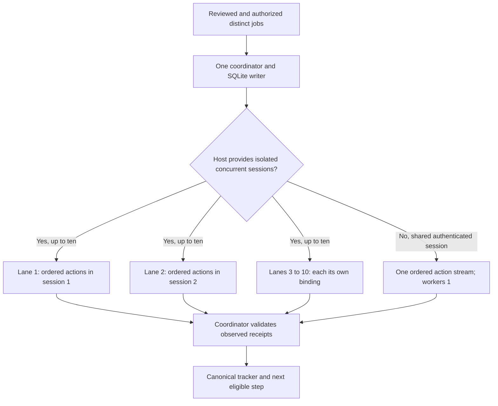
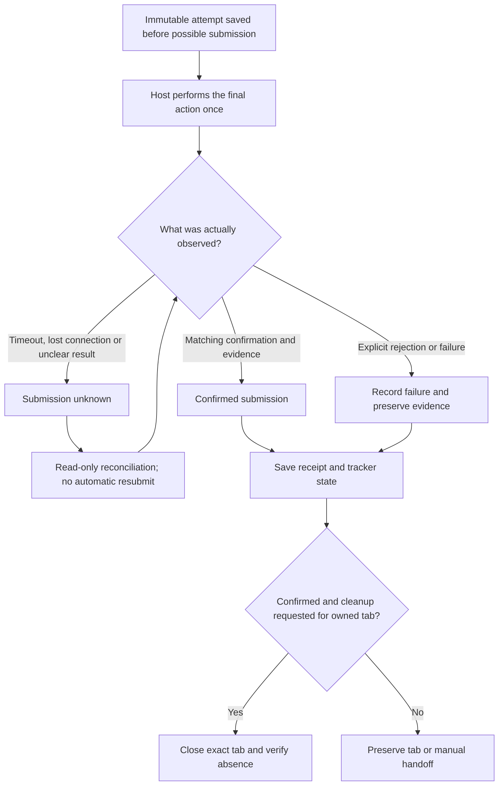

# From your CV to a verified application outcome

New user? [Clone/fork walkthrough](START_HERE.md) · [System models and diagrams](SYSTEM_MODELS.md).

This guide explains the current kit. Use the [detailed campaign prompt](../prompts/GUIDED_CAMPAIGN.md)
to give your own agent a concrete task. [English README](../README.md) ·
[README tiếng Việt](../README.vi.md).

New clone? Start with [agent/skill/hook setup](AGENT_SETUP.md), configure optional
[TinyFish Fetch](TINYFISH_SETUP.md), then fill the [setup-and-goal prompt](../prompts/SETUP_AND_GOAL.md).

## 1. Prepare once, review each job



The candidate owns facts and choices. The agent researches and prepares; the
local CLI validates contracts and records state. An evidence link does not prove
the meaning of a claim: retain basic/prototype/team-contribution qualifiers and
leave unknown dates, salaries, eligibility and experience unknown. Search snippets
are leads; a current employer JD and application destination need inspection.

Use one candidate workspace outside the clone. SQLite is canonical; reports are
projections. Reuse prior confirmed facts, dated exclusions and submitted records.
Do not create a new tracker to bypass unresolved attempts. PDF/DOCX source-CV
extraction is not built into the importer: use an explicitly supported, reviewed
extraction path to authorized UTF-8 TXT/Markdown, or report a handoff.

## 2. Disclosure starts before Submit



Typing and uploading can transmit data immediately. Review employer/requisition,
destination/redirects, exact CV and answer hashes, consent choices, retention and
sharing implications, allowed operations, expiry and submission cap beforehand.
Reuse valid bounded standing authority when it covers the new exact manifest;
do not ask the same local question repeatedly. Runtime-required confirmation is
still separate. A local approval file cannot authenticate a human or grant a tool
permission. A changed package cannot inherit permission for its previous bytes.

Start with PREPARE. ASSIST permits approved fill/upload with no final submission.
APPROVED_BATCH additionally requires delegated submit scope and its finite cap.
Passwords, MFA, CAPTCHA, legal attestations and employment assessments stay with
the candidate. Unknown required answers pause the affected job.

## 3. Ten lanes require ten isolated sessions



Each lane performs inspect, fill, upload, review, submit and verify in order.
Workers return observations; the coordinator commits receipts and issues the
next action. One blocked job can leave other isolated lanes free. Different tabs
or binding names alone do not demonstrate isolation: shared navigation, focus,
cookies or authenticated account state can interfere. A shared signed-in browser
or mailbox therefore uses one mutation stream, even if public research is parallel.

`start-parallel-execution --workers 10` configures the local engine; it does not
create ten browsers. A permitted host bridge must implement `perform(request)`
and return real receipts. Optional [local Chromium](LOCAL_PLUGINS.md) and
[TinyFish Browser](TINYFISH_BROWSER.md) adapters supply scoped execution paths;
production employer/provider acceptance remains separately unverified.
See [commands and benchmark](PARALLEL_APPLICATIONS.md).
Do not turn fixture speed or a worker count into a live 100x or 100/hour claim.

## 4. Record outcomes before cleanup



An upload, click, prepared PDF or successful CLI exit is not a submission receipt.
Keep candidate-reported submissions distinct from host-observed confirmations.
For host-operated email, inspect the matching Sent item and immediate rejection
evidence. The Gmail API plugin records a send acknowledgement without inbox
access; it does not inspect bounces or prove delivery. Uncertain submissions are
not counted and never retried automatically. Cleanup failure does not undo a
confirmed application; retrying submission cannot fix tab cleanup.

The diagram uses readable outcome labels. Exact persisted states and CLI
outcomes follow [execution](execution.md), [pre-submission gates](PRE_SUBMISSION_GATES.md)
and [throughput semantics](THROUGHPUT.md).

## What is implemented

| Capability | Current scope | Required separately |
|---|---|---|
| Local preparation/tracker | Implemented Python CLI; fictional tests | Explicit private workspace and actual confirmed facts |
| DOCX/PDF/page previews | Optional local pipeline and review contracts | Locked Python dependencies, trusted LibreOffice/fonts; inspect every page |
| Firecrawl research | Experimental public search/scrape/batch and evidence import | Reviewed finite public plan, source permission and provider budget/key |
| TinyFish Fetch | Experimental batch POST for 1–10 public URLs; durable intent/results | Reviewed plan, private key and live account verification |
| Greenhouse discovery | Experimental bounded public board reads | Permitted board and subsequent JD/liveness review |
| Sequential/parallel execution | Implemented local requests, attempts, receipt validation and recovery | Supported permitted host bridge; isolation for concurrent lanes |
| Local Gmail MCP | Exact reviewed PDF/message, Desktop OAuth, ordered API send and canonical receipt | [Optional plugin setup](LOCAL_PLUGINS.md); own OAuth client/vault and live account acceptance |
| Local Chromium MCP | Isolated mapped same-origin forms, bounded lanes and owned-window cleanup | [Optional plugin setup](LOCAL_PLUGINS.md); native host and real employer acceptance |
| TinyFish Browser sessions | Experimental single-page guest-form driver; fictional tests only | [Optional client, exact cloud scope and live verification](TINYFISH_BROWSER.md) |
| TinyFish Agent-goal submissions | Unsupported | No autonomous submit-goal translation |
| Native runtime integration | Scope depends on named interface/version/OS | [Compatibility evidence](compatibility.md); wrappers alone are instruction-only |

TinyFish Fetch never receives candidate CVs, account cookies or application answers.
Its provider-controlled concurrency is not ten local browser workers. Preview
does not call the provider; live dispatch is explicit. Unknown Fetch results
must be reconciled, not replaced with another POST. This adapter has no TinyFish
cancellation API, and shared status/cancel commands do not route it through
Firecrawl. Actual billing remains unknown unless observed.

## Runnable starting point

From the cloned repository, using Python 3.11+:

```sh
python scripts/kit.py doctor --runtime generic
python scripts/demo_slice1.py
python scripts/kit.py --help
```

These commands use no employer accounts, provider API calls or real CV. The demo
without `--data-dir` uses a disposable fictional workspace. For your own campaign,
fill the [prompt](../prompts/GUIDED_CAMPAIGN.md), then follow [setup](setup.md).
Use actual returned IDs/fingerprints; example placeholders are not executable
approval. Existing workspaces require a backup and explicit `init` for schema 6;
older clients reject that schema. Never run demo confirmation against real facts.

At each checkpoint, return employer/role, source, fit/gap, recorded state,
receipt reference, blocker and next step. Count observed confirmations separately
from prepared, manual and uncertain jobs. Continue independent authorized work
without hiding required user decisions or inventing a success receipt.

## Community and maintenance

Made by [DUYTRUYENTHONG](https://github.com/DUYTRUYENTHONG), freely shared under
[MIT](../LICENSE). Keep notices on redistribution; external services may have fees.
Contributions use fictional fixtures and the [change workflow](change-workflow.md).
See [branch protection](BRANCH_PROTECTION.md): the checked-in policy is a template;
actual GitHub enforcement requires separate server verification. No documentation
or prompt changes repository settings or starts a campaign automatically.
