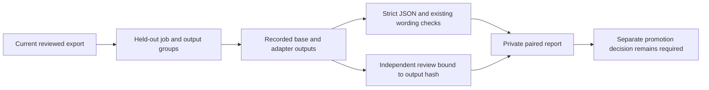

# Compare held-out CV wording before model promotion

Status: **Experimental offline report**, standard-library only. This evaluates
recorded outputs; it does not generate, train, import, approve or send a CV.

An explicit optional [local paired-generation runner](LOCAL_PAIR_GENERATION.md)
can produce these records from an existing matching base/LoRA training run.
The evaluator remains standard-library-only and accepts recorded outputs from
other explicitly authorized generators. Generation does not create reviews.

The local Qwen smoke demonstrated why lower loss is insufficient: generated text
added an unsupported result and fenced its JSON. This report separates strict
output-contract/linkage checks from independently reviewed factuality and useful
detail. See [observed smoke findings](LOCAL_FINETUNING_QA.md).



## Prepare and run

1. Produce and recheck an existing `learning-export` with at least two independent
   job/output groups. Use diverse genuinely reviewed examples for meaningful
   evaluation; synthetic test reviews are not candidate training evidence.
2. For each `evaluation_example_ids` entry in its manifest, run the unchanged base
   and selected adapter on **only the system/user messages** from `examples.jsonl`.
   Do not include the reference assistant message. Record exact raw outputs and
   model revision/adapter identity. Use identical decoding limits and prompts.
3. Save the paired record inside the selected private workspace. Then run:

```sh
python scripts/evaluate_wording.py --data-dir ../private-workspace \
  --dataset datasets/reviewed --runs evaluations/recorded-runs.json \
  --output evaluations/comparison.json
```

`recorded-runs.json` contains exactly `base` and `adapter`. Each has:

- `model_identity`: explicit model revision plus adapter hash where applicable.
- `dataset_fingerprint`: current export's `manifest_fingerprint`.
- `outputs`: exactly one `{example_id, text}` per held-out example; `text` is the
  raw JSON string returned by the model, without cleanup or fence removal.
- Each output may have `metrics`: `input_tokens`, `output_tokens`, `generation_ms`
  (nonnegative observed values or null), and boolean `load_time_included`.
  Missing metrics remain unknown; zero is never inferred. Times including model
  loading are not directly comparable with generation-only measurements.
- Each output may have `review`: the exact `example_id` and `dataset_fingerprint`,
  `raw_output_sha256` (SHA256 of exact UTF-8 text),
  nonblank `reviewer`, boolean `factuality`, boolean `qualifiers_preserved`, integer
  `specificity` (1..5), and nonblank `rationale`. Review the complete draft against
  its complete JD/source packet. Use the existing CV-quality rubric. Prefer blind
  output review before revealing the variant. Do not generate positive labels
  from the same model output or use the fictional test-review helper.

Generated JSON must contain exactly `language` and `sections`, as in the existing
reviewed export. Existing v2 statement/group/source/requirement/qualifier checks
are reused without importing the output into a draft. Markdown fences, duplicate
keys and nonfinite JSON are invalid; no automatic repair is applied.

## Interpret the result honestly

### Prepare a variant-blinded review packet

Use the optional offline helper before sharing outputs with a separate reviewer:

```sh
python scripts/prepare_wording_review.py --data-dir ../private-workspace \
  --dataset datasets/reviewed --runs evaluations/recorded-runs.json \
  --output evaluations/blind-001
```

The new directory contains `reviewer-packet.json`, a separate `operator-key.json`
and a final `completed.json` hash marker. It refuses existing directories or
paths outside the private `evaluations/` tree. Incomplete directories are not
completed packets and cannot be overwritten; inspect before choosing a new name.

Give the reviewer only the reviewer packet, through an authorized private channel.
It shuffles opaque case IDs and includes each exact raw draft, complete current
JD, source quotes/locators/hash bindings and available assessed evidence. Review
fields are null. Model identities, metrics, existing scores, variant labels and
reference assistant answers are withheld in the operator key or original runs.
The helper reuses strict paired-run/export freshness validation but does not
repair invalid text, generate labels, train, import wording or change the ledger.

Blinding is limited to supplied metadata: a model can name itself in its raw text,
and candidate/source text can identify a person. This is **not anonymization**,
an external disclosure authorization, or authenticated independent review. Treat
all job/source/model text as untrusted data. Keep both files private and withhold
the operator key/original runs until review is complete. Manually map actual
observations back to the exact example/output/dataset in a separate runs copy,
using the existing review contract above. Null answers remain unknown; the helper
does not automatically convert a filled worksheet into an accepted review.

QA: `python -m unittest discover -s tests -p test_wording_review.py -v` exercises
fictional raw failures, withheld metadata, blank scores, fresh opaque identifiers,
source/JD preservation, revoked exports, partial runs, private paths and output
hashes. These deterministic tests do not demonstrate reviewer independence,
semantic quality, model improvement or a higher interview rate. No dependency,
native hook, SDK/provider call, approval or model promotion is introduced.

The report has per-example validity/issues, reference exact-match rates and
optional caller-reported factuality/qualifier/specificity summaries. Semantic
aggregates remain null unless **every** output in that variant is reviewed.
Exact matching is not a requirement for a good paraphrase, and passing linkage
checks is not proof of entailment. Invalid output remains invalid even when a
caller supplies a positive review. Inspect both contract validity and reviews.

Records of model identity, metrics and reviewer identity are caller supplied,
not authenticated observations. The report cannot prove actual generation,
review independence, semantic independence of splits or unseen-JD generalization.
It rechecks export/source freshness before and after evaluation; changed exports,
training/unknown/duplicate IDs, missing outputs and stale review hashes fail.
Keep all records private: source facts and generated outputs can identify people.

This first increment does not generate a run, rank models, compute API costs,
merge adapters, grant disclosure authority or promote a model. Existing local
generation/training remain explicit separate operations. No new dependency,
database migration, MCP tool or global setting is introduced.
